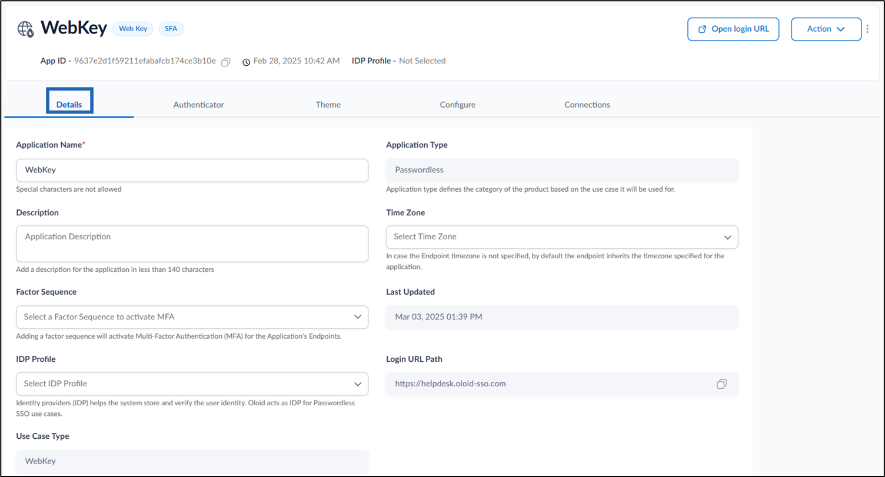

{/* Source: Intercom article 10799157 -  */}
{/* Generated by intercom_to_mintlify.py - re-running overwrites this file. */}

**Pre-requisite:**

You must create a Passwordless application of type WebKey. For further details, refer [How to create a WebKey application](/platforms/web/webkey/webkey-how-to-create-and-configure-a-webkey-application-in-tenant)

Steps to edit Details tab:

1. Log in to the **Tenant Admin Portal**.
2. On the **Applications** page, click on the Webkey application to edit.

   

   The application page is displayed.

   

3. Do the following:
   1. Edit **Application Name** if required.
   2. Add **Description**. (Optional)
   3. Select **Factor Sequence**. (Coming Soon)
   4. Select IDP Profile from **IDP Profile** dropdown list. (Optional)
   5. Select **Time Zone** from the dropdown list. (Optional)
   6. Copy **Login URL Path** to sign in to WebKey app.

      <Note>
        **Note:** These are one-time settings and all the default settings are recommended.
      </Note>
