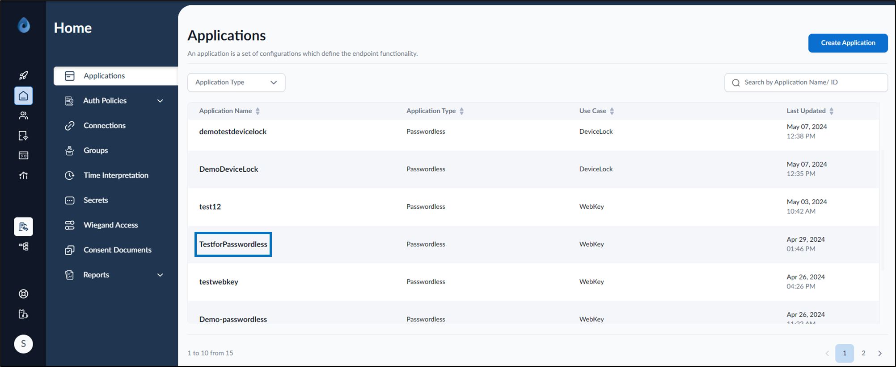
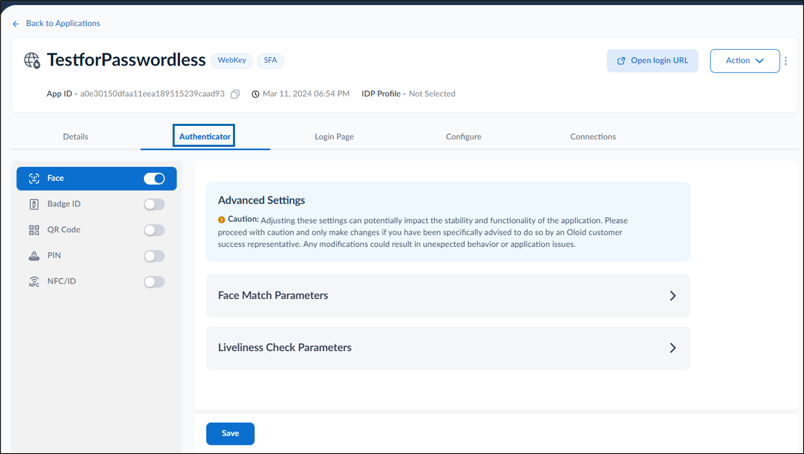
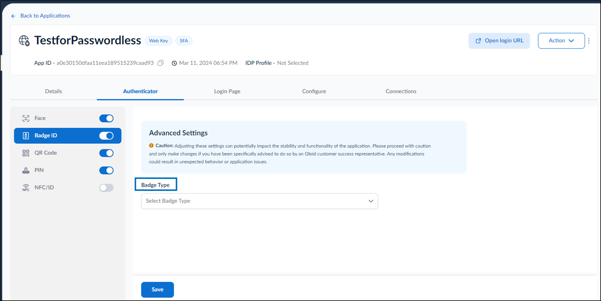
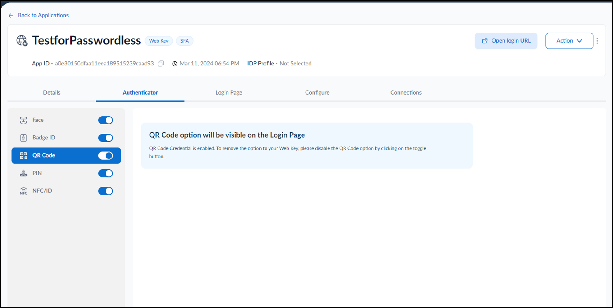
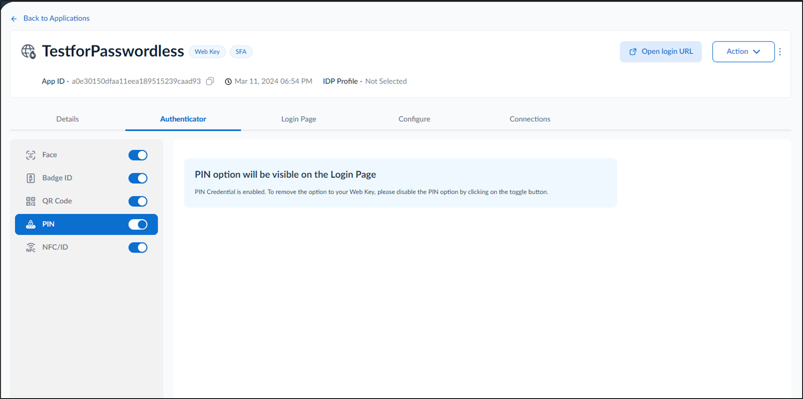
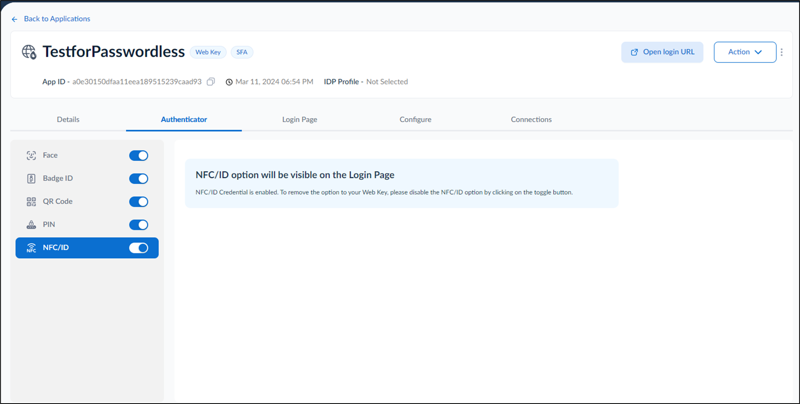

{/* Source: Intercom article 9277357 -  */}
{/* Generated by intercom_to_mintlify.py - re-running overwrites this file. */}

To enable authenticator factor:

1. Log in to the **Oloid Portal**.
2. On the **Applications** page, select an application to edit.

   

   The application detail page is displayed.

Go to **Authenticator** tab and configure the following:

<Note>
  **Note:** You may enable one or more credential options based on your requirements.
</Note>

## Face

1. To use face as credential, enable **Face** option.
   The **Advanced Settings** section is displayed.
   - Configure **Face Match Parameters**, and **Liveliness Check Parameters** on the Advanced Settings page.

<Note>
  **Note:** The parameters are pre-configured. This is done by Oloid admin.
</Note>

## Badge ID

1. Select a Badge Type from the dropdown list to use Badge ID as credential.

   <Note>
     **Note:** Enable Badge ID, and then enable Pin for multi-factor authentication.
   </Note>

   

## QR Code

2. To use **QR Code** as credential, enable QR Code to sign into WebKey application.

   

## PIN

3. To use PIN as a credential, enable PIN alongside other credential like Face, Badge, or NFC for multi-factor authentication.

   

## NFC/ID

4. To use **NFC/ID** credential, enable NFC/ID to sign into WebKey application.

   <Note>
     **Note:** Enable NFC/ID, and then enable Pin for multi-factor authentication.
   </Note>

   
