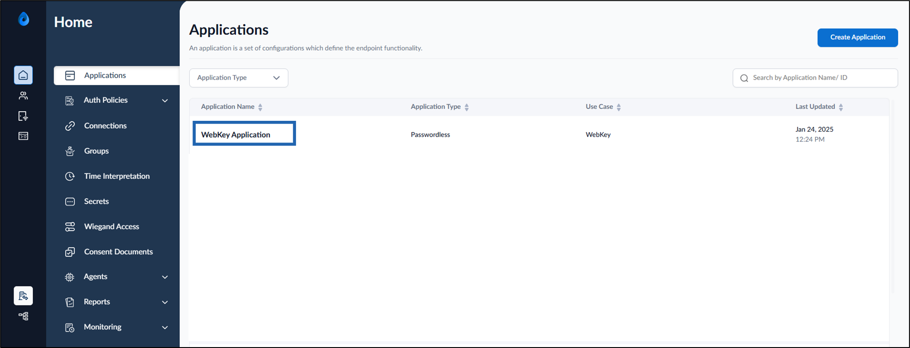
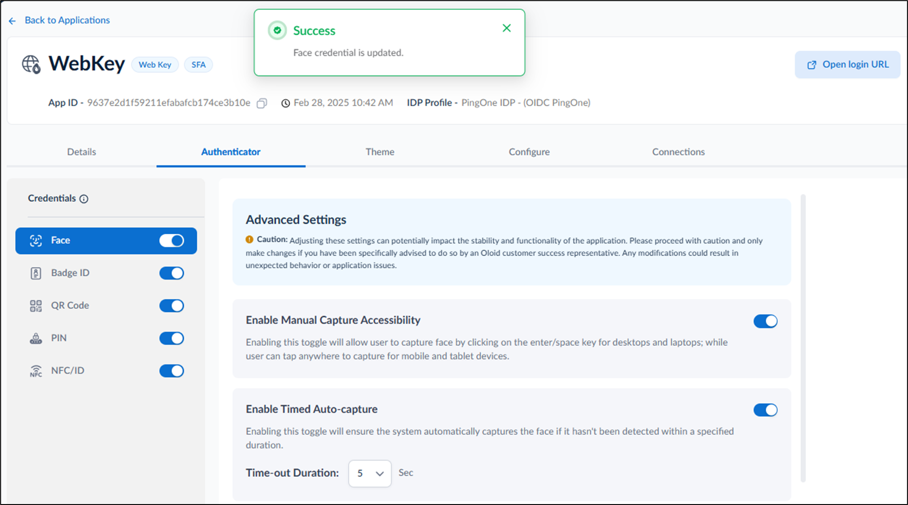

{/* Source: Intercom article 11168930 -  */}
{/* Generated by intercom_to_mintlify.py - re-running overwrites this file. */}

**Introduction**

Enabling the Timed Auto-capture feature in the Tenant Admin Portal allows the WebKey application to automatically capture the user's face during facial authentication if it is not manually captured within the configured time-out duration.

Steps to enable Timed Auto Capture:

1. Log in to **Oloid Portal**.
2. On the homepage, select **WebKey** application.

   

   The **WebKey details** page is displayed.
3. Go to **Authenticator** tab > **Face** tab.
4. Turn on **Enable Timed Auto-capture** toggle button to allow the WebKey application to automatically capture the user’s face if it is not detected within a specified duration.
   **Time out duration:** Specify the number of seconds after which the system should auto-capture the face if manual input is not detected.
5. Click **Save**.
   The face credential is saved successfully.

   
