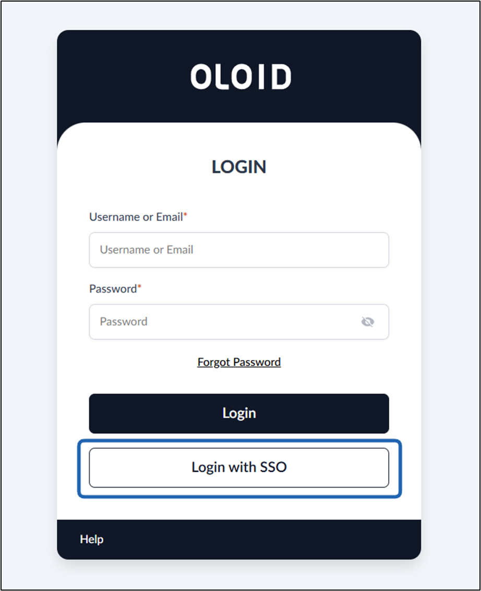
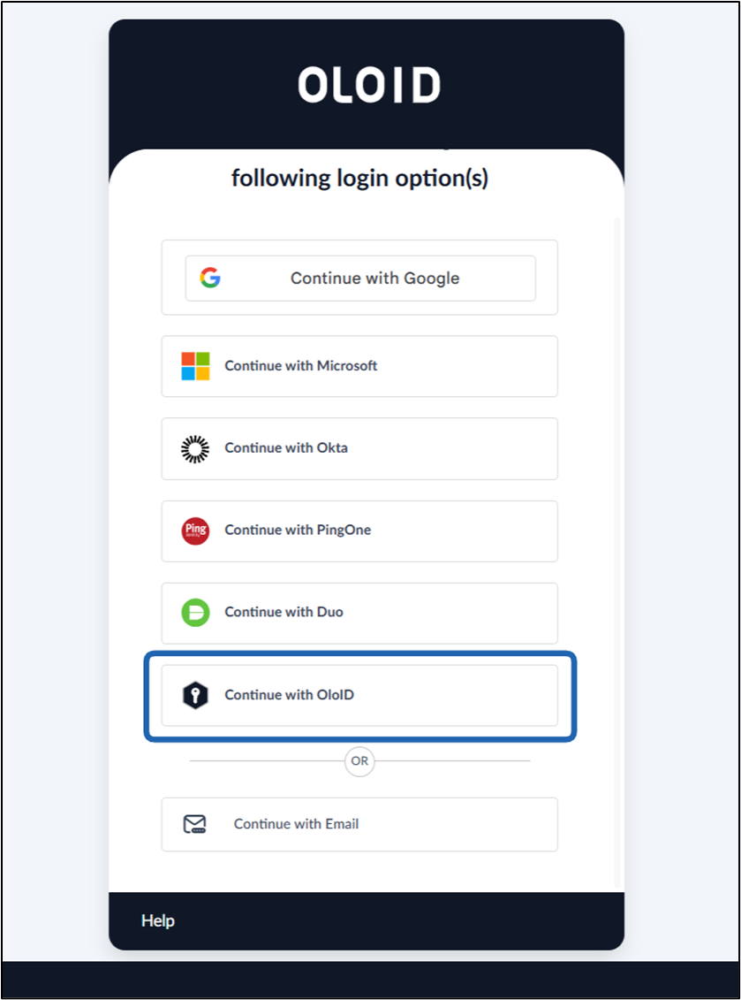
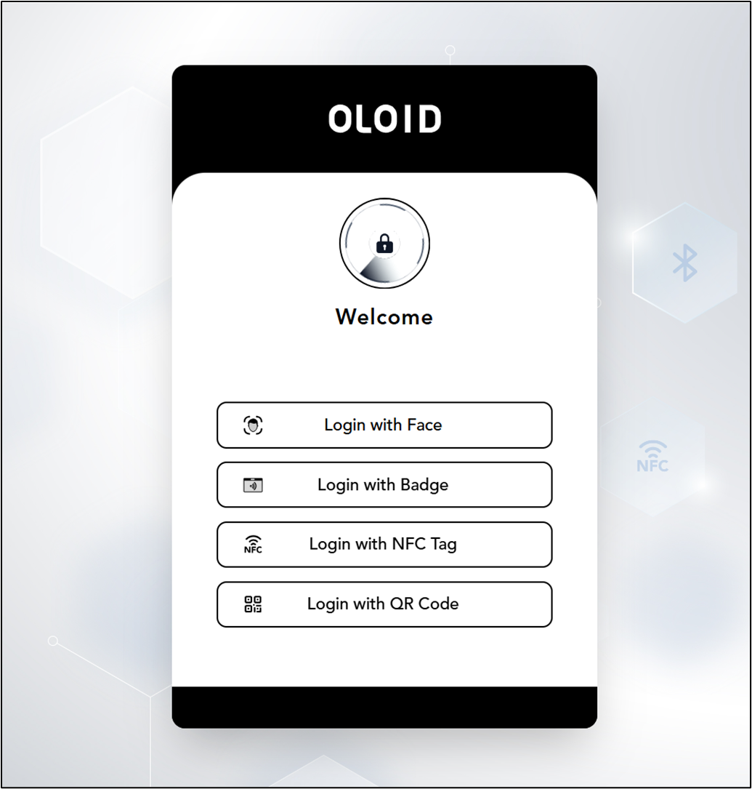
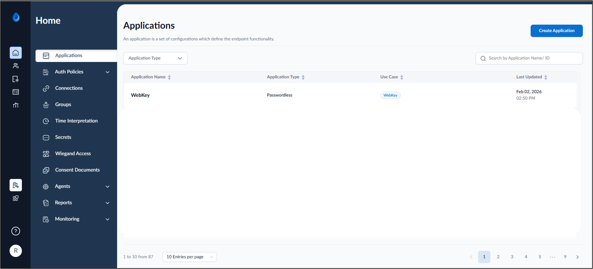

{/* Source: Intercom article 13598349 -  */}
{/* Generated by intercom_to_mintlify.py - re-running overwrites this file. */}

## Introduction

WebKey SSO allows Users to access the portal by authenticating with the Webkey SSO and configured authentication factor.

## Prerequisites

Before logging into the User Portal using Webkey SSO, ensure the following:

- You have the **login URL** provided to access the User portal.

## Steps to log into User Portal using Webkey SSO

1. Launch your browser.
2. Enter the provided **URL** in the browser’s address bar and press **Enter**.
   The **Oloid Login** page is displayed.

   

3. Click **Login with SSO**.
   The configured Log in options are displayed.

   

4. Click **Continue with Oloid** to log in to Oloid Platform with Webkey SSO.
   The Authentication screen is displayed.

   

5. Select the authentication factor to Login.

Complete the authentication steps.

Authentication successful message is displayed.

User is logged into User Portal.
