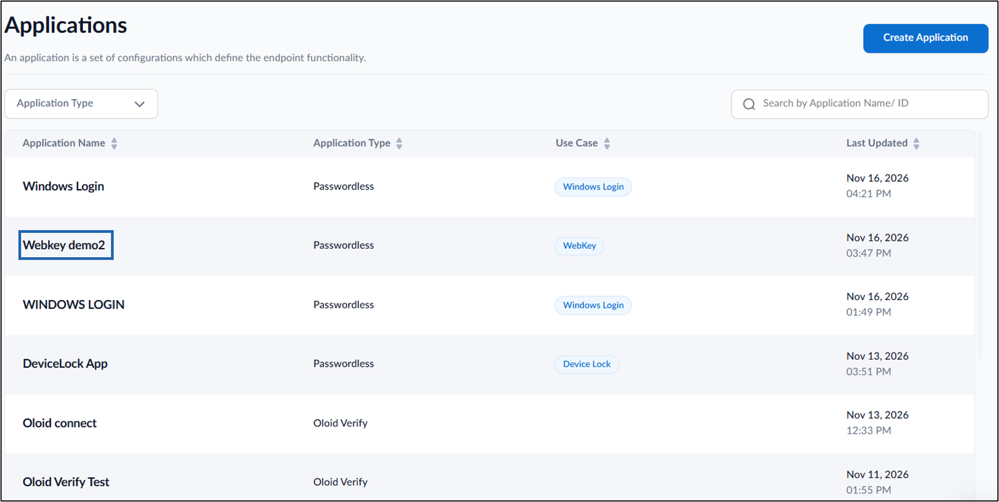
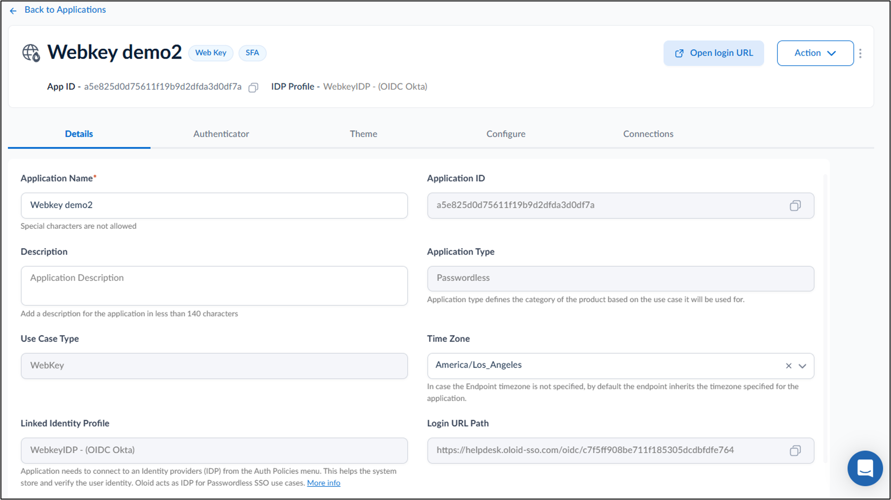
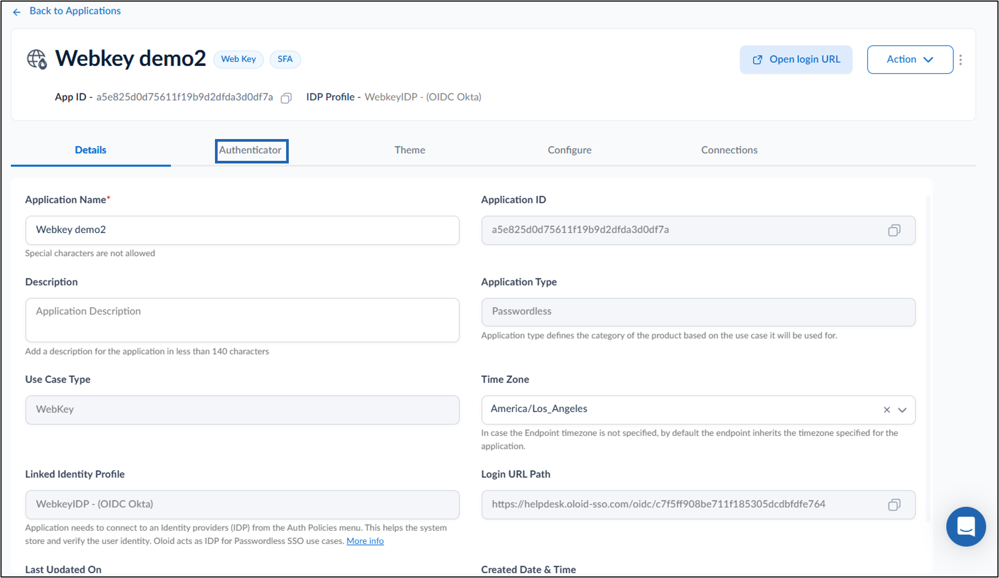
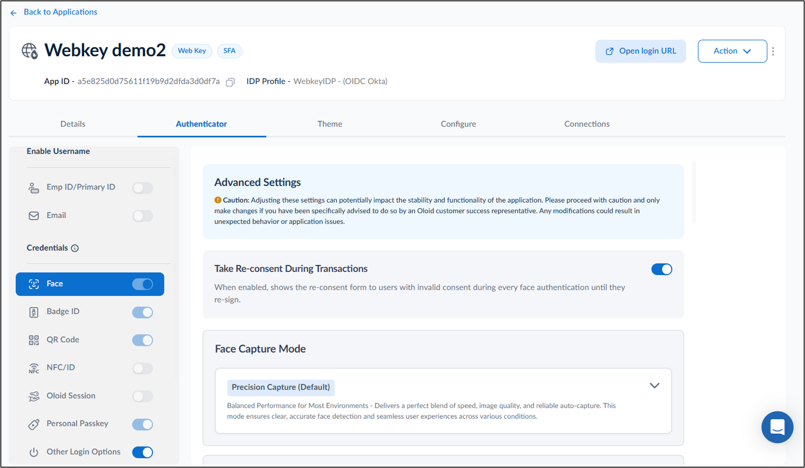
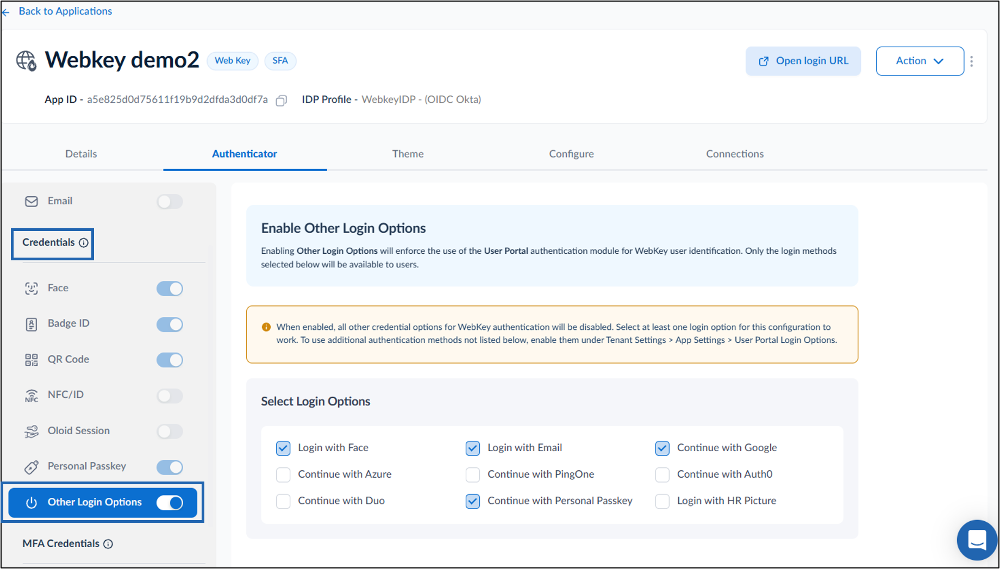
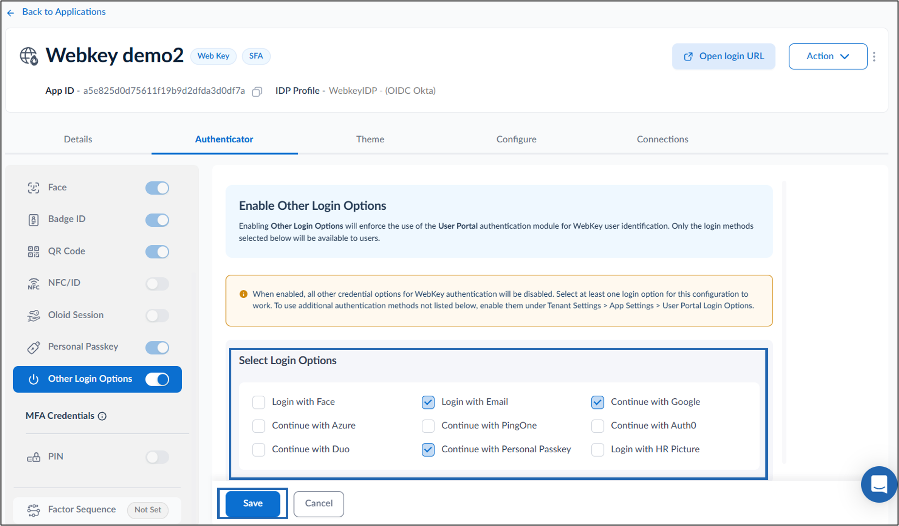
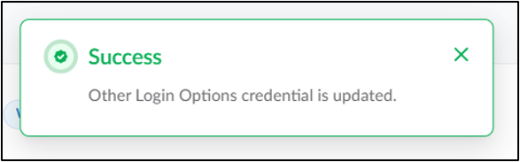

{/* Source: Intercom article 18457283 -  */}
{/* Generated by intercom_to_mintlify.py - re-running overwrites this file. */}

## Introduction

Other Login Options let a Tenant Admin use the Oloid User Portal authentication module to identify users of a Webkey application. Only the login methods selected by the admin, such as Email, Google, or Personal Passkey, are available on the Webkey login page.

## Prerequisites

- You must have admin access to the Tenant Admin Portal.
- You must be created a webkey application in the Tenant Admin Portal. For more information, refer: [Webkey - How to Create and Configure a Webkey Application in Tenant Admin Portal](/platforms/web/webkey/webkey-how-to-create-and-configure-a-webkey-application-in-tenant).
- User must

## Steps to Configure Other Login Options

1. Log in to the **Tenant Admin Portal**.
2. On the homepage, go to **Applications** and select **WebKey** application.

   

   The **WebKey Details** page is displayed.

   

3. Click **Authenticator** tab.

   

   The Authenticator page is displayed.

   

4. Go to **Credentials** >turn on **Other Login Options** toggle.

   

   The **Enable Other Login Options** page is displayed.

   <Note>
     **Note:** Enabling **Other Login Options** enforces the use of the **User Portal** authentication module for Webkey user identification. All other credential options for Webkey authentication are disabled.
   </Note>

5. Do the following:
   a. Go to **Select Login Options**, select one or more login options:

| Login option | Description |
| --- | --- |
| Login with Face | The user signs in with face recognition through the User Portal. |
| Login with Email | The user enters an email address and signs in with a one-time verification code sent to it. |
| Continue with Google | Single sign-on with a Google account. |
| Continue with Azure | Single sign-on with a Microsoft Azure account. |
| Continue with PingOne | Single sign-on through PingOne. |
| Continue with Auth0 | Single sign-on through Auth0. |
| Continue with Duo | Single sign-on through Duo, followed by the Duo authenticator step. |
| Continue with Personal Passkey | Sign-in with a passkey associated with the user's own account. |
| Login with HR Picture | The user's live image is matched against the HR picture stored in Oloid. |

b. Click **Save**.

The Other Login Options are configured successfully.

<Note>
  **Note:** To use authentication methods not listed on this page, enable them under **Tenant Settings** > **App Settings** > **User Portal Login Options**.
</Note>
