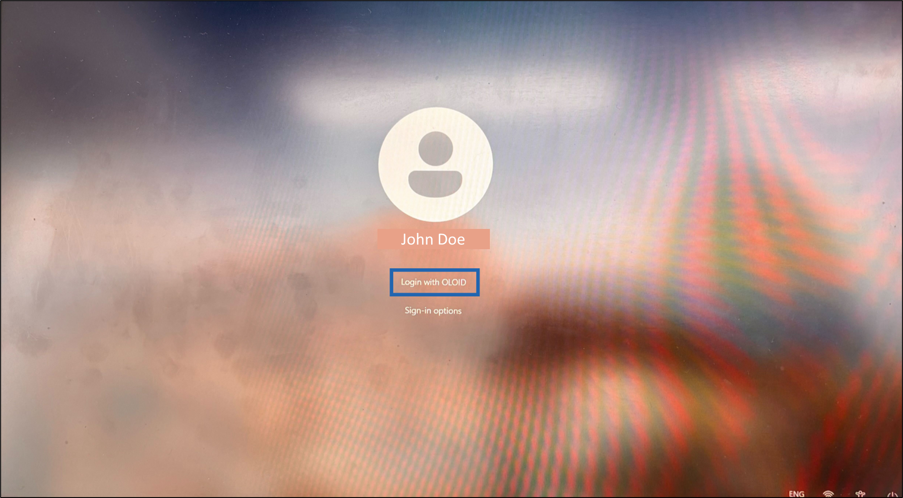
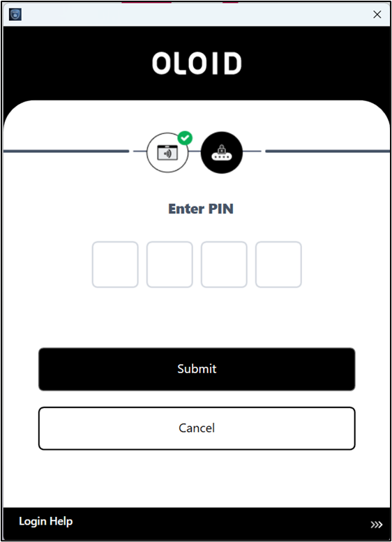
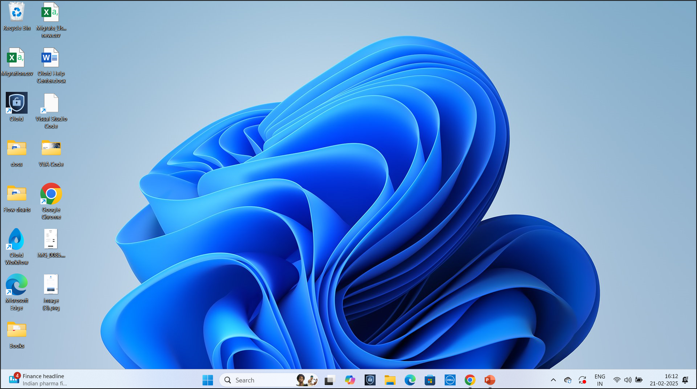
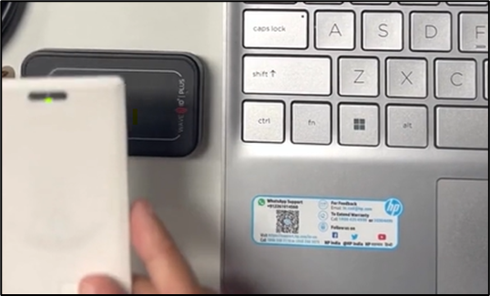
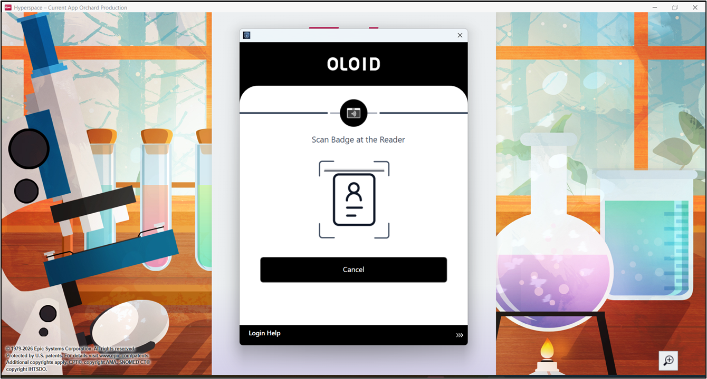
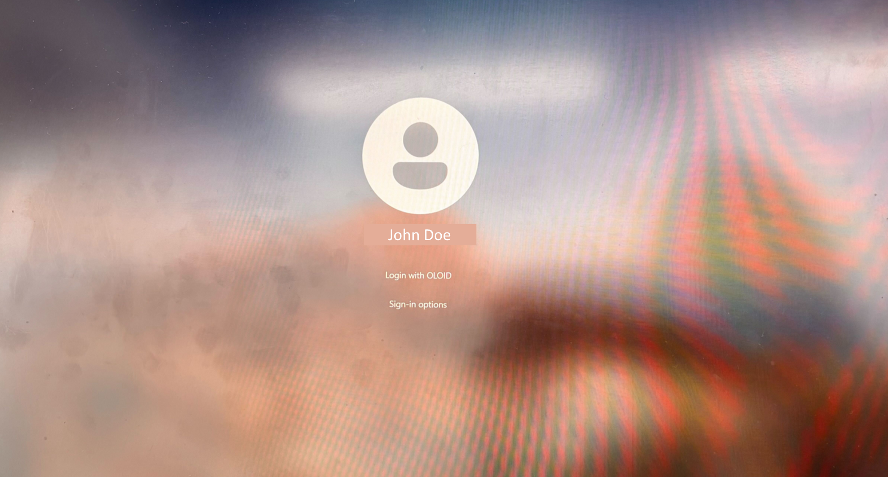

{/* Source: Intercom article 14796418 -  */}
{/* Generated by intercom_to_mintlify.py - re-running overwrites this file. */}

## Introduction

## Prerequisites

- You must have access to Epic Hyperspace.
- Epic Vault Password must be created for the user.
- Ensure that Epic SSO is enabled.
- Ensure the Tray application is running in the background.
- The badge reader must be connected to the Windows system.
- Badge Out options must be configured. Refer: [Windows Login - How to Configure Badge Out option](/platforms/windows/windows-login/windows-login-how-to-configure-badge-out-option)

## Steps to Sign Out using Badge ID

1. On the Lock screen, select **Login with OLOID**.

   

   The **Scan Badge** screen is displayed.
   **Note:**
2. Tap the **Badge** on the **Badge Reader** to scan it.

   

   The **Enter PIN** screen is displayed.
3. Enter the **PIN**.

   

   The Windows homepage is displayed.

   

4. Log in to **Epic Hyperspace** refer: **[How to log in to Epic Hyperspace using Badge ID + PIN](/integrations/epic/windows-login-healthcare-how-to-log-in-to-epic-hyperspace-using-badge)**
   User is successfully logged in to **Epic Hyperspace.**
5. Sign Out using badge out:
   - [When SSO is not enabled](#when-sso-is-not-enabled).
   - [When SSO is enabled](#when-sso-is-enabled)

     

### When SSO is not enabled

Tap the **Badge** on the **Badge Reader** to scan it.

User is signed out of Epic Hyperspace.

### When SSO is enabled

Tap the **Badge** on the **Badge Reader** to scan it.

Your Windows system is successfully locked, and the **Lock** screen appears.

<Note>
  **Note:** If the Windows Login application is configured with the **Sign out of Windows** option, all open applications in the system will close, and the **Lock** screen will appear.
</Note>

The user is signed out.

---

##### Keywords
