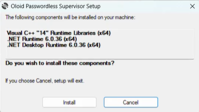
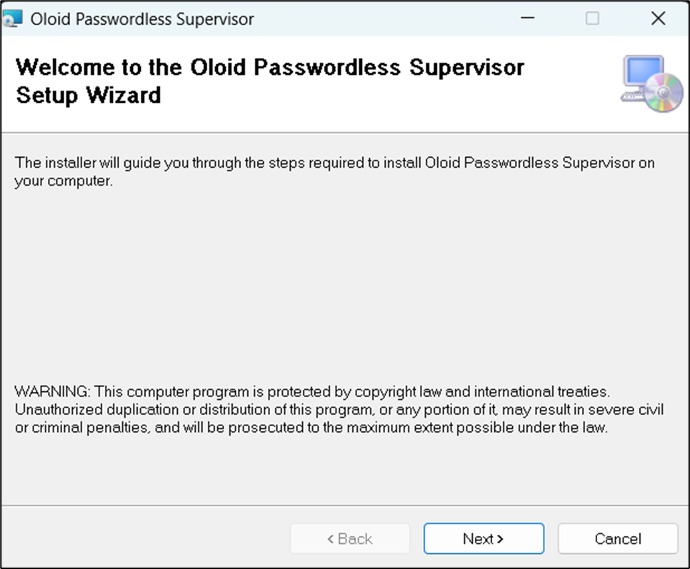
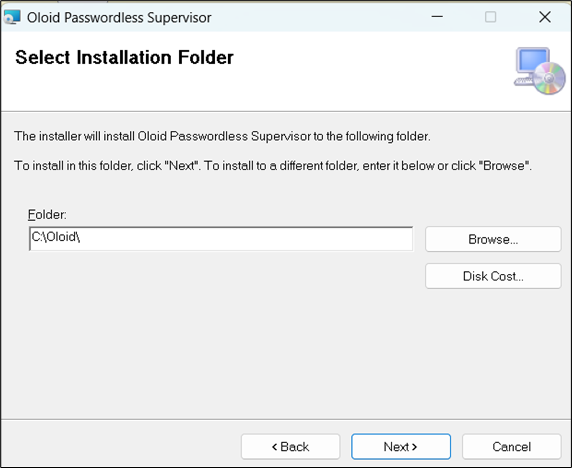
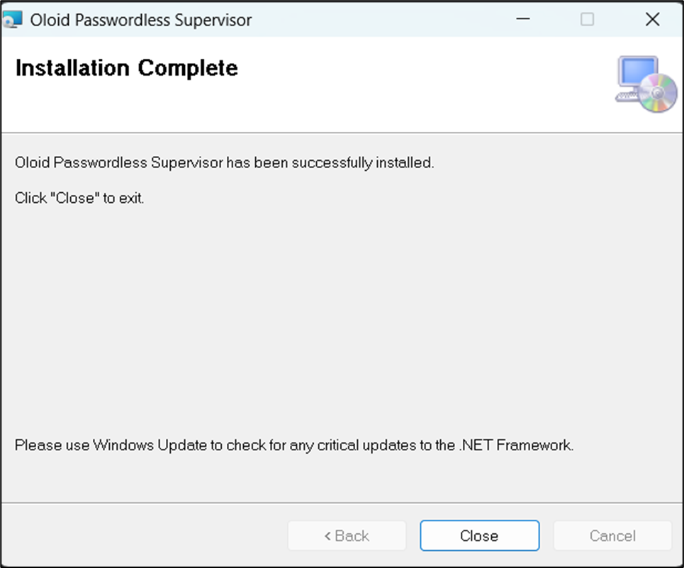

{/* Source: Intercom article 10272164 -  */}
{/* Generated by intercom_to_mintlify.py - re-running overwrites this file. */}

The Supervisor App is a Windows-based application that enables you to configure the Windows Login app. It allows you to set up endpoints, manage users and shared credentials, and support multiple authentication methods such as badge, PIN, and password.

**Pre-requisite**

The Supervisor App must be downloaded. See, **How to download Supervisor App >** [Steps to download from Tenant Setting](/platforms/windows/supervisor-app/how-to-download-supervisor-app)

Steps to install Supervisor App:

1. Download **OloidPasswordlessSupervisor.Setup.zip** file on your system.
2. Right-click and select **Extract All** > **OloidPasswordlessSupervisor.Setup.zip** file.
   The extracted files will be saved in the same folder as the original zipped file.
3. Double-click on **setup.exe** file.
   The **Oloid Passwordless Supervisor Setup** window is displayed.

   

4. Review the listed components and click **Install** to proceed.

   <Note>
     **Note:** If any of the files are missing, the application prompts to install the missing component.
   </Note>

5. On the **Oloid Passwordless Supervisor** Setup wizard, click **Next**.

   

6. Use the default path to install the application and click **Next**.

   

7. Click **Next** to confirm the installation.

   

8. Click **Close** after the installation is complete.

   

   You can find the app icon on your desktop. For first-time installation, it is recommended to restart your system.
