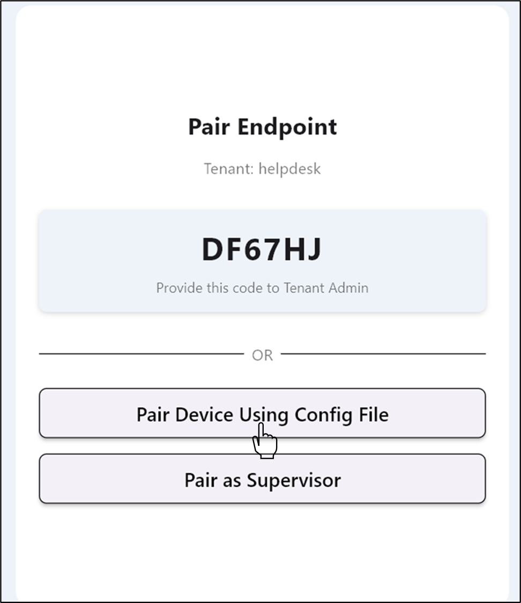
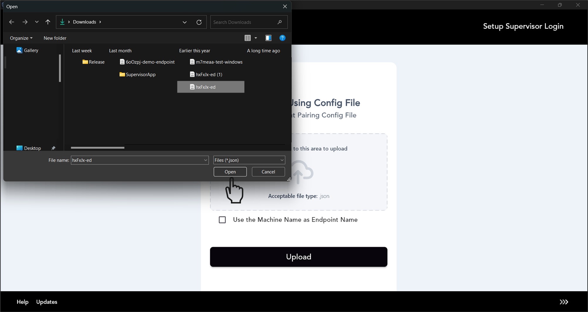
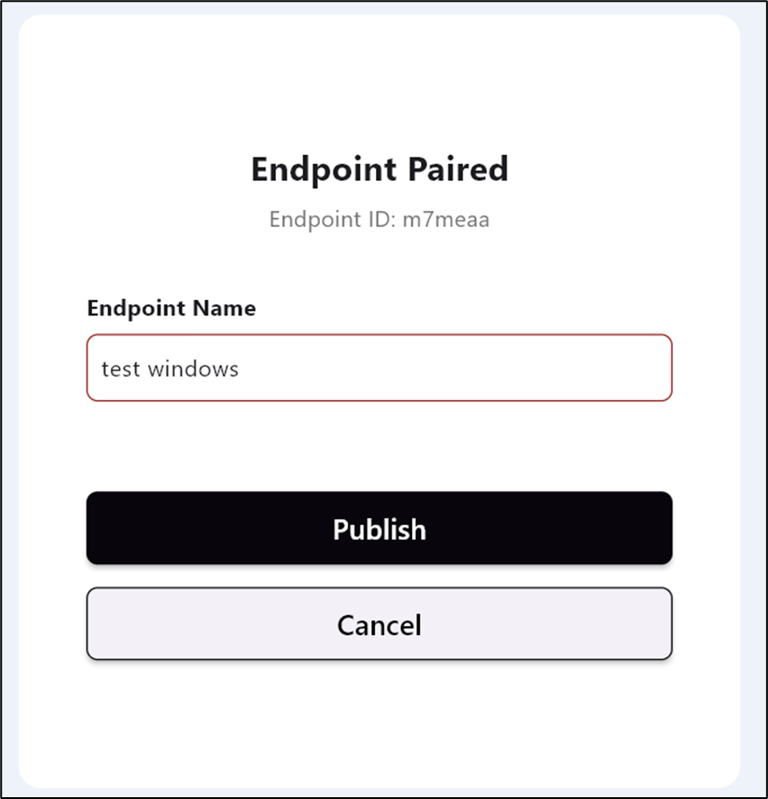
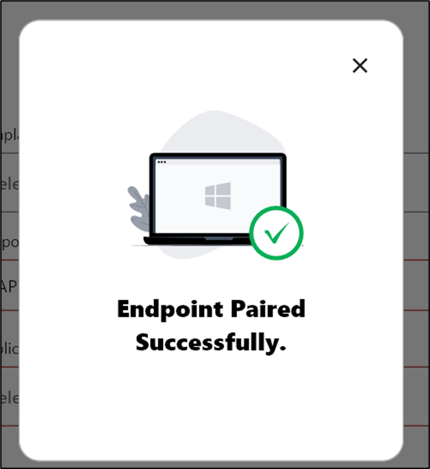
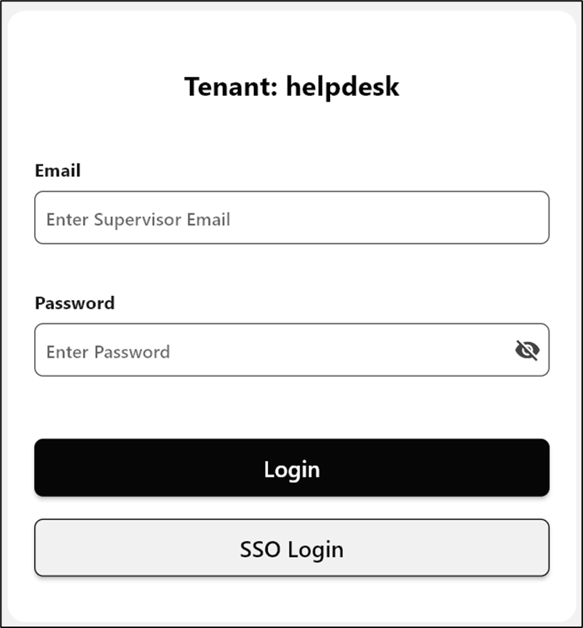

{/* Source: Intercom article 9036798 -  */}
{/* Generated by intercom_to_mintlify.py - re-running overwrites this file. */}

## Pre-requisite

If endpoint is created through the Oloid Portal, you need to download the config file of the preferred endpoint from the Oloid Portal. For details, refer [How to download endpoint config file for Windows Login?](/drafts/platform/tenant-admin-portal/how-to-download-endpoint-config-file-for-windows-login)

To pair an endpoint:

1. Double-click on the **Supervisor App** to start.

   

   The **Pair Endpoint** screen is displayed.
2. Select **Pair Device Using Config File**.

   

   The **Pair Device Using Config File** screen is displayed.
3. Select the json file you want to upload and click **Open**.

   

   <Note>
     **Note:** Check mark to **Use the Machine Name as Endpoint Name** (Optional).
   </Note>

4. Click to **Upload** the endpoint JSON file.

   <Note>
     **Note:** You can choose **Reset** to upload the JSON file again.
   </Note>

   The **Pairing endpoint** screen is displayed.
5. The **Endpoint Name** is auto-populated.

   

6. Select **Publish**.
   The endpoint is paired successfully.

   

   Now, you can log in to admin mode.

   
