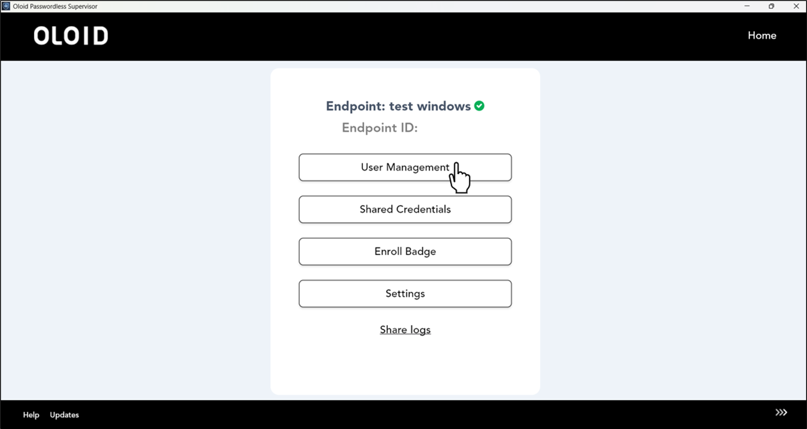
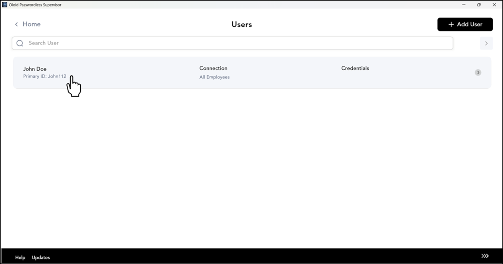
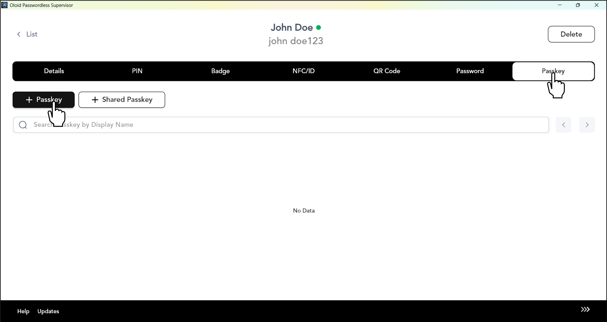
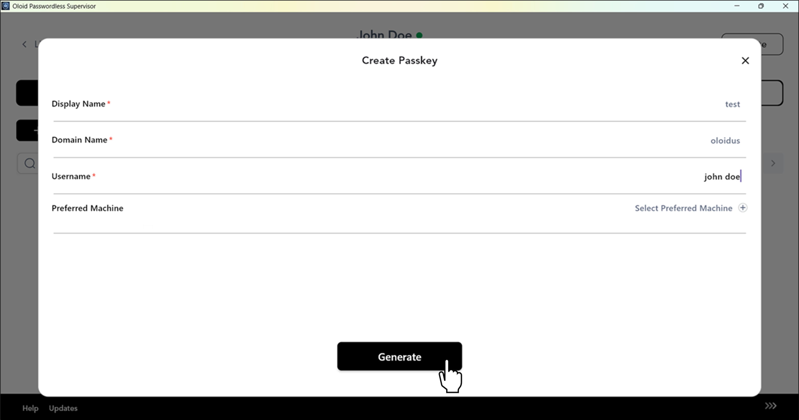
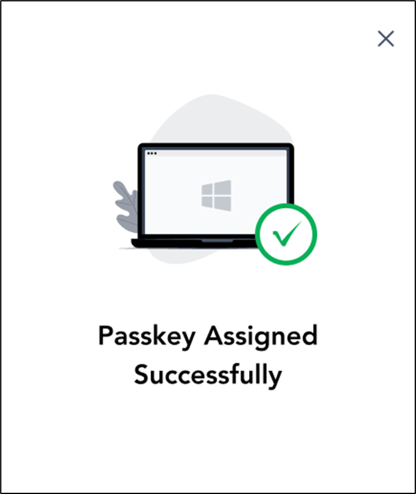

{/* Source: Intercom article 11829502 -  */}
{/* Generated by intercom_to_mintlify.py - re-running overwrites this file. */}

**Prerequisite:**

Windows Passkey must be enabled in the Tenant Admin Portal.

**Steps to add Passkey:**

1. Log in to the **Supervisor App**.
2. On the Admin Home screen, select **User Management**.

   

   The **Home** screen is displayed.
3. Select the preferred user to view details.

   

4. Go to **Passkey** tab > select +**Passkey**.

   

   The **Create Passkey** pop-up box is displayed
5. On the pop-up box, do the following:
   1. Enter **Display Name**.
   2. Enter **Domain Name**.
   3. Enter **Username**.
   4. Select **Preferred Machine**.
   5. Click **Generate**.

      

      The Passkey is successfully assigned.

      
