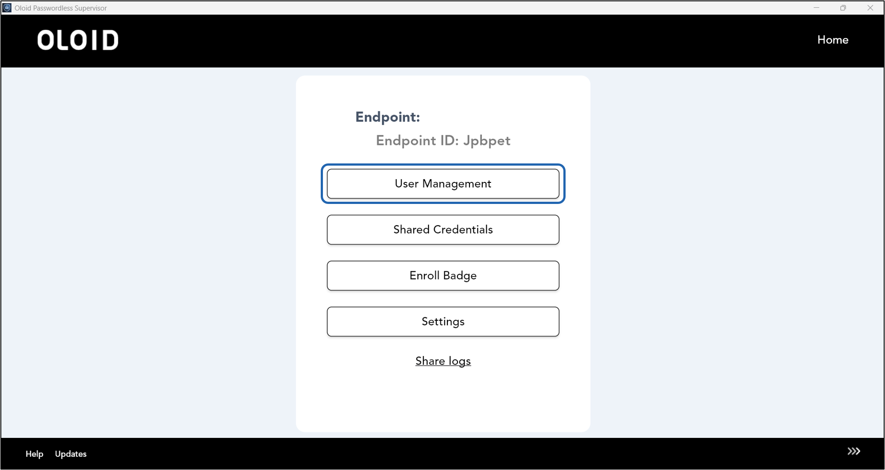
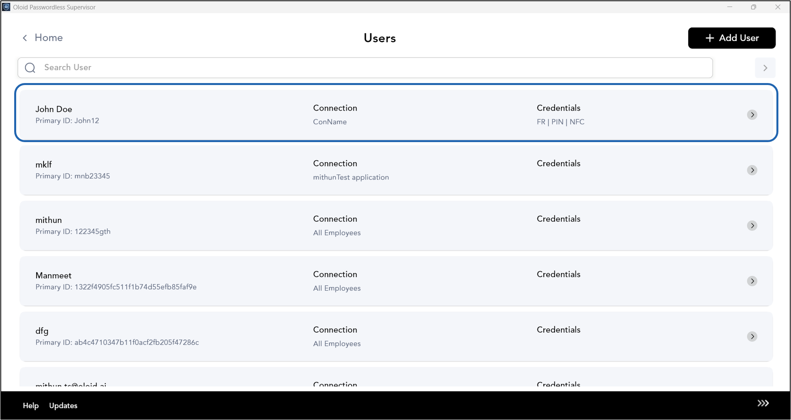
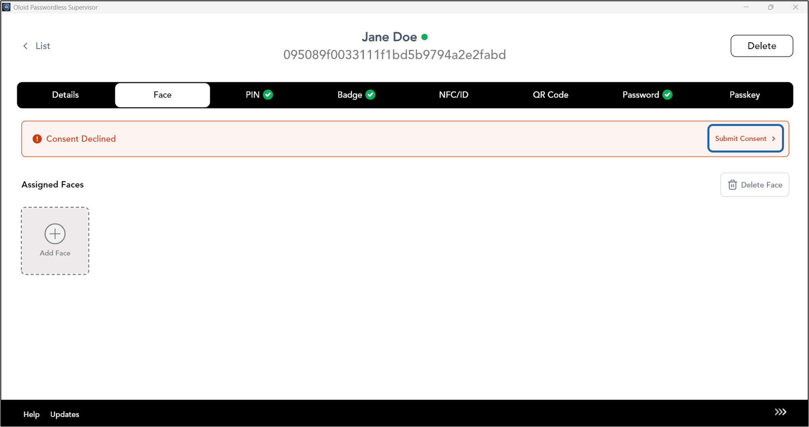
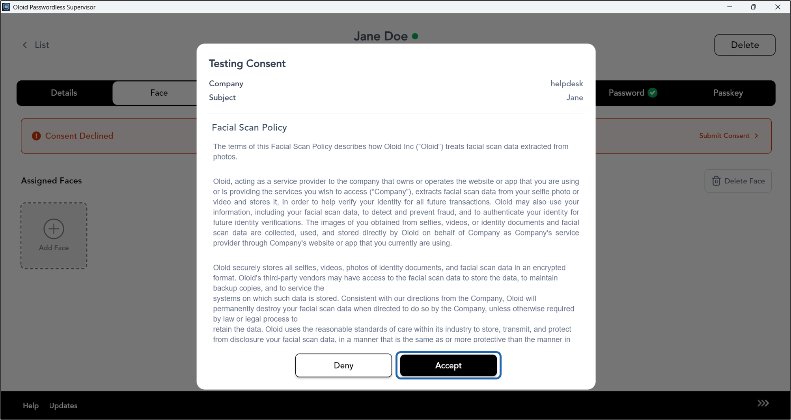
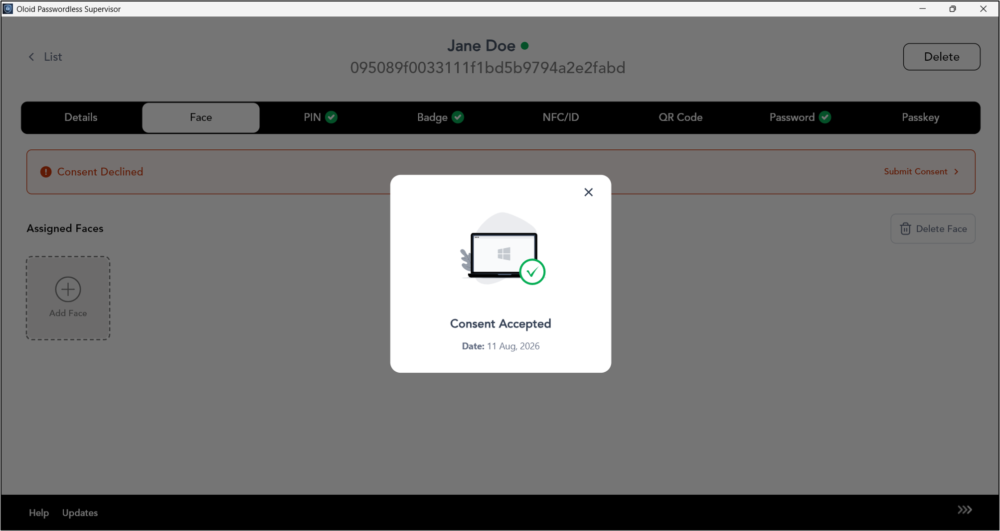
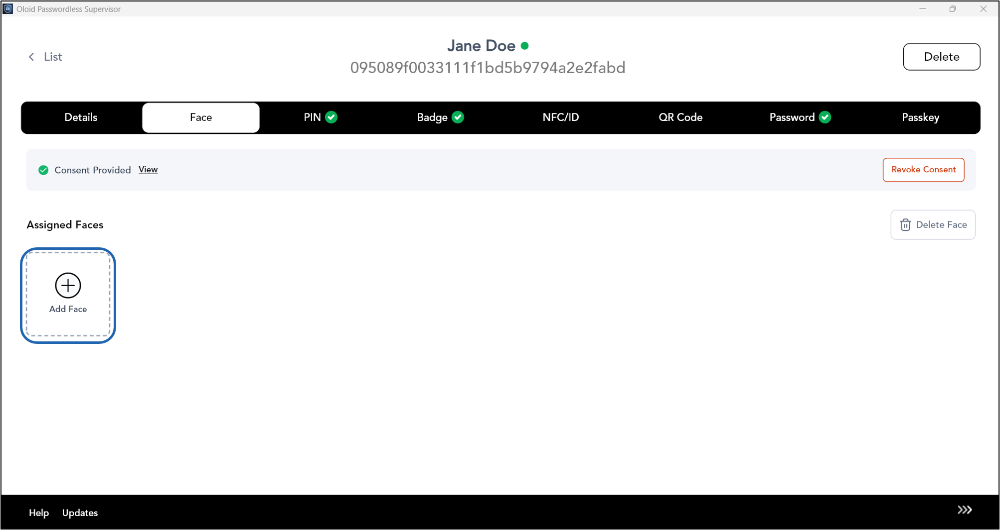

{/* Source: Intercom article 15732109 -  */}
{/* Generated by intercom_to_mintlify.py - re-running overwrites this file. */}

## Introduction

## Prerequisite

- Ensure the endpoint is paired with the Windows Login application. For more information, refer: [Windows Login - How to manually pair the Supervisor App](/platforms/windows/supervisor-app/windows-login-how-to-manually-pair-the-supervisor-app)
- Log in to the Supervisor App using an Admin or Supervisor account. For more, refer [How to log in to Supervisor App](/platforms/windows/supervisor-app/how-to-log-in-to-supervisor-app)
- Ensure at least one connection is configured for the selected application in the Tenant Admin Portal. For more information, refer: [How to Configure a Connection in the Tenant Admin Portal](/platform/tenant-admin-portal/tenant-admin-portal-how-to-configure-a-connection-in-the-tenant-admin)

## **Steps to Add** Face

1. Log in to **Supervisor App**. For more, refer to [How to log in to Supervisor App](/platforms/windows/supervisor-app/how-to-log-in-to-supervisor-app)
   The **Admin Home** screen is displayed.
2. On the Admin Home screen, select **User Management**.

   

   The **Users** screen with list of users is displayed.
3. Select **user** from the list, or search for a user using the search bar at the top.

   

   The user's **Details** screen is displayed
4. Click **Submit Consent.**

   

   The Consent pop-up box is displayed.
5. Click **Agree.**

   

   Consent submitted successfully.

   

6. Select **Face** tab > Tap **ADD +**.

   

   The Camera turns on.
7. Position your face in front of the camera and tap the **Capture** button to enroll your face.

   <Note>
     **Note:** If you do not tap the **Capture** button, the app automatically captures your face after a few seconds.
   </Note>

8. Do one of the following:
   1. Tap **Yes- Submit** to submit the image.
      The face is submitted successfully and is displayed on the details screen.
   2. Tap **No- Retake** to take the photo again.
      The camera turns on to retake the photo.

---

##### Keywords
