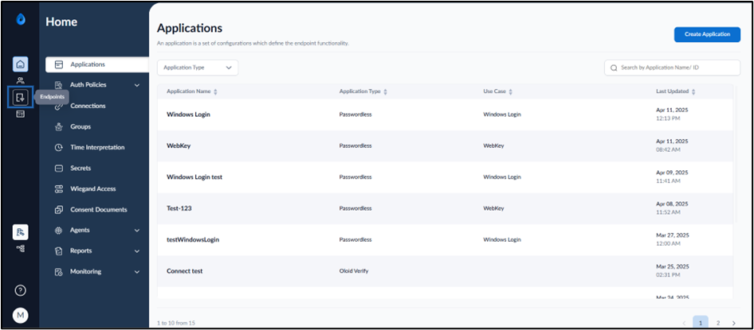
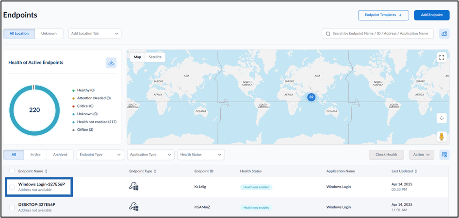
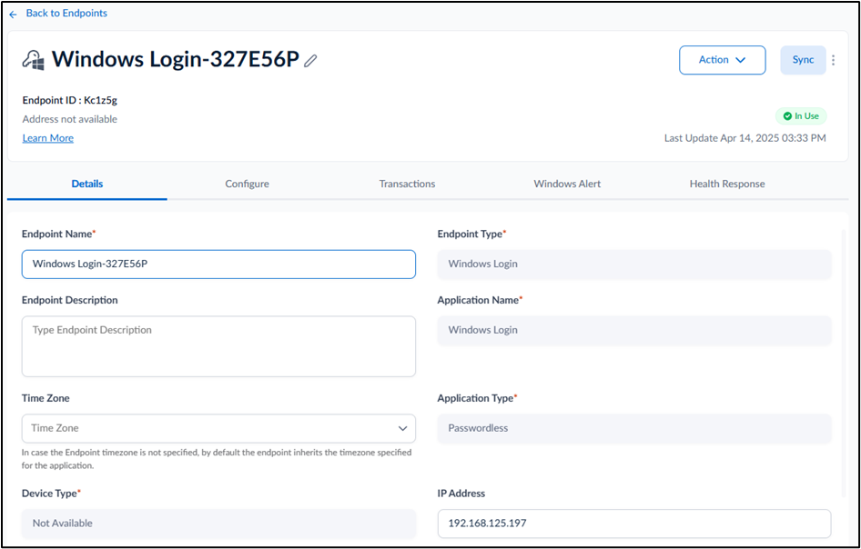
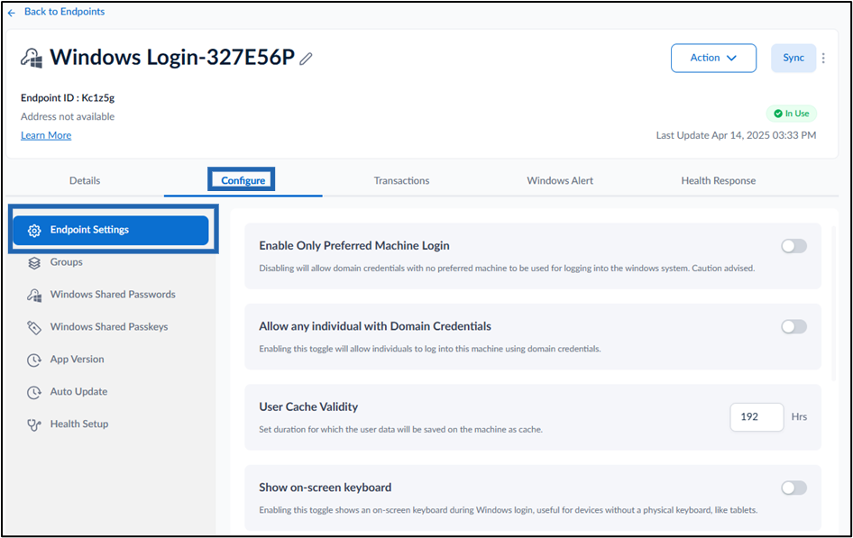
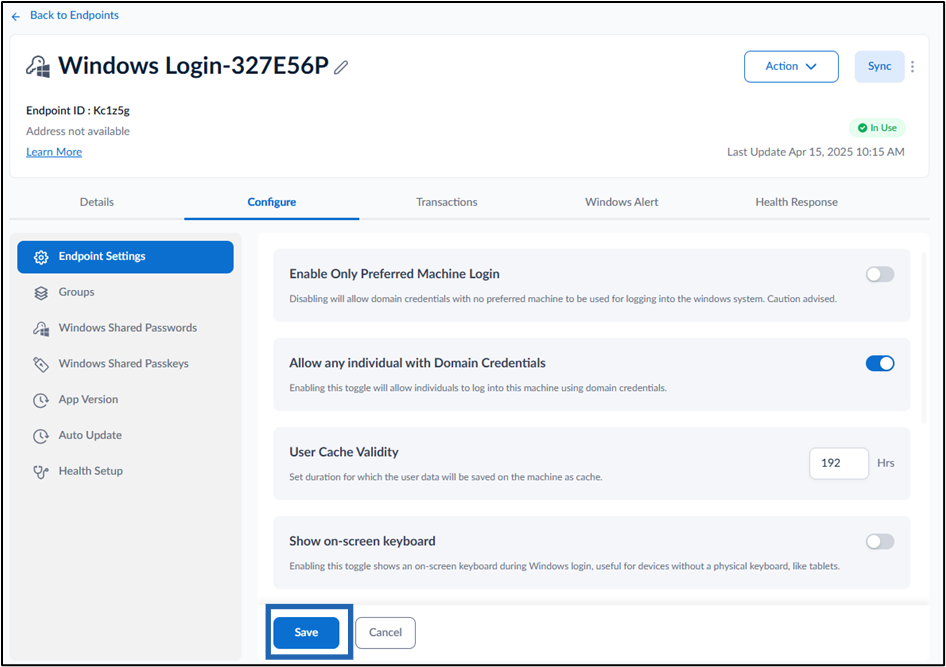

{/* Source: Intercom article 11085787 -  */}
{/* Generated by intercom_to_mintlify.py - re-running overwrites this file. */}

## Introduction

In Oloid Portal, enabling Allow any individual with Domain Credentials feature allows

individuals to log in to the machine using domain credential.

## Steps to Allow any individual with Domain Credentials

1. Log in to the **Oloid Portal**.
2. On the home page of the portal, click **Endpoints** on the left menu panel.

   

   The **Endpoints** page is displayed.
3. Select the paired Windows Login Endpoint.

   

   The **Endpoint Details** page is displayed.

   

4. Go to **Configure** > **Endpoint Settings** tab.

   

5. Turn on **Allow any individual with Domain Credentials** toggle button to allow individuals to log in to the machine using domain credential.

   

6. Click **Save**.

   

   The configuration is saved successfully.

   <Note>
     **Note:** In **Windows Authenticator** app, you must sync the configuration to allow any individual with Domain Credentials. For more details, refer [How to sync configuration in Supervisor App](/platforms/windows/supervisor-app/how-to-sync-configuration-in-supervisor-app)
   </Note>
