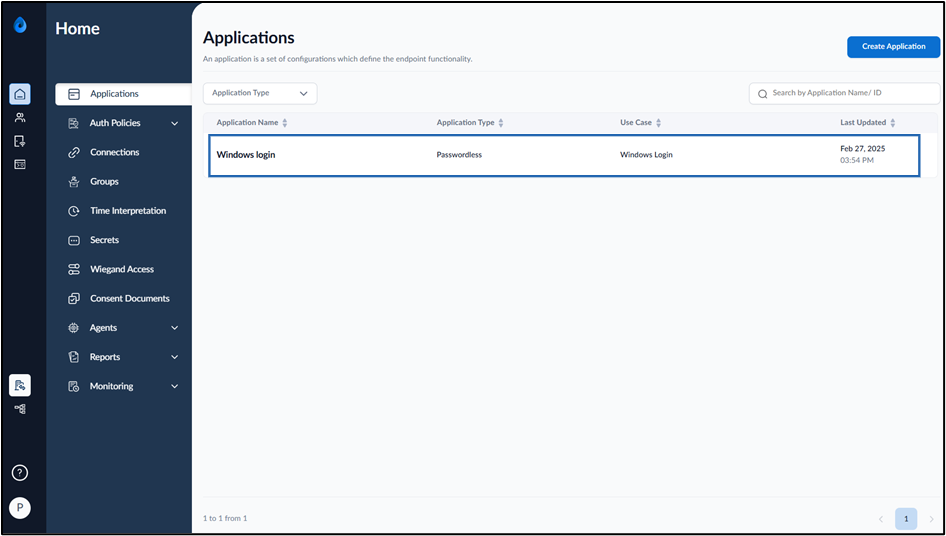
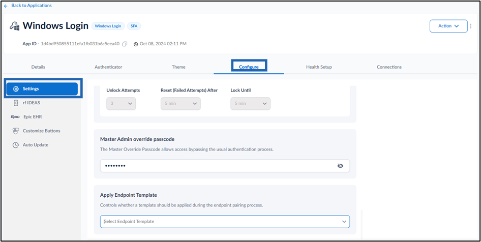
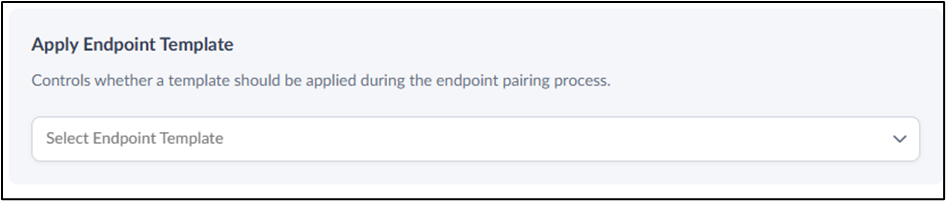
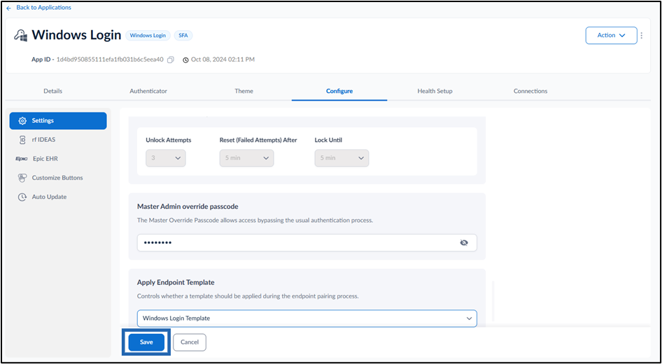
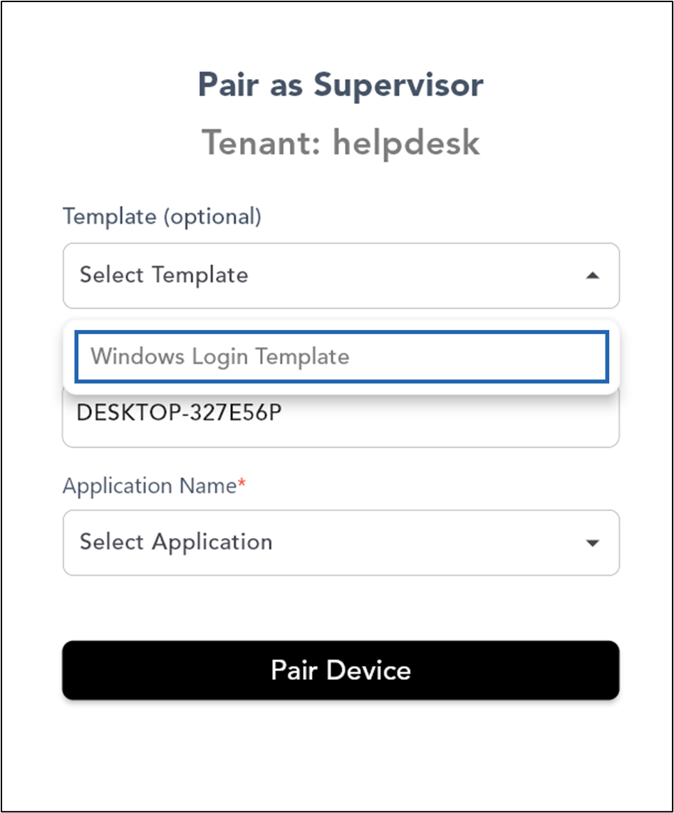

{/* Source: Intercom article 11069235 -  */}
{/* Generated by intercom_to_mintlify.py - re-running overwrites this file. */}

## Introduction

In Oloid Portal, enabling the Apply Endpoint Template feature allows Supervisors to view and select endpoint templates during the endpoint pairing process in the supervisor app.

## Steps to Apply Endpoint Template

1. Log in to the **Oloid Portal**.
2. On the **Applications** page, select the application paired in the Supervisor App (Windows Authenticator App).

   

   The application page is displayed.

   

3. Go to **Configure** > **Settings** tab.

   

4. Click **Select Endpoint Template** field to select an endpoint template from the dropdown menu.

   <Note>
     **Note:** You must create an Endpoint Template. For more, refer to [How to create and configure Windows Login Endpoint Template](/platforms/windows/windows-login/windows-login-how-to-create-and-configure-windows-login-endpoint)
   </Note>

   

Click **Save**.

The configuration is saved successfully. See,[Sample screen for Apply Endpoint Template](#sample-screen-for-apply-endpoint-template)

<Note>
  **Note:** In **Windows Authenticator** app, you must sync the configuration to Apply Endpoint Template. For more details, refer [How to sync configuration in Supervisor App](/platforms/windows/supervisor-app/how-to-sync-configuration-in-supervisor-app)
</Note>

## Sample screen for Apply Endpoint Template

5. 
