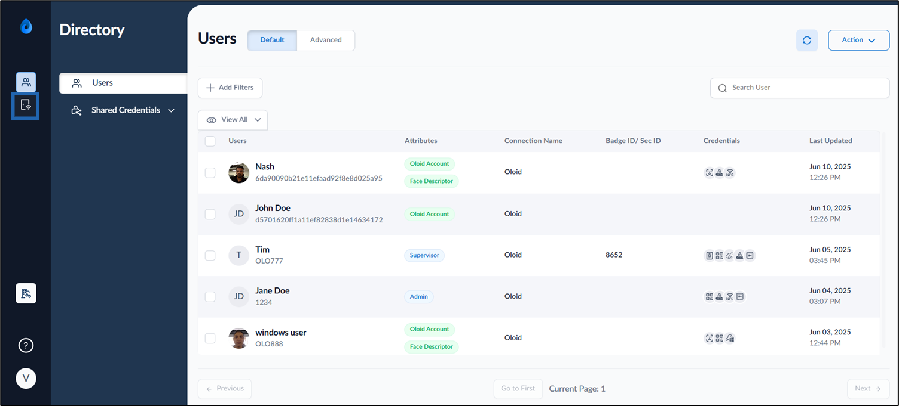

{/* Source: Intercom article 11494152 -  */}
{/* Generated by intercom_to_mintlify.py - re-running overwrites this file. */}

Steps to configure Windows Login Endpoint:

1. Log in to the **Supervisor Portal**.
2. On the home page of the portal, click **Endpoints** on the left menu panel.

   

   The Endpoints page is displayed.
3. Click an endpoint name to edit from the listed endpoints.
   The Endpoint details page is displayed.
4. Do the following:
   1. [Details tab](/platform/tenant-admin-portal/how-to-configure-endpoint-for-windows-login)
   2. [Configure tab](/platform/tenant-admin-portal/how-to-configure-endpoint-for-windows-login)
   3. [Transactions tab](/platform/tenant-admin-portal/how-to-configure-endpoint-for-windows-login)
   4. [Windows Alert tab](/platform/tenant-admin-portal/how-to-configure-endpoint-for-windows-login)
   5. Health Response tab
      The Windows Login endpoint is configured.

## Configure Details Tab

1. Edit **Endpoint Name**. (if required)
2. Enter **Endpoint Description.** (optional).
3. Select Timezone from **Timezone** dropdown. (optional)

   <Note>
     **Note:** If Endpoint time zone is not specified, by default the endpoint takes the time zone specified for the application.
   </Note>

4. Edit **IP Address**. (optional)
5. Edit **Machine Name**. (optional)

   <Note>
     **Note:** Enter your Windows device name.
   </Note>

## Design Configure Tab

The Configure tab allows you to manage settings for Endpoint Settings, Groups, Windows Shared Passwords, App Version, and Health Setup.

Do the following:

1. [Endpoint Settings tab](/platform/tenant-admin-portal/how-to-configure-endpoint-for-windows-login)
2. [Groups tab](/platform/tenant-admin-portal/how-to-configure-endpoint-for-windows-login)
3. [Windows Shared Passwords tab](/platform/tenant-admin-portal/how-to-configure-endpoint-for-windows-login)
4. [App Version](/platform/tenant-admin-portal/how-to-configure-endpoint-for-windows-login)
5. [Health Setup](/platform/tenant-admin-portal/how-to-configure-endpoint-for-windows-login)

### Endpoint Settings Tab

- **Enable Only Preferred Machine Login:** Turn on this option to allow users to log in to the endpoint only from preferred machines. If disabled, domain credentials can be used to log in from any machine.
- **Allow any individual with Domain Credentials:** Turn on this button to allow any individual to log into the endpointusing domain credentials.
- **User Cache Validity:** Set the duration (in hours) to save user data as cached on the machine. This prevents repeated logins from the same machine within the specified time.
- **Show on-screen keyboard:** Turn on this option to display an on-screen keyboard during Windows login. This option is useful for devices without a physical keyboard, such as tablets.

### Groups Tab

1. Select **+ Add Group** to map a group to the endpoint.
2. On the **Add Group** pop-up box, select group from the **Add Group** dropdown list and click **Save**.

### Windows Shared Passwords Tab

1. Select **+Assign Windows Shared Credential** to allow you to add new Windows shared credentials for endpoints.
2. On the **Assign Windows Shared Credential** pop-up box, select Domain Windows Shared Credential(s) from the **Assign Windows Shared Credential** dropdown list and click **Assign**.

### App Version Tab

You can view the versions of the installed apps.

### Health Setup Tab

Do the following:

1. Enter **Server Name**.
2. Enter **URL that needs to be monitored**.
3. Click **Add**.

## Transactions Tab

You can view the transaction for the endpoint.

## Windows Alert Tab

You can configure the windows alert tab by following the onscreen instructions.

For further details, refer **[How to configure Windows Alert for Presence Detection](/platforms/windows/windows-login/windows-login-how-to-configure-windows-alert-for-presence-detection)**.

## Health Response Tab

You can check the health status of the endpoint.

In this section, you can see the endpoint status, check health of the endpoint and configure health alert. For more information on health alert, see**[How to configure health alert for an endpoint](/platform/tenant-admin-portal/how-to-add-health-alerts-in-the-endpoint)**.
