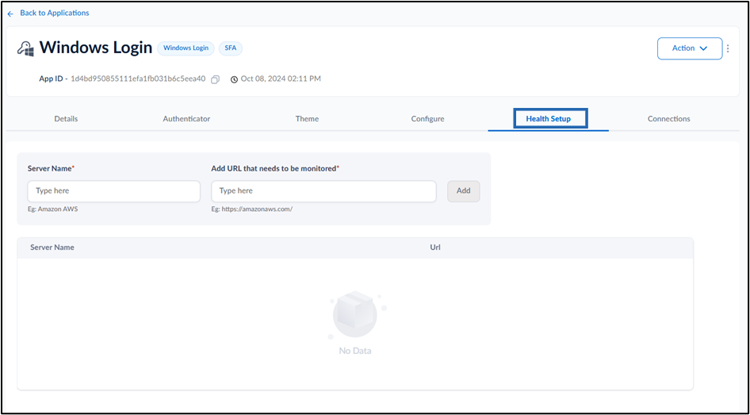

{/* Source: Intercom article 10796420 -  */}
{/* Generated by intercom_to_mintlify.py - re-running overwrites this file. */}

**Pre-requisite:**

You must create a Passwordless application of type Windows Login. For further details, refer [How to create a Windows Login Application](/platforms/windows/windows-login/windows-login-how-to-create-and-configure-windows-login-application)

Steps to edit Health Setup tab:

1. Log in to the **Oloid Portal**.
2. On the **Applications** page, click on an Windows application to edit.

   

   The application page is displayed.

   

   Do the following:
3. Click > **Health Setup** tab.
   1. Enter **Server Name**.
   2. Enter URL in **Add URL that needs to be monitored** field. > click **Add**.
      The Server Name is added and the Health Setup tab is configured successfully.
