{/* Source: Intercom article 12096020 -  */}
{/* Generated by intercom_to_mintlify.py - re-running overwrites this file. */}

## Introduction

The Settings menu in the Windows Login application allows Tenant Admins to configure features that control the authentication process and user interaction with Windows devices. It provides options to manage login methods, credential handling, user activity capture, and recovery mechanisms, ensuring a secure and seamless login experience.

## Prerequisites

You must create a Windows Login application. For further details, refer [How to create a Windows Login Application](/platforms/windows/windows-login/windows-login-how-to-create-and-configure-windows-login-application).

## Steps to edit setting menu

1. Log in to the **Tenant Admin Portal**.
2. On the **Applications** page, click on a Windows Login application to edit.

   

   The application page is displayed.
3. Go to **Configure** tab.

   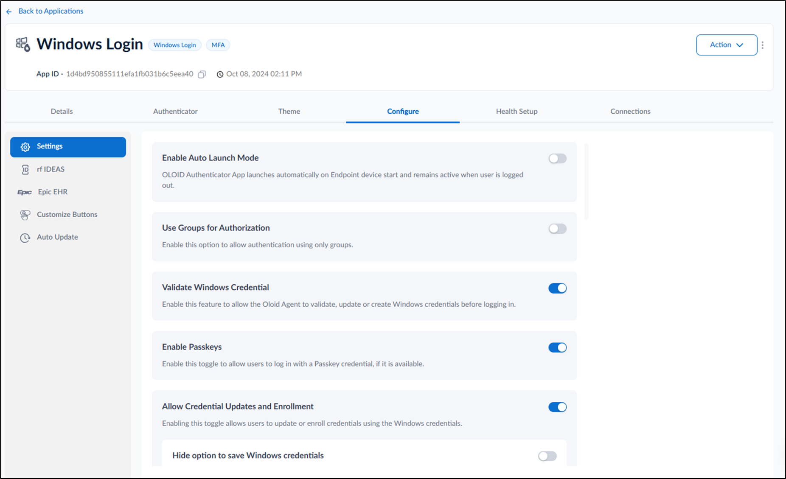

4. Enable **Auto Launch Mode** toggle to auto-launch the Windows Login app in the login screen.

   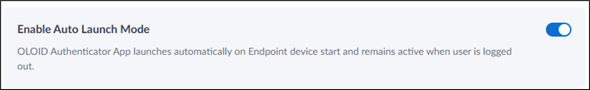

5. Enable **Use Groups for Authorization** toggleto allow authentication using only groups.

   

6. Enable **Validate Windows Credential** toggle to allow the Oloid Agent to validate, update or create Windows credentials before logging in.

   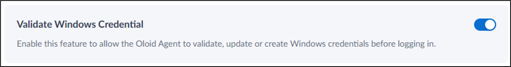

7. Enable **Passkeys** toggle to allow users to log in with a Passkey credential.

   

8. Enable **Allow Credential Updates and Enrolment** toggle to allow users to update or enrol credentials using Windows credentials.
   1. Enable **Hide option to save Windows credentials** toggle to remove the checkbox for saving Windows domain credentials to the Oloid account during enrolment.
   2. Select **Auto-save credentials on successful validation** checkbox to automatically save credentials when the Save option is hidden.
   3. Enable **Allow Login Through Local Credentials** toggle to allow users to log in to Windows using their local Windows credentials.

      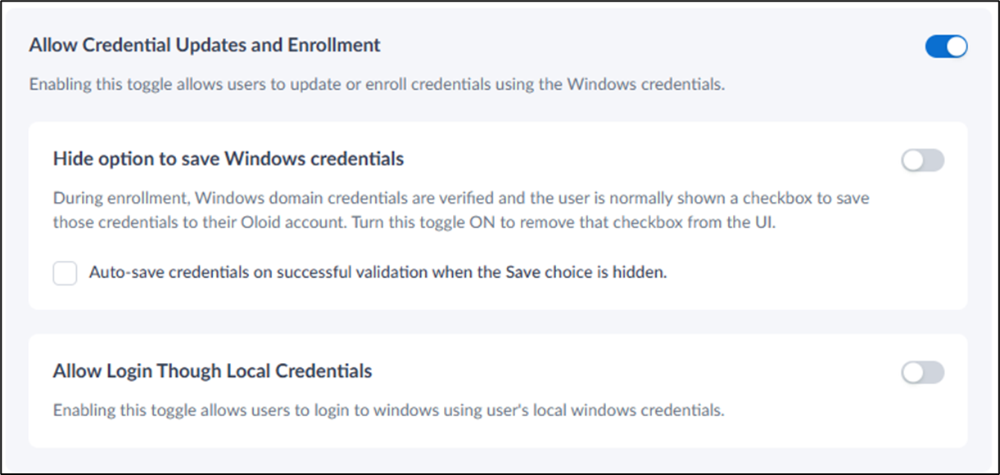

9. Enable **Capture Windows User Events** toggle to capture Windows events for user logins, logouts, locks, unlocks, and credential provider details. All captured data is stored in the transaction tab.

   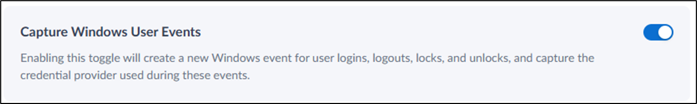

10. Enable **Auto-recover Endpoint toggle** to check the Endpoint configuration and automatically sync it when the Login module launches.

    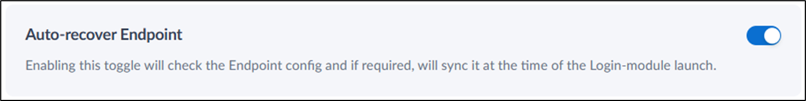

11. Enable **Manual Capture Accessibility** to allow users to manually capture their face during face authentication.

    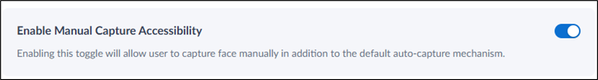

12. Enable **Auto Authentication of Webkey using Local Transaction** toggle to automatically authenticate the user into Webkey after device login.

    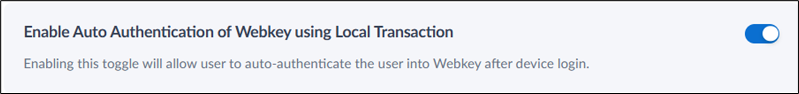

13. Enable **Badge Out** toggle to allow users to lock or sign out of Windows using badge scan. For details, refer to [Windows Login - How to configure Enable Badge Out option](/platforms/windows/windows-login/windows-login-how-to-configure-badge-out-option).

    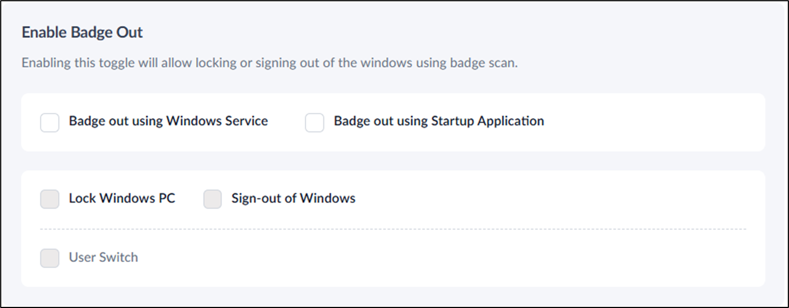

14. Set **Time-out for Login Screen** to define the maximum duration the system will wait on the login screen before timing out.

    

15. **Master Admin override passcode:** Follow the onscreen instruction to create master admin override passcode. For details, refer [How to create device-admin passcode for Supervisor App](/platforms/windows/supervisor-app/windows-login-how-to-create-device-admin-passcode-for-supervisor-app).

    

16. **Apply Endpoint Template**: Select a Windows Login endpoint template that is applied during the endpoint pairing process.

    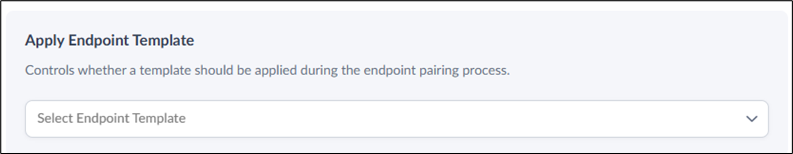

17. To check..

    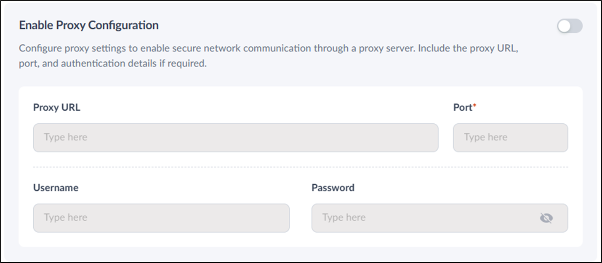
