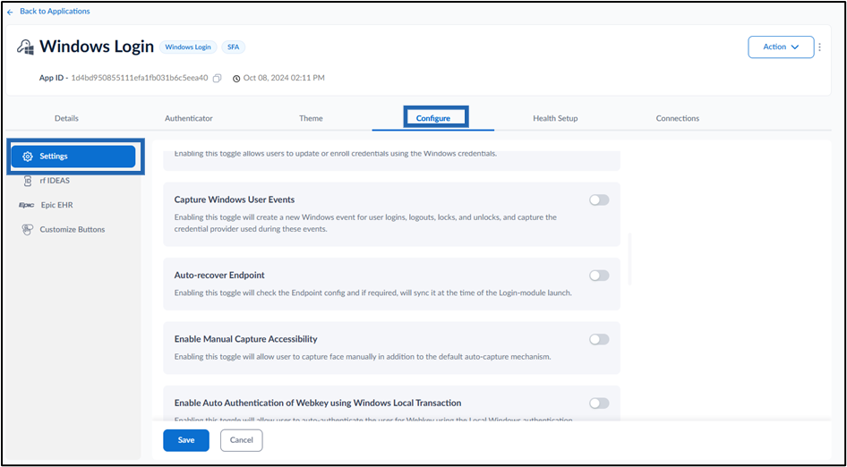
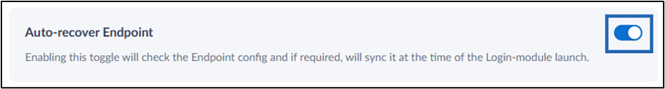
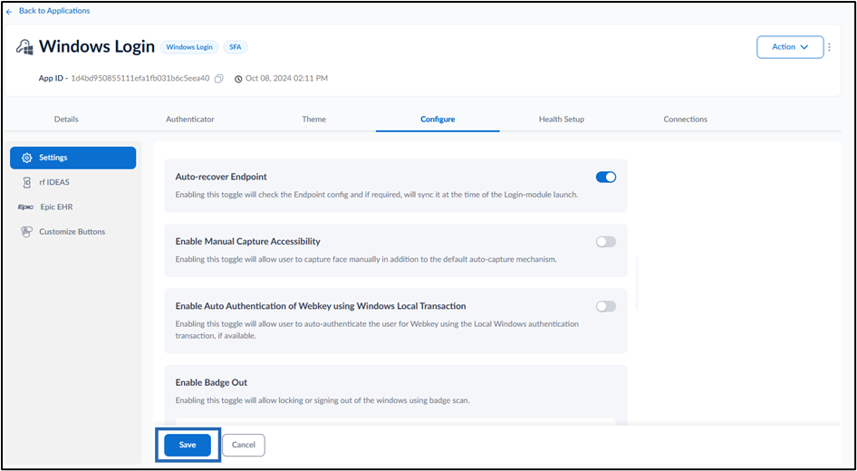
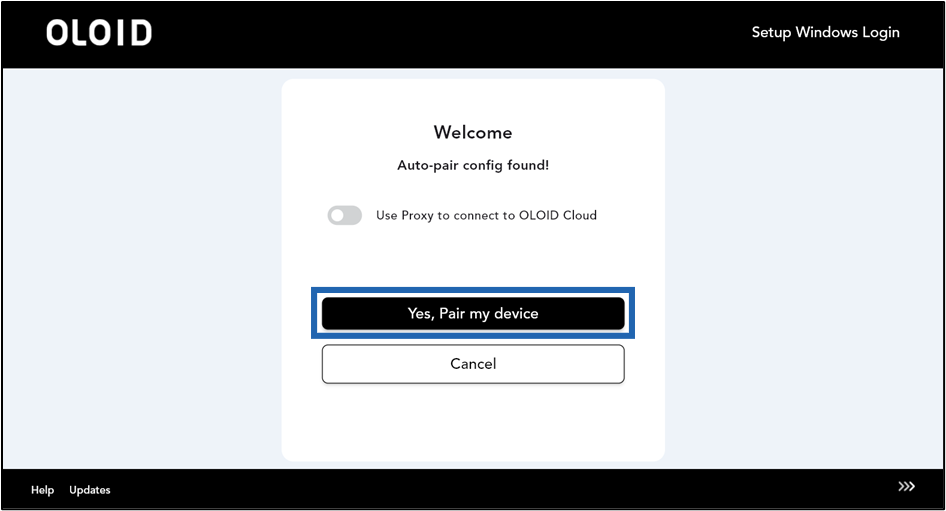
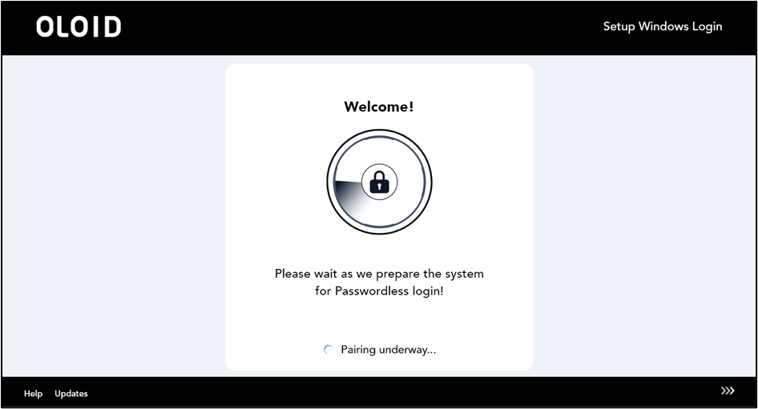
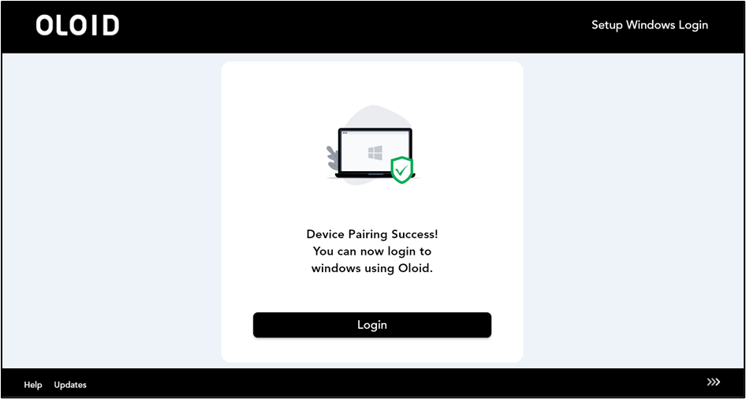

{/* Source: Intercom article 11008747 -  */}
{/* Generated by intercom_to_mintlify.py - re-running overwrites this file. */}

## Introduction

In Oloid Portal, enabling Auto recover Endpoint feature in Windows Login application allows you to recover the existing endpoint configuration in the Windows Authenticator App. Then, you must sync the application to pair the endpoint if required.

## Steps to enable Auto-recover Endpoint

1. Log in to the **Oloid Portal**.
2. On the **Applications** page, select the application paired in the Supervisor App (Windows Authenticator App).

   

   The application page is displayed.

   

3. Go to **Configure** > **Settings** tab.

   

4. Turn on **Auto-recover Endpoint** toggle button to automatically recover the endpoint configuration.

   

Click **Save**.

The configuration is saved successfully.

<Note>
  **Note:** In **Windows Authenticator** app, you must sync the configuration to Auto-recover Endpoint. For more details, refer [How to sync configuration in Supervisor App](/platforms/windows/supervisor-app/how-to-sync-configuration-in-supervisor-app)
</Note>

## Steps to check Auto-recover Endpoint in Oloid Supervisor app

1. Launch the Oloid Supervisor app.
2. Click **Yes, pair my device.**

   

   Welcome screen is displayed.

   

   After the endpoint pairing completes, the **Device pairing success** page is displayed.

   

   <Note>
     **Note:** You must download the auto-configure file to your local system. For more information, refer to [How to generate Auto-Pair config file for Windows Login in Oloid Portal
   </Note>

   ](https://oloid.help/en/articles/10441578-how-to-generate-auto-pair-config-file-for-windows-login-in-oloid-portal)
