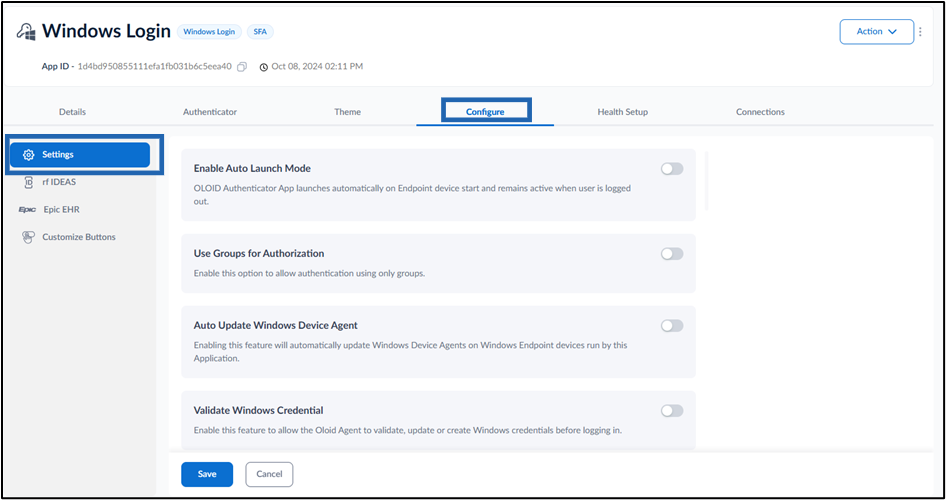
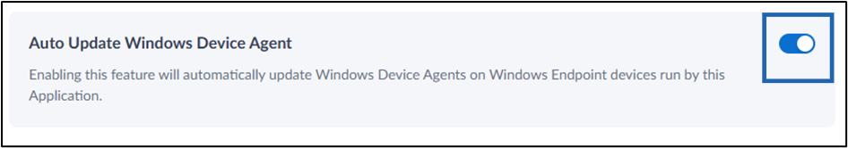
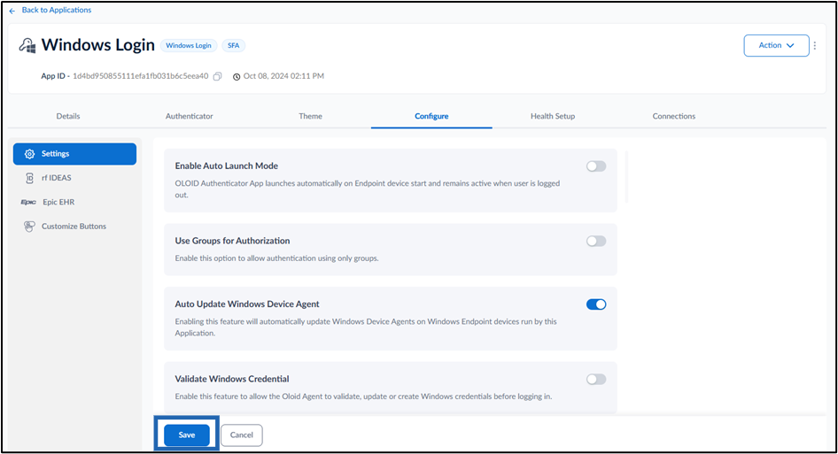

{/* Source: Intercom article 10897576 -  */}
{/* Generated by intercom_to_mintlify.py - re-running overwrites this file. */}

## **Introdu**ction

In Tenant Admin Portal, enabling Auto update windows device agent feature automatically updates the windows device agent for Windows authenticator app.

## Steps to enable Auto Update Windows Device Agent

1. Log in to the **Tenant Admin Portal**.
2. On the **Applications** page, select the application paired in the Supervisor App (Windows Authenticator App).

   

   The application page is displayed.

   

3. Go to **Configure** > **Settings** tab.

   

4. Turn on **Auto Update Windows Device Agent** toggle button to automatically update the windows device agent for Windows authenticator app.

   

5. Click **Save**.

   

   The configuration is saved successfully.

   <Note>
     **Note:** In **Windows Authenticator** app,you must sync the configuration for auto Update Windows Device Agent.
   </Note>

   For more details, refer [How to sync configuration in Supervisor App](/platforms/windows/supervisor-app/how-to-sync-configuration-in-supervisor-app)

## Check the latest update in Oloid Supervisor app

To check the latest update in Oloid Supervisor app, Refer to [How to view updates in Supervisor App](/platforms/windows/supervisor-app/how-to-view-updates-in-supervisor-app)
