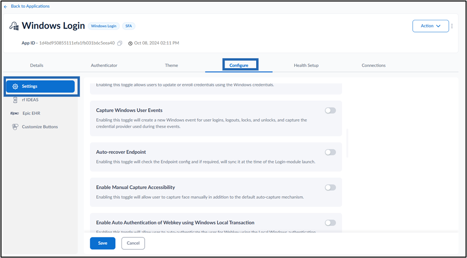
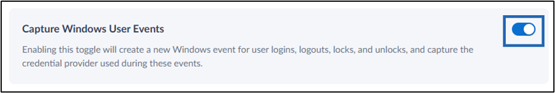
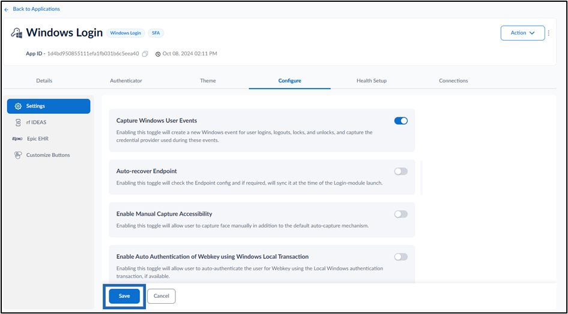
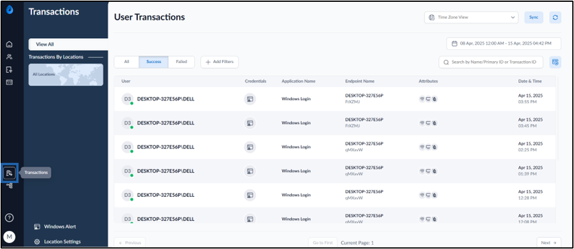

{/* Source: Intercom article 10978430 -  */}
{/* Generated by intercom_to_mintlify.py - re-running overwrites this file. */}

## Introduction

In Oloid Portal, enabling the Capture Windows User Events feature in the Windows Login application track user activity, including log-in and out, and when the device is locked or unlocked. The feature also captures the authentication method used, such as face recognition, badge, NFC, or PIN.

## Steps to enable Capture Windows User Events

1. Log in to the **Oloid Portal**.
2. On the **Applications** page, select the application paired in the Supervisor App (Windows Authenticator App).

   

   The application page is displayed.

   

3. Go to **Configure** > **Settings** tab.

   

4. Turn on **Capture Windows User Events** toggle button to create events that track when an endpoint logs in and out.

   

Click **Save**.

The configuration is saved successfully. See, [Sample screen for Capture Windows User Events feature](#sample-screen-for-capture-windows-user-events)

<Note>
  **Note:** In **Windows Authenticator** app, you must sync the configuration to Capture Windows User Events. For more details, refer [How to sync configuration in Supervisor App](/platforms/windows/supervisor-app/how-to-sync-configuration-in-supervisor-app)
</Note>

## Sample screen for Capture Windows User Events

5. 
