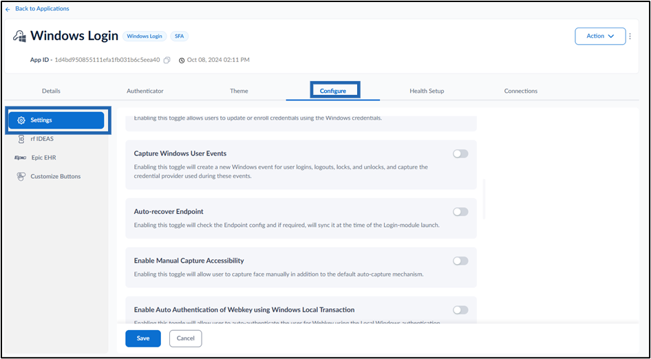
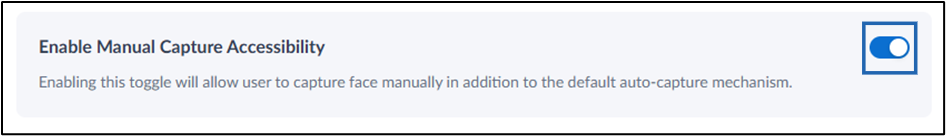
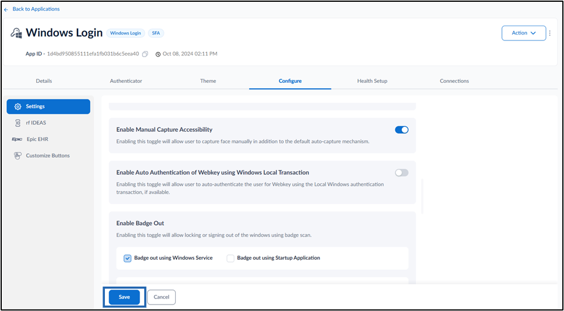
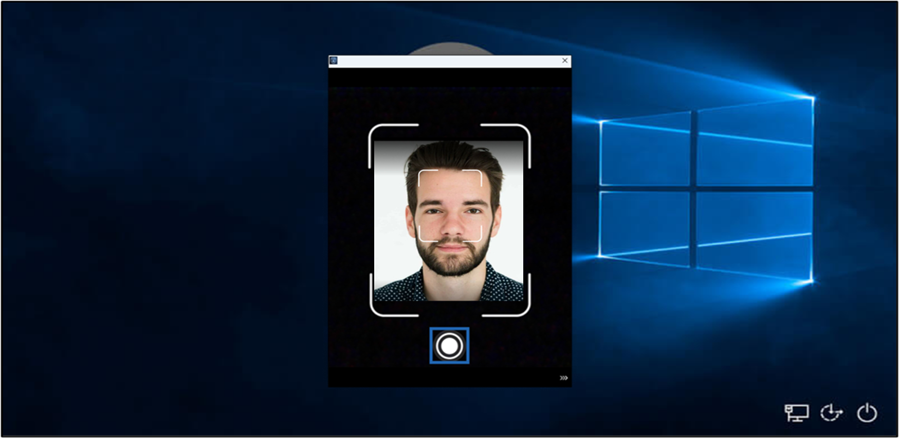

{/* Source: Intercom article 11016632 -  */}
{/* Generated by intercom_to_mintlify.py - re-running overwrites this file. */}

## **Introduc**tion

In Oloid portal, enabling Manual Capture Accessibility feature in Windows Login application allows users to manually capture the face when using the Windows Login app.

## Steps to Enable Manual Capture Accessibility

1. Log in to the **Oloid Portal**.
2. On the **Applications** page, select the application paired in the Supervisor App (Windows Authenticator App).

   

   The application page is displayed.

   

3. Go to **Configure** > **Settings** tab.

   

4. Turn on **Enable Manual Capture Accessibility** toggle button to manually capture face for sign-in Windows Login app.

   

Click **Save**.

The configuration is saved successfully. See, [Sample screen for Manual Capture Accessibility](#sample-screen-for-manual-capture-accessibility)

<Note>
  **Note:** In **Windows Authenticator** app, you must sync the configuration to enable Manual Capture Accessibility. For more details, refer [How to sync configuration in Supervisor App](/platforms/windows/supervisor-app/how-to-sync-configuration-in-supervisor-app)
</Note>

## Sample screen for Manual Capture Accessibility

5. 
