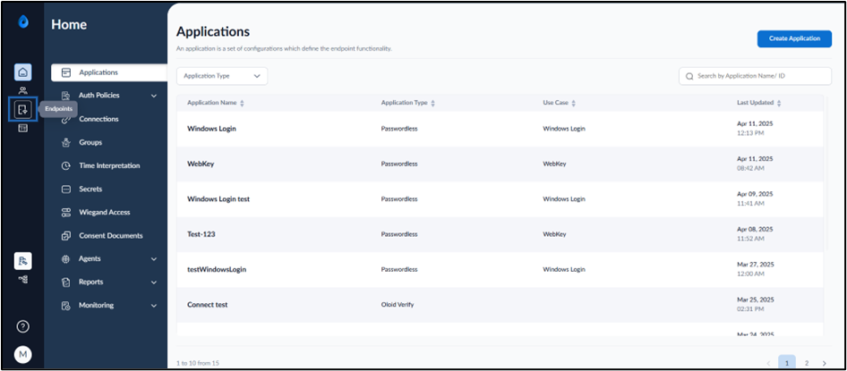
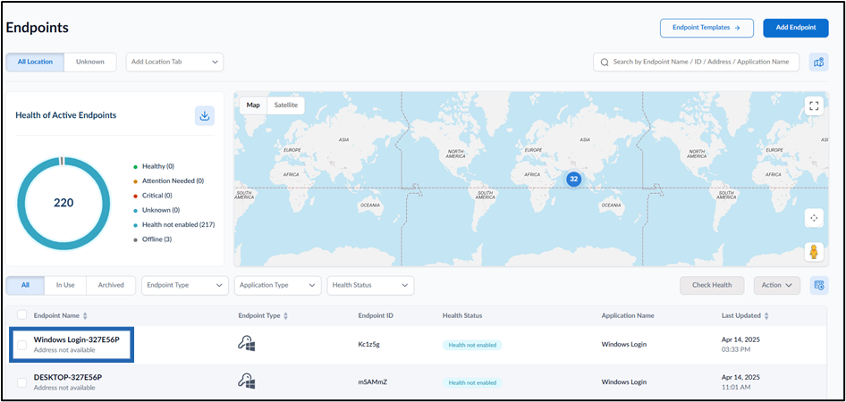
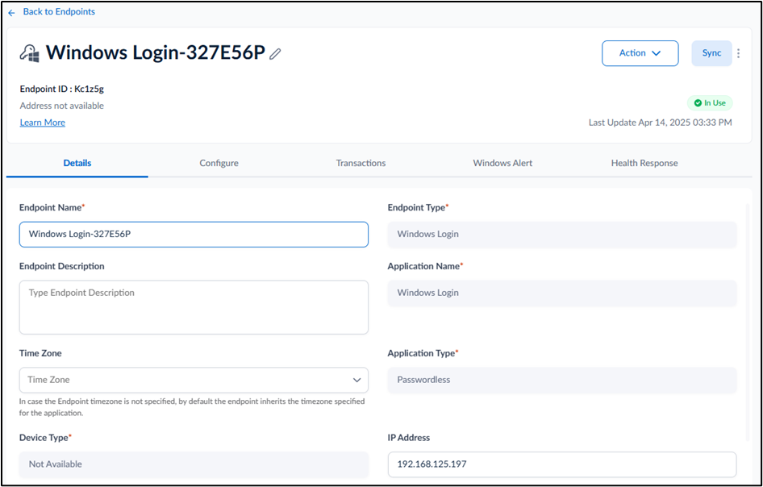
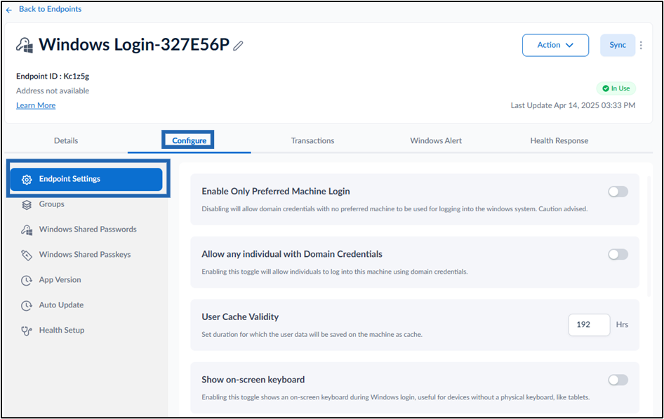
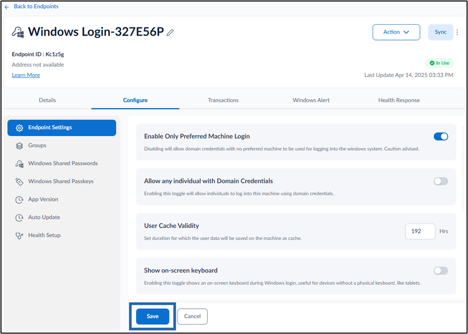

{/* Source: Intercom article 11079846 -  */}
{/* Generated by intercom_to_mintlify.py - re-running overwrites this file. */}

## Introduction

In Oloid Portal, enabling Only Preferred Machine Login feature allow domain credentials to be used only in preferred machine to log in to windows system.

## Steps to Enable Only Preferred Machine Login

1. Log in to the **Oloid Portal**.
2. On the home page of the portal, click **Endpoints** on the left menu panel.

   

   The **Endpoints** page is displayed.
3. Select the paired Windows Login Endpoint.

   

   The **Endpoint Details** page is displayed.

   

4. Go to **Configure** > **Endpoint Settings** tab.

   

5. **Enable Only Preferred Machine Login** toggle button to allow domain credentials to be used only in preferred machine to log in to windows system.

   

6. Click **Save**.

   

   The configuration is saved successfully.
   For more details, refer [How to sync configuration in Supervisor App](/platforms/windows/supervisor-app/how-to-sync-configuration-in-supervisor-app)
