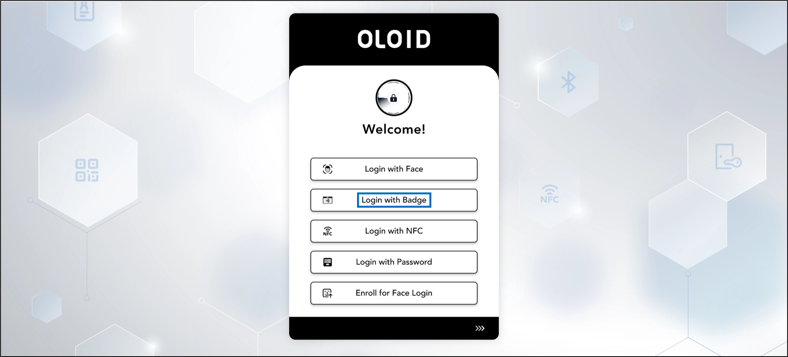
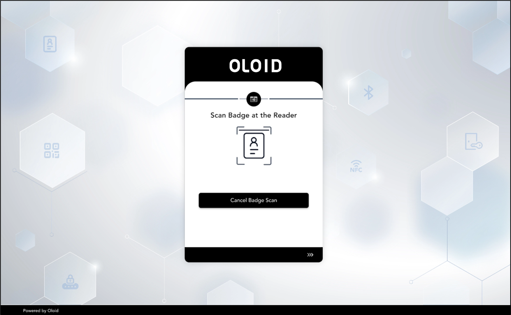
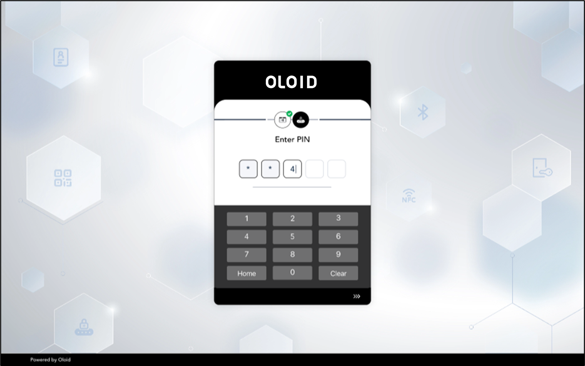

{/* Source: Intercom article 8702342 -  */}
{/* Generated by intercom_to_mintlify.py - re-running overwrites this file. */}

**Pre-requisite:**

- You must have an Okta account.
- The badge reader should be connected to your android tablet.
- User and PIN credentials are created in the Oloid Portal.
- Oloid Device Lock App is launched and Welcome screen is displayed.

To log in with badge:

1. Tap **Login with Badge**.

   

2. Scan your badge in the Badge Reader.

   

   On successful badge authentication, the **Enter PIN** page is displayed.
3. Enter the **PIN**.

   

   On PIN authentication, you are signed into the Okta system.
