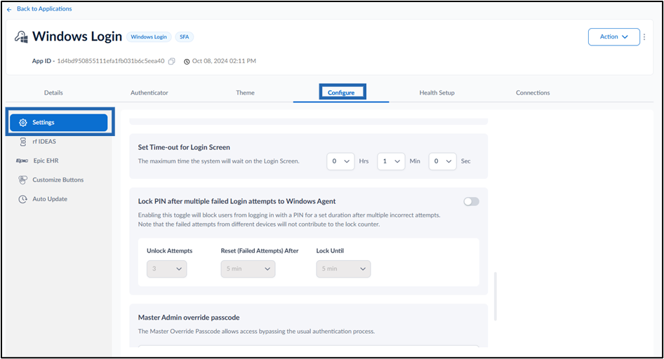
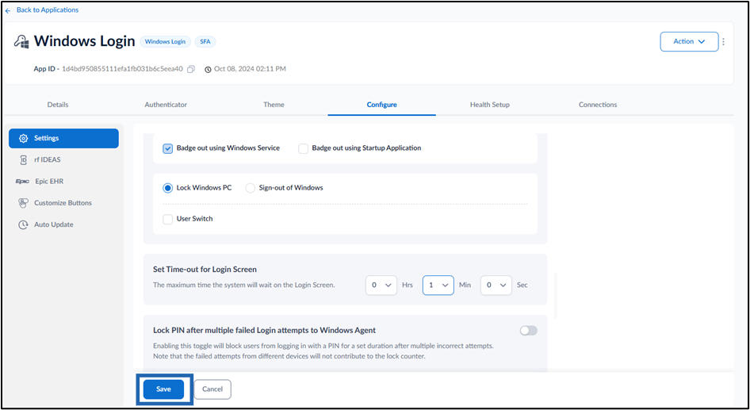

{/* Source: Intercom article 11059154 -  */}
{/* Generated by intercom_to_mintlify.py - re-running overwrites this file. */}

## Introduction

In Oloid Portal, Set Time-out for Login Screen feature allows the Tenant Admin to set how long the Windows Login screen remains visible when there is no user response in the Windows Login app.

## Steps to set Time-out for Login Screen

1. Log in to the **Oloid Portal**.
2. On the **Applications** page, select the application paired in the Supervisor App (Windows Authenticator App).

   

   The application page is displayed.

   

3. Go to **Configure** > **Settings** tab.

   

4. **Set Time-out for login screen** in Hours, Mins, and sec for the Windows Login app. If there is no user activity, the login screen in the Windows Login application will time out and close automatically after the set time.

   

5. Click **Save**.

   

   The configuration is saved successfully.

   <Note>
     **Note:** In **Windows Authenticator** app, you must sync the configuration to enable Set Time-out for Login Screen. For more details, refer [How to sync configuration in Supervisor App](/platforms/windows/supervisor-app/how-to-sync-configuration-in-supervisor-app)
   </Note>
