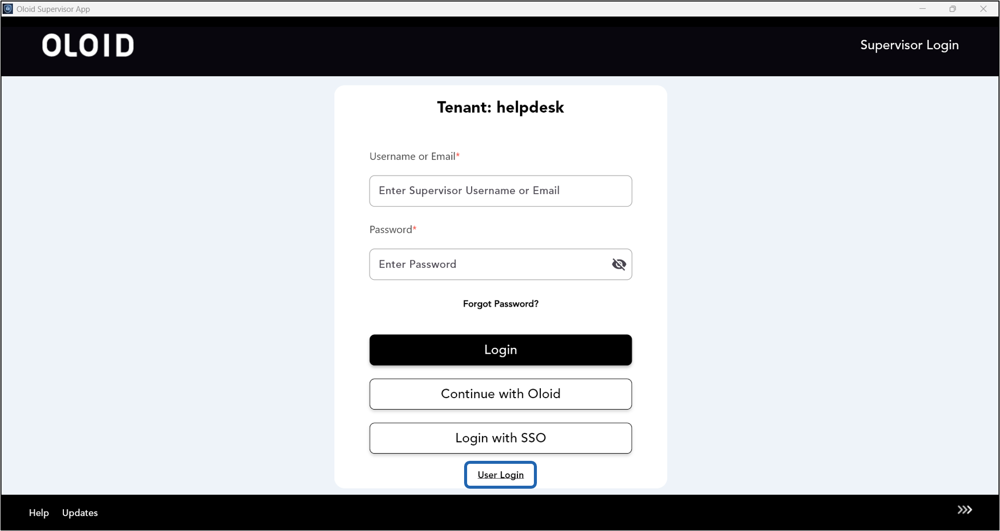
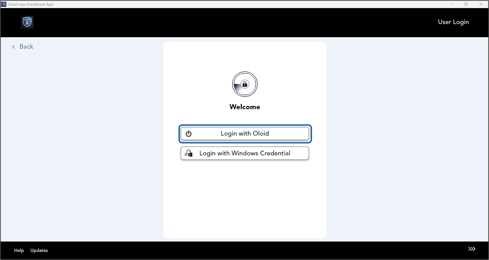
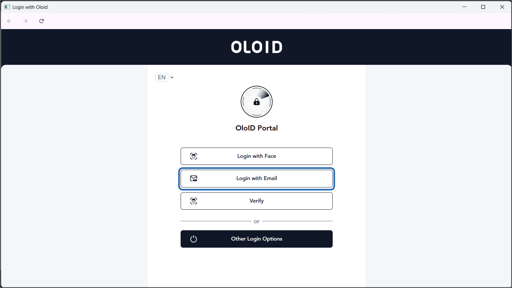
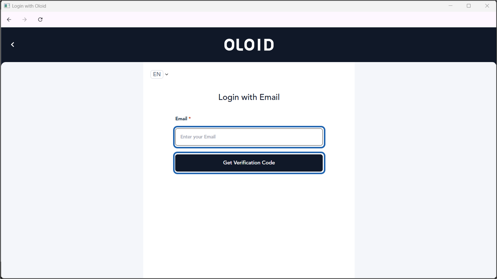
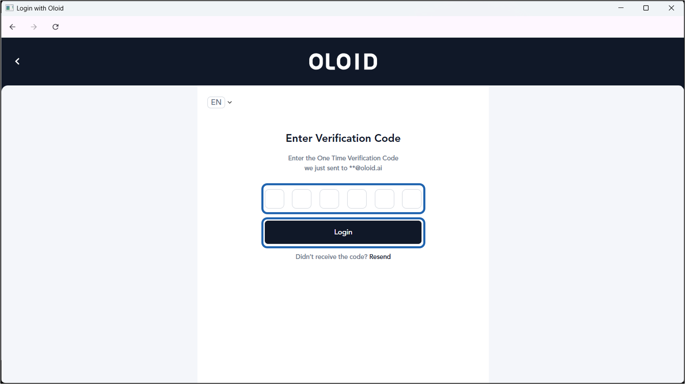
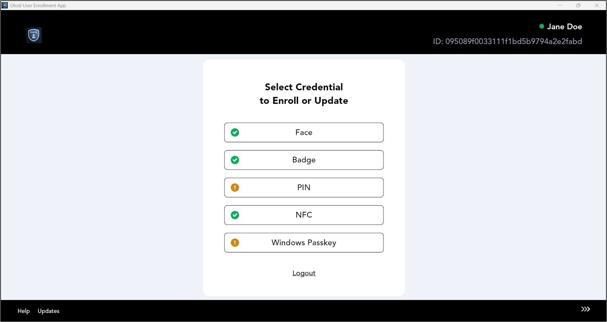

{/* Source: Intercom article 17272368 -  */}
{/* Generated by intercom_to_mintlify.py - re-running overwrites this file. */}

## Introduction

## Prerequisites

- Windows Login Application must be created in the Tenant Admin Portal. For more information, refer: [How to create and configure Windows Login application in the Tenant Admin Portal](/platforms/windows/windows-login/windows-login-how-to-create-and-configure-windows-login-application)
- Ensure the Continue with Oloid option checkbox is selected in the Tenant Admin Portal. For more information, refer: [Windows Login - How to Configure Login options for Oloid Apps](/platforms/windows/windows-login/windows-login-how-to-configure-login-options-for-oloid-apps)
- Ensure the endpoint is paired with the Windows Login application. refer [Windows Login - How to Manually Pair the Supervisor App](/platforms/windows/supervisor-app/windows-login-how-to-manually-pair-the-supervisor-app)

## Steps to Login to Supervisor App using Oloid User Portal

1. Double-click on the **Supervisor App** to start.

   

   The Login screen is displayed.
2. Click **User Login**.

   

   The **Welcome Screen** is displayed.
3. Click **Login with Oloid.**

   

   The Oloid User Portal pop-up is displayed.
4. Click **Login with Email.**

   

   The Login with email screen is displayed.
5. Enter **Email ID** > click **Get Verification Code.**

   

   The Enter Verification Code screen is displayed.
6. Enter the **Verification Code** > click **Login.**

   

   The **Credential Enrollment/ Update** screen is displayed.

   

7. Select the credential you want to enroll or update.
