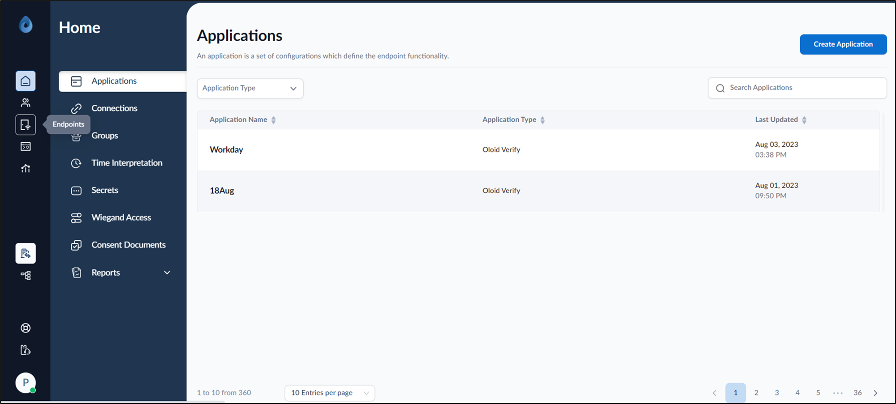
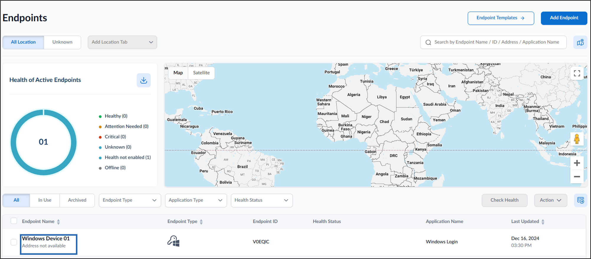
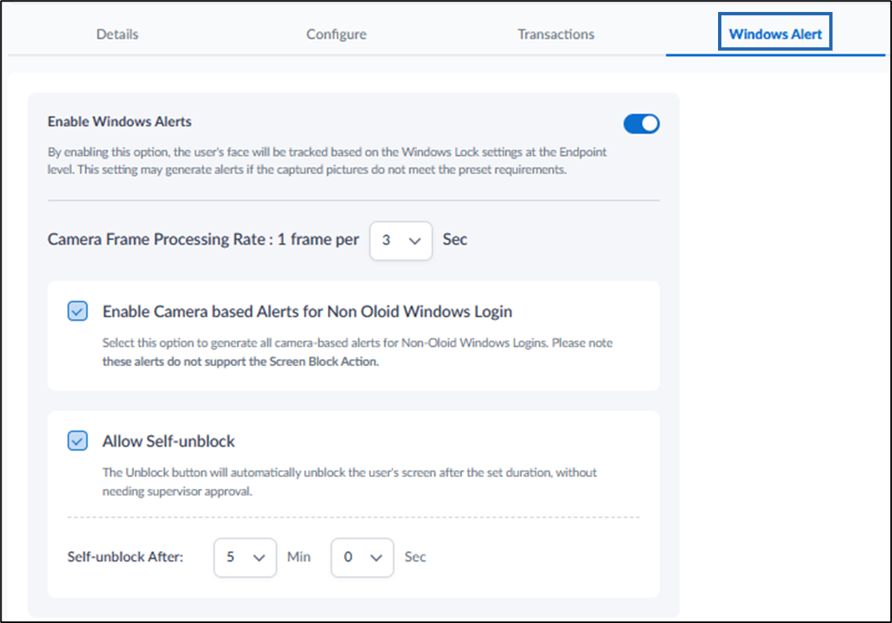
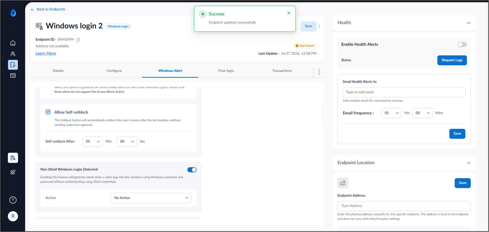

{/* Source: Intercom article 16095215 -  */}
{/* Generated by intercom_to_mintlify.py - re-running overwrites this file. */}

## Introduction

## Prerequisites

- You must have access to the **Tenant Admin Portal**.
- Ensure the endpoint is paired with the Windows Login application. refer: [How to pair endpoint using Pair as Supervisor in Supervisor App](/platforms/windows/supervisor-app/windows-login-how-to-manually-pair-the-supervisor-app)
- Ensure that your system is unlocked
- Ensure that your system's camera is working properly

## Steps to configure Check Emotions

1. Log in to Tenant Admin Portal.
2. On the home page of the portal, click **Endpoints** on the left menu panel.

   

   The Endpoints page is displayed.
3. Click endpoint name (Windows Login) to edit from the listed endpoints.

   

   The Endpoint details page is displayed.
4. Go to **Windows Alert** tab.

   

5. Do the following:
   1. Enable the **Check Emotions** toggle button.
   2. Enter the Check Emotions frequency.
   3. Select **Action** from drop down.
   4. Click **Save.**

Windows Alerts for presence detection is configured.

---

##### Keywords
