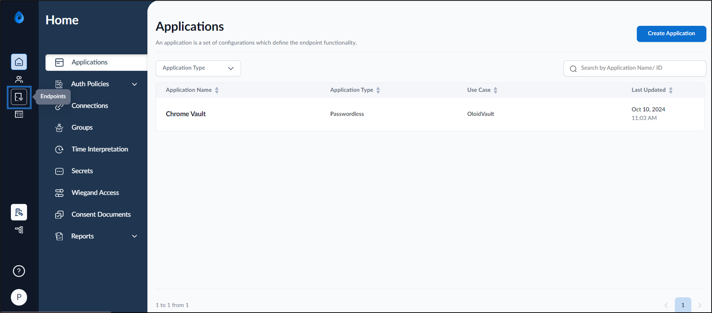
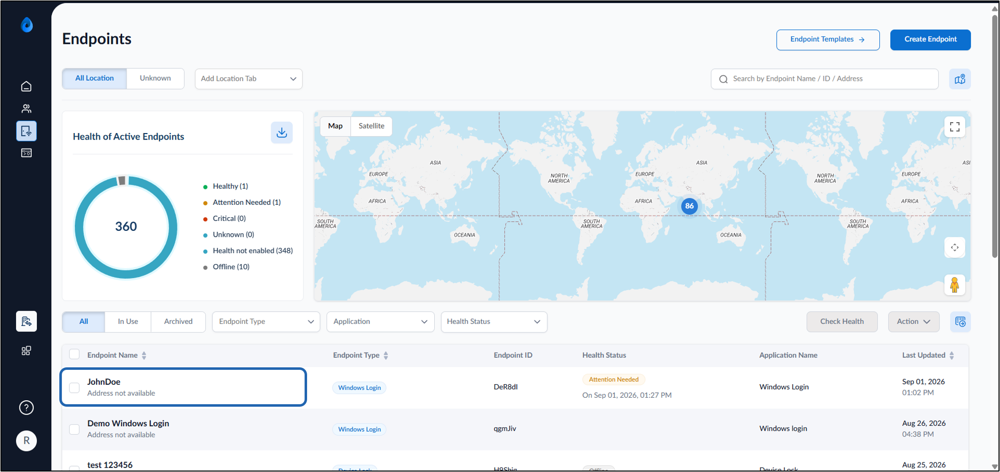
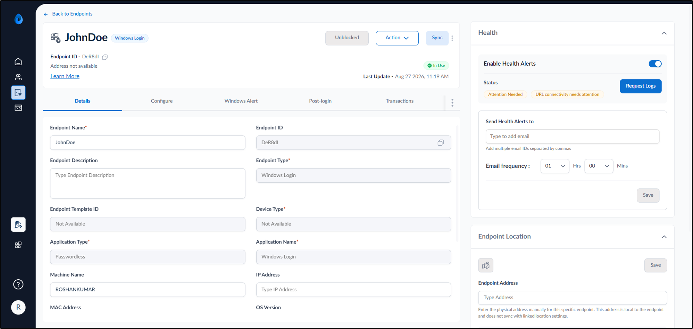
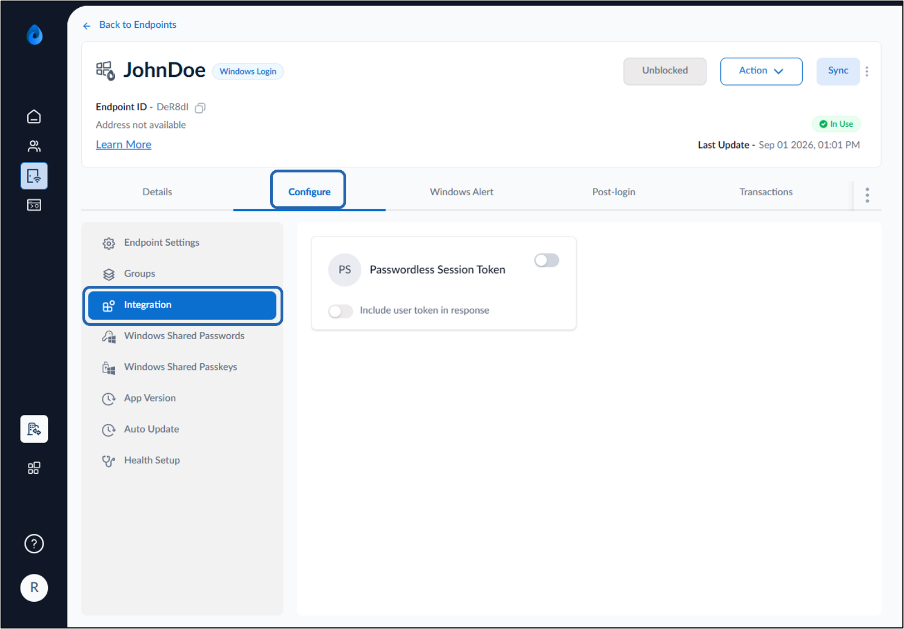
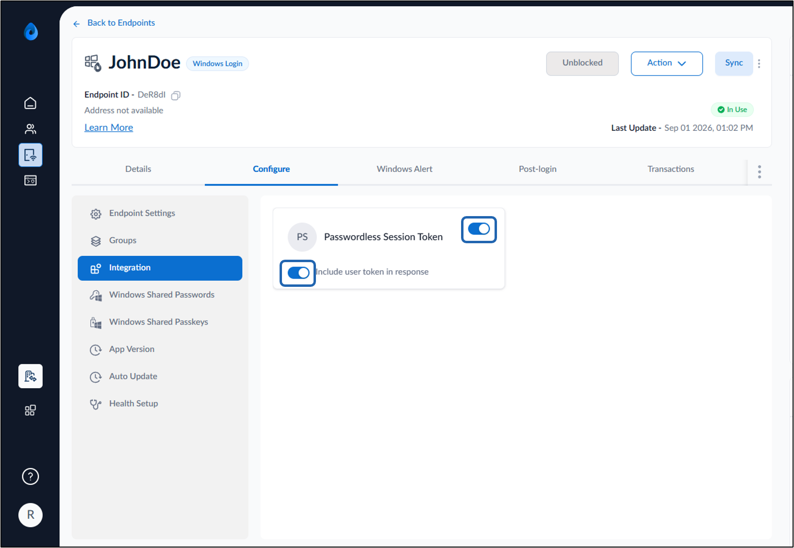
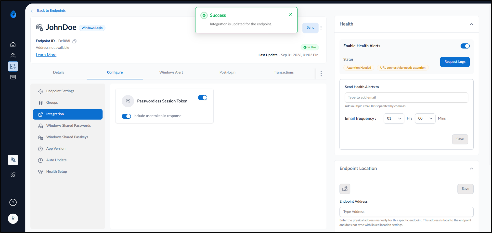

{/* Source: Intercom article 16769146 -  */}
{/* Generated by intercom_to_mintlify.py - re-running overwrites this file. */}

## Introduction

When the Passwordless Session Token is enabled, the endpoint can generate a passwordless session token after successful authentication, which can be used to establish a secure user session without requiring a password.

## Prerequisites

- You must have a **Tenant Admin** account.
- Ensure the Windows Login application is created and configured. For more information, refer: [Windows Login - How to create and configure Windows Login application in the Tenant Admin Portal](/platforms/windows/windows-login/windows-login-how-to-create-and-configure-windows-login-application)
- Ensure the endpoint is paired with the Windows Login application. For more information, refer: [Windows Login - How to manually pair the Supervisor App](/platforms/windows/supervisor-app/windows-login-how-to-manually-pair-the-supervisor-app)

## Steps to Enable Passwordless Session Token

1. Log in to the **Tenant Admin Portal**.
2. On the home page of the portal, click **Endpoints** on the left menu panel.

   

   The Endpoints page is displayed.
3. Click an endpoint name to edit from the listed endpoints.

   

   The Endpoint details page is displayed.

   

4. Click **Configure Tab** > Click **Integrations**.
   The Integrations tab is displayed.

   

5. Enable the **Passwordless Session Token** toggle.
   1. Enable the **Include User Token in response** toggle. (Optional)

      

      The Passwordless Session Token is enabled for the Windows Login Endpoint.

