{/* Source: Intercom article 11424173 -  */}
{/* Generated by intercom_to_mintlify.py - re-running overwrites this file. */}

## Pre-requisite

- In Oloid Portal, you must enable **Allow Credential Updates and Enrollment** to enroll credentials in Windows Login app. For more details, refer to [How to enable Allow Credential Updates and Enrollment in Windows Login application](/platforms/windows/windows-login/windows-login-how-to-enable-credential-updates-and-enrollment-for)
- Make sure either the user's Primary ID or email ID matches your System Account Name.

## Enroll Face

Steps to enroll face through Windows Login app:

1. On the Windows lock screen, click **Login with OLOID**.

   

   The Windows login app opens and the **Welcome** page is displayed.
2. Select **Login with Face**.

   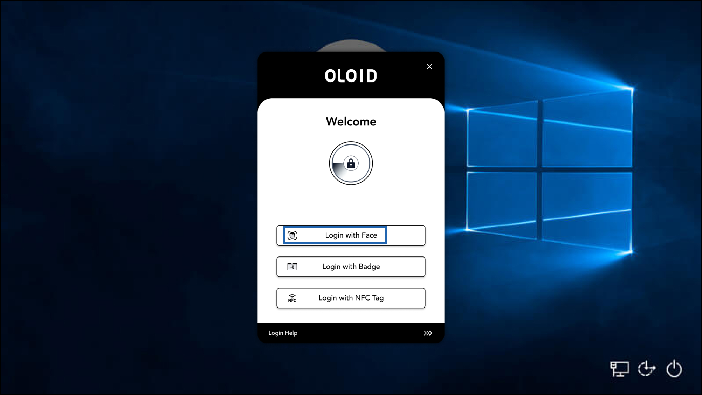

   The Windows login app opens and the camera turns on.
3. Place your face in front of the camera for facial authentication.

   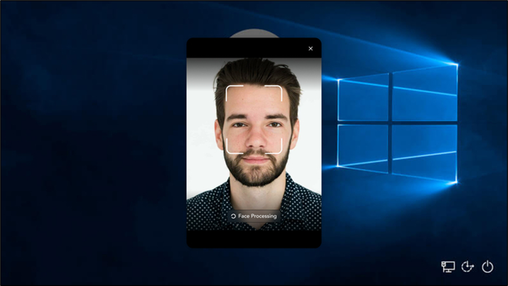

   The Face authentication fails and the Enroll Credential option is displayed.
4. On the **Authentication Failed** screen, select **Enroll Credential**.

   

   The **Verify using Windows Credential** screen is displayed.
5. Do the following:
   1. Enter **Domain\Username**.
      Enter your Windows domain and username in the format `Domain\Username`.
   2. Enter **Password**.
      Use your Windows account password.
   3. Select **Enroll Windows credential to your account**. (Optional)
   4. Click **Continue**.

      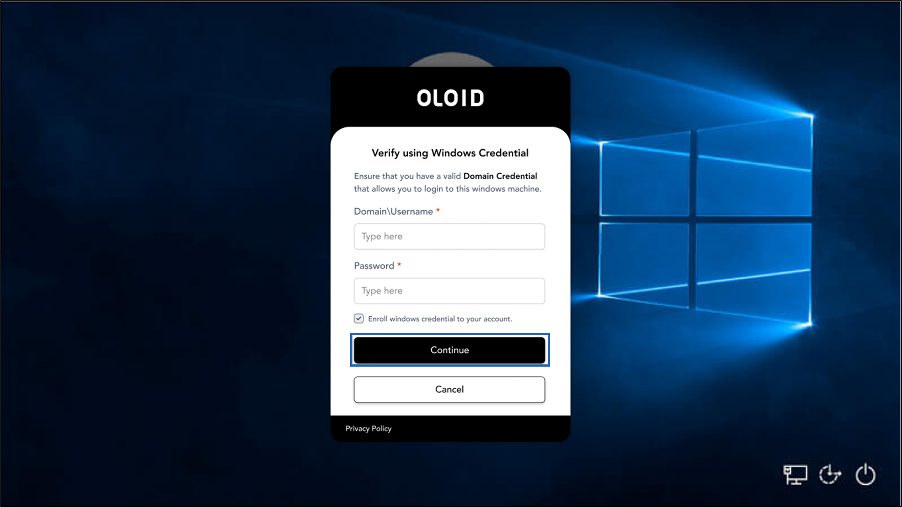

      The **Select Credential to Enroll or Update** screen is displayed.
6. Select **Face**.

   <Note>
     **Note:** If connection is enabled, user consent is requested before uploading the picture.
   </Note>

   

   The camera turns on.
7. Place your face in front of the camera for face authentication.

   

   Your face is automatically captured and it is enrolled successfully.

   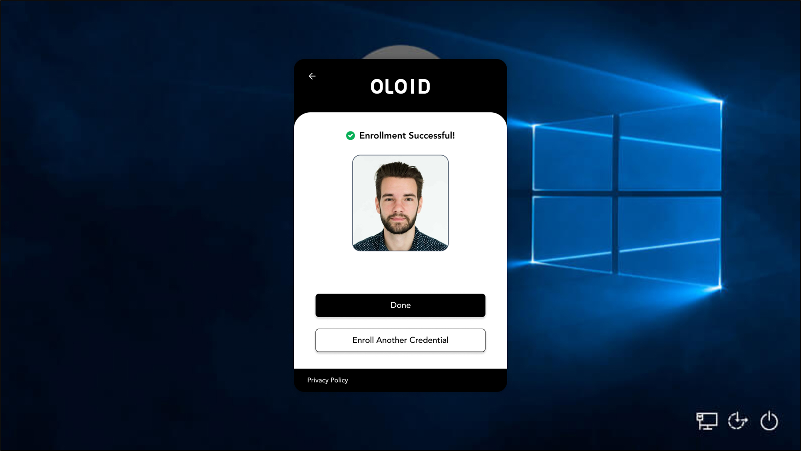

## Enroll Badge

Steps to enroll badge through Windows Login app:

1. On the Windows lock screen, click **Login with OLOID**.

   

   The Windows login app opens and the **Welcome** page is displayed.
2. Select **Login with Badge**.

   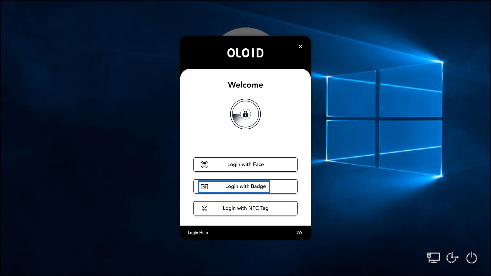

3. Tap the **Badge** on the **Badge Reader** to scan it.

   <Note>
     **Note:** The badge reader must be connected to the computer.
   </Note>

   

   The badge authentication fails and the Enroll Credential option is displayed.
4. On the **Authentication Failed** screen, select **Enroll Credential**.

   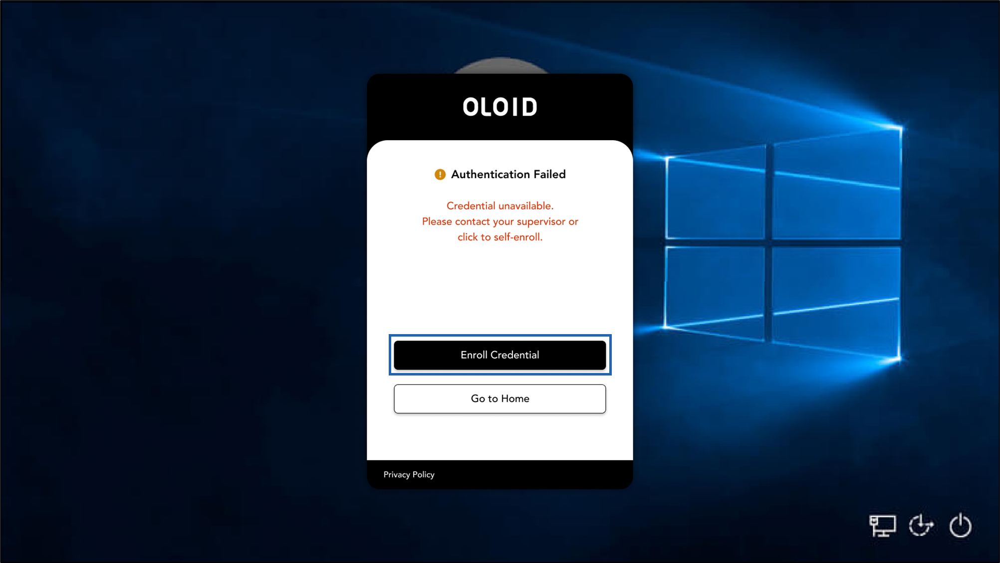

   The **Verify using Windows Credential** screen is displayed.
5. Do the following:
   1. Enter **Domain\Username**.
      Enter your Windows domain and username in the format `Domain\Username`.
   2. Enter **Password**.
      Use your Windows account password.
   3. Select **Enroll Windows credential to your account**. (Optional)
   4. Click **Continue**.

      

      The **Select Credential to Enroll or Update** screen is displayed.
6. Select **Badge**.

   <Note>
     **Note:** You can also update the badge credential.
   </Note>

   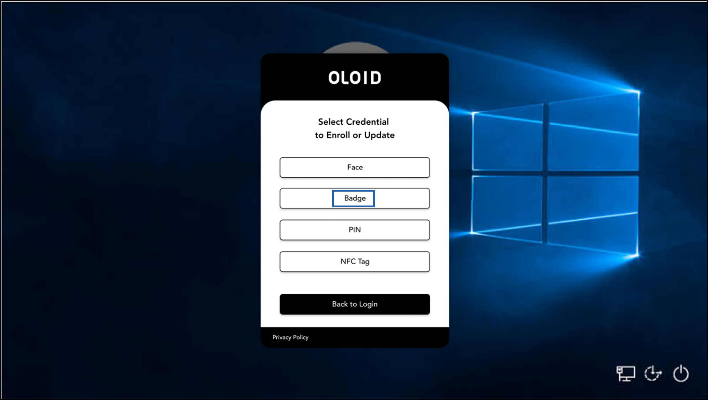

   The **Scan your Badge to Enroll** screen is displayed.
7. Scan your badge in the Badge Reader.

   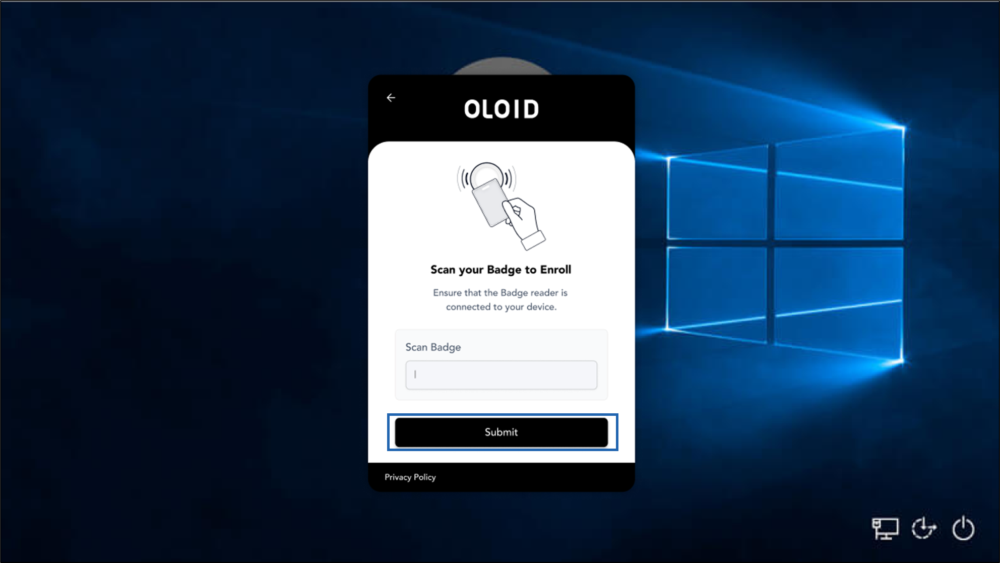

8. Click **Submit**.
   The badge is enrolled successfully.

   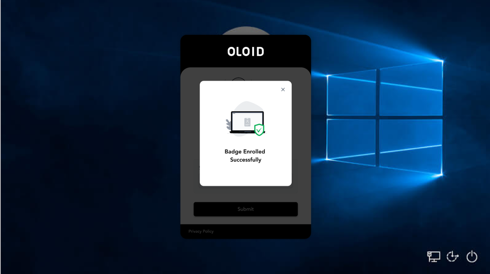

## Enroll PIN

## Enroll NFC

Steps to enroll NFC through Windows Login app:

1. On the Windows lock screen, click **Login with OLOID**.

   

   The Windows login app opens and the **Welcome** page is displayed.
2. Select **Login with NFC Tag**.

   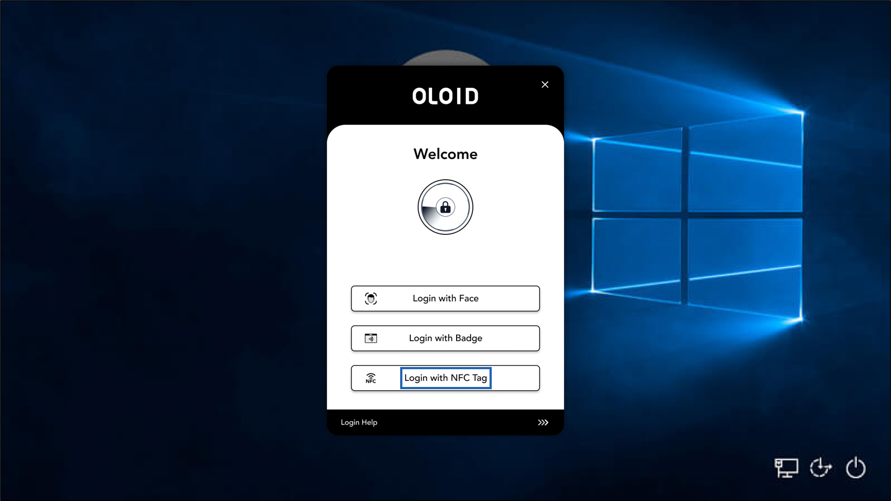

3. Tap the **NFC Tag** on the **Card Reader** to scan it.

   <Note>
     **Note:** The card reader must be connected to the computer.
   </Note>

   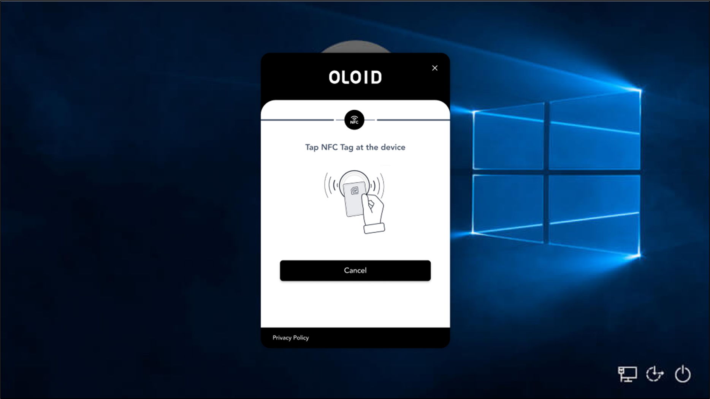

   The NFC authentication fails and the Enroll Credential option is displayed.
4. On the **Authentication Failed** screen, select **Enroll Credential**.

   

   The **Verify using Windows Credential** screen is displayed.
5. Do the following:
   1. Enter **Domain\Username**.
      Enter your Windows domain and username in the format `Domain\Username`.
   2. Enter **Password**.
      Use your Windows account password.
   3. Select **Enroll Windows credential to your account**. (Optional)
   4. Click **Continue**.

      

      The **Select Credential to Enroll or Update** screen is displayed.
6. Select **NFC Tag**.

   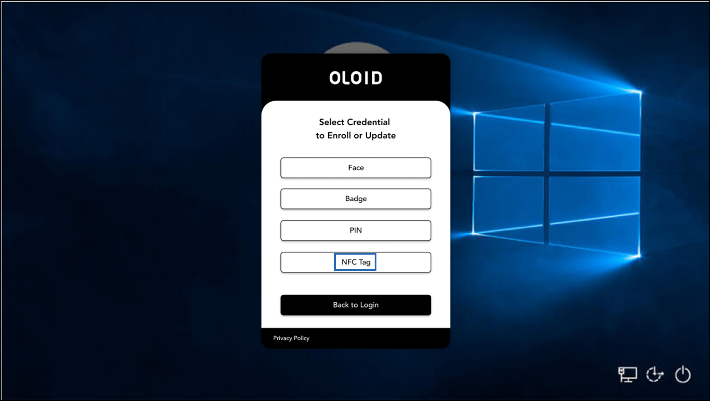

   The **Scan your NFC Tag to Enroll** screen is displayed.
7. Scan your NFC Tag in the Card Reader.

   

8. Click **Submit**.
   The NFC Tag is enrolled successfully.

   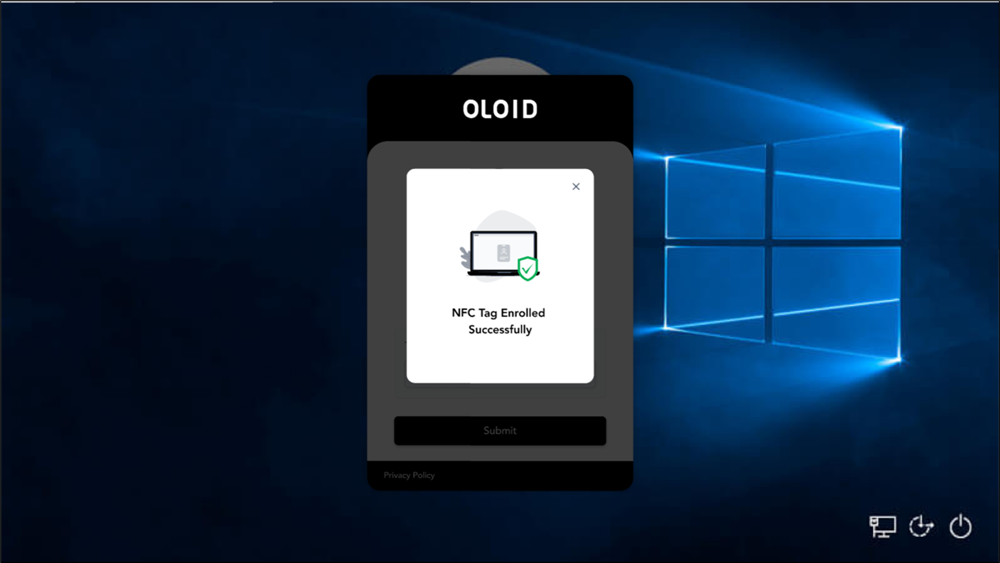
