{/* Source: Intercom article 15500503 -  */}
{/* Generated by intercom_to_mintlify.py - re-running overwrites this file. */}

## Introduction

This document explains how to configure the Post-login Module for a Windows Login endpoint in the Tenant Admin Portal. You can enable the module, choose how users authenticate after Windows login, and set the triggers and actions that run once a user is authenticated.

## Prerequisites

- You must have admin access to the Tenant Admin Portal.
- Ensure **Windows Post-login Module** is enabled.
- Ensure the 'Enable Badge Out' feature (Tap to Lock/Logout) is not active in the linked Application's Configure tab.

## Steps to Configure the Post-login Module

1. Log in to the **Tenant Admin Portal**.
2. On the home page of the portal, click **Endpoints** on the left menu panel.

   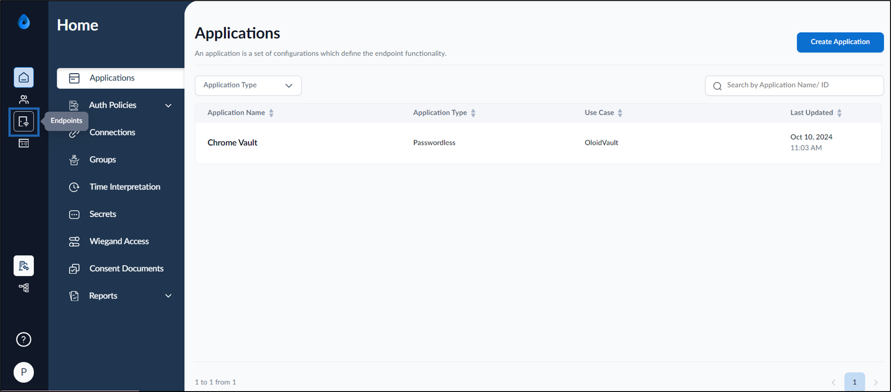

   The Endpoints page is displayed.

   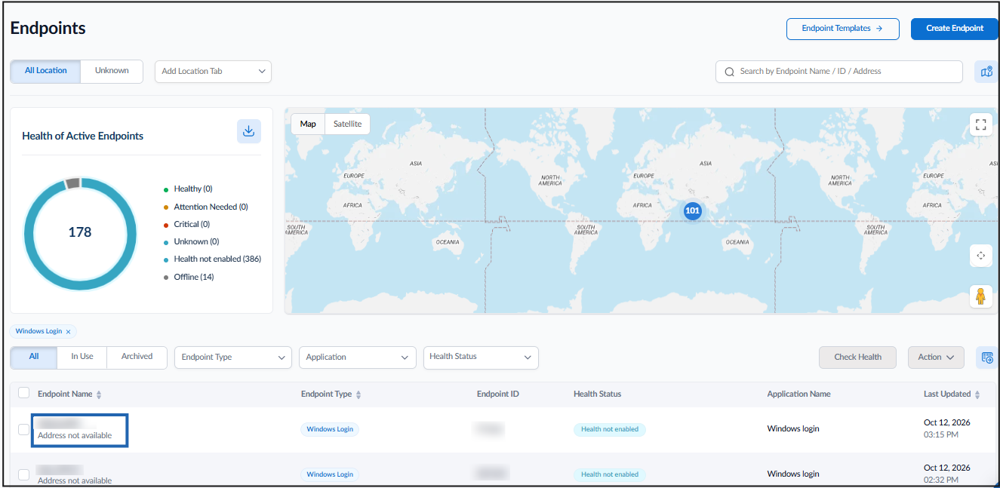

3. Click an endpoint name to edit from the listed endpoints.
   The Endpoint details page is displayed.

   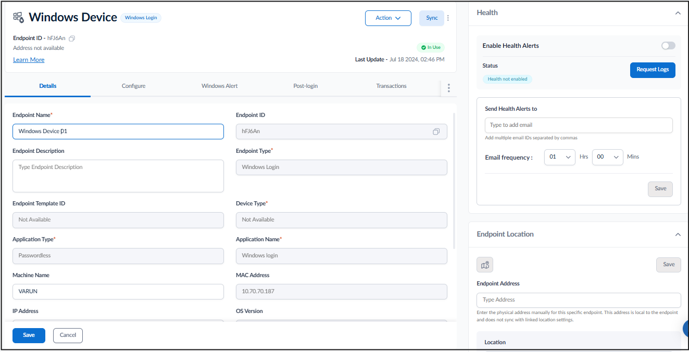

4. Click the **Post-login** tab.

   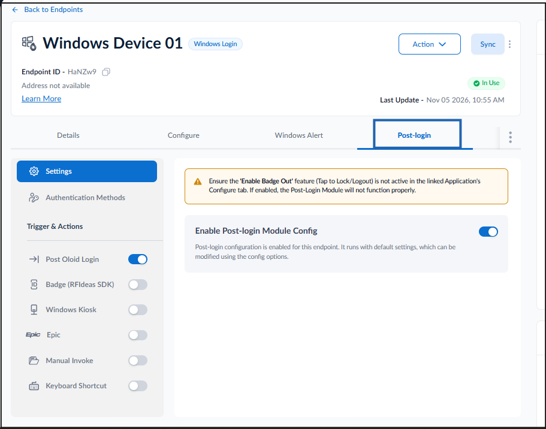

   The **Settings** tab is displayed by default.
5. Do the following:
   [Configure Settings Tab](#configure-settings-tab)
   [Configure Authentication Methods](#configure-authentication-methods)
   [Configure Triggers and Actions](#configure-triggers-and-actions)

### Configure Settings Tab

1. Turn on the **Enable Post-login Module Config** toggle.
2. Click **Save.**

   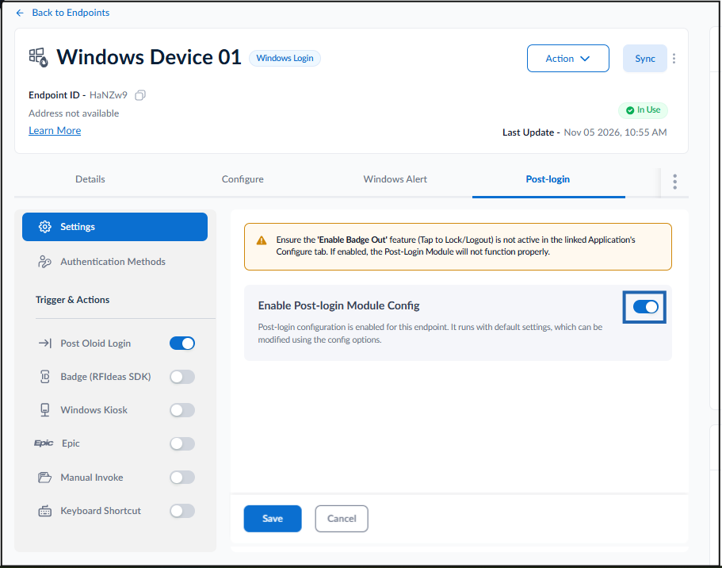

   The Post-Login Module Config is successfully enabled.

### Configure Authentication Methods

1. Click **Authentication Methods**.
   The **Authentication options for Post login session** section is displayed. These options control how users authenticate after Windows login, for example in Epic, Okta or browser logins.
2. Select one of the following options:
   - **Re-authenticate using Application factors:** Users must authenticate again using all factors enabled at the application level.
   - **Honor Oloid’s local session token:** Users are validated with the latest local Oloid authentication session token.
   - **Honor Oloid’s cloud session token (for Citrix):** Users are validated with the latest cloud Oloid authentication session token. Use this option for Citrix environments.
3. If you selected **Honor Oloid’s local session token** or **Honor Oloid’s cloud session token (for Citrix)**, choose what happens under **On session Expiry/ Time-out**:
   - **Do Nothing:** Exits the Post-login Module and creates a post-login activity log.
   - **Re-authenticate using Application factors:** Users must authenticate again using all factors enabled at the application level.

     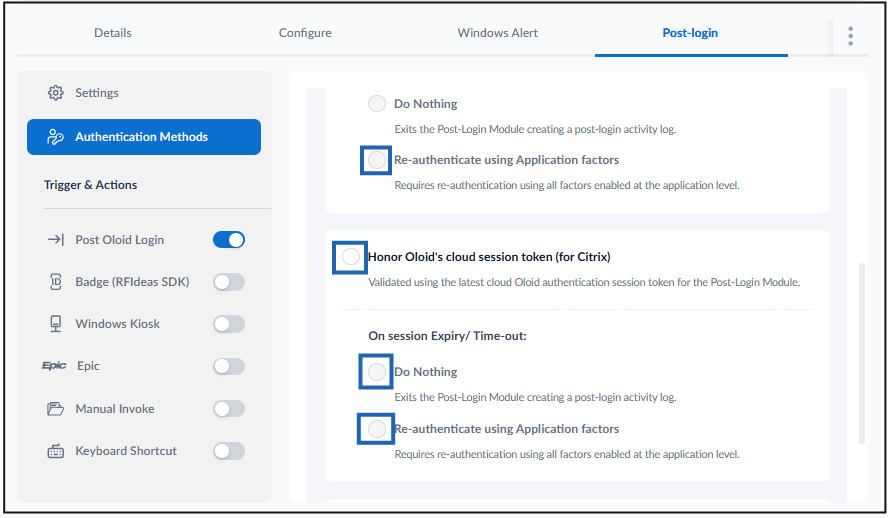

4. Under **Time-Out Limit**, select the minutes (**Mins**) and seconds (**Sec**) to set how long a session token stays valid.
5. Click **Save**.

   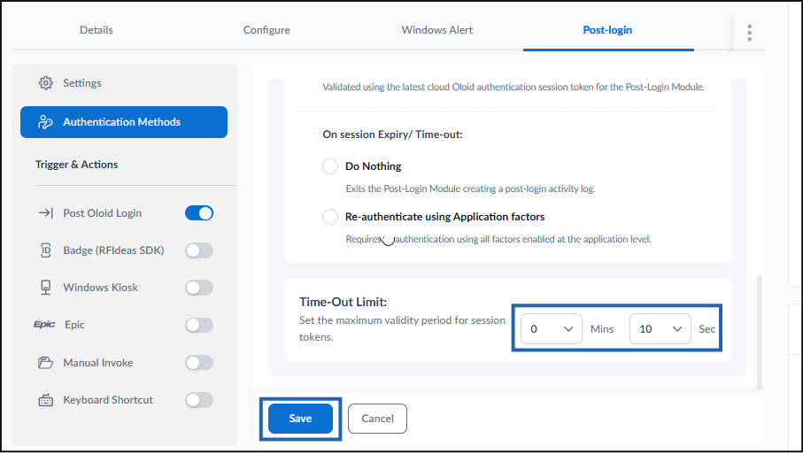

### Configure Triggers and Actions

Do the following:

[Post Oloid Login](#post-oloid-login)

[Configure Badge (RFIdeas SDK)](#configure-badge-rfideas-sdk)

[Configure Windows Kiosk](#configure-windows-kiosk)

[Configure Epic](#configure-epic)

[Configure Manual Invoke](#configure-manual-invoke)

[Configure Keyboard Shortcut](#configure-keyboard-shortcut)

#### Post Oloid Login

1. Click **Post Oloid Login** tab.
2. Enable **Post Oloid Login** toggle.
3. The Post Oloid Login trigger starts the post-login process when a user logs in through the Oloid Credential Provider. For more information, refer to

   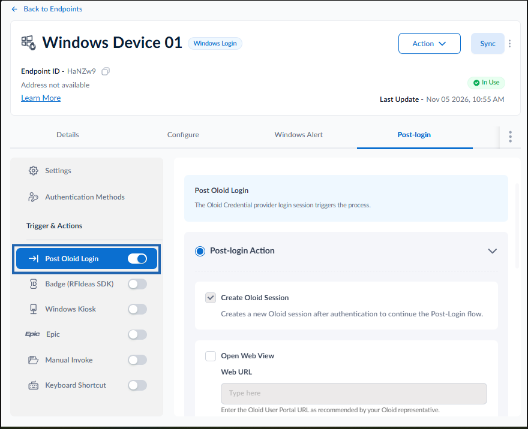

#### Configure Badge (RFIdeas SDK)

1. Click **Badge(RFIdeas SDK)** tab.
2. Enable the **Badge (RFIdeas SDK)** toggle.
   **Post-login Action** is selected by default.
3. Do one of the following:
   1. Select **Post-login Action** to run actions after the user authenticates. Then select the actions you want to run:
      - **Create Oloid Session:** Creates a new Oloid session after authentication so the post-login flow can continue.
      - **Open Web View:** Opens a web view. In **Web URL**, enter the Oloid User Portal URL your Oloid representative recommends.

        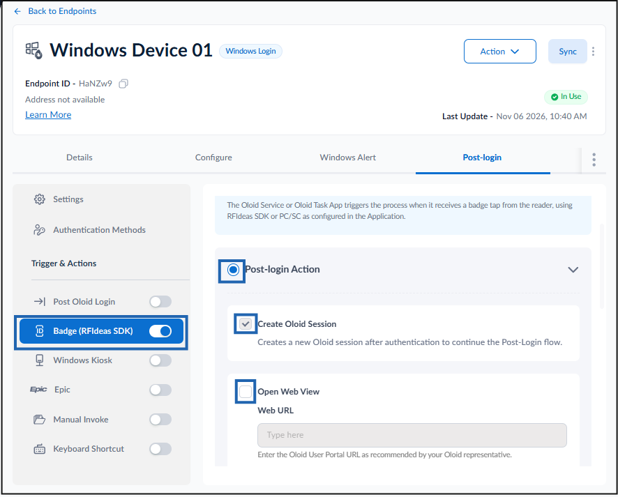

      - **Invoke a .SH script file:** Runs a script. In **File Path**, enter the local path to the .SH script file.
      - **Open Browser with configured URL:** Opens the browser. In **Web URL**, enter the Auto-SSO URL your Oloid representative provides.
      - **Redirect to EPIC SAML SDK:** Redirects to Epic for SAML login. In **Dynamic Client ID**, enter the static client ID.

        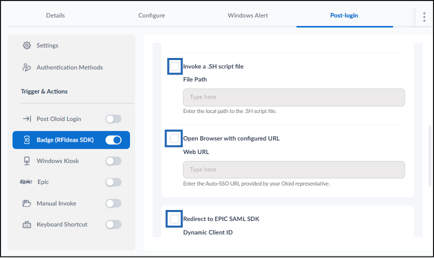

      - **End Post-login Action:** Ends the Post-login Module. Logs are generated and available in the Activity Log.
   2. Select **Lock/Sign Out Action** to lock or sign out the session when the badge is tapped.
4. Click **Save**.

   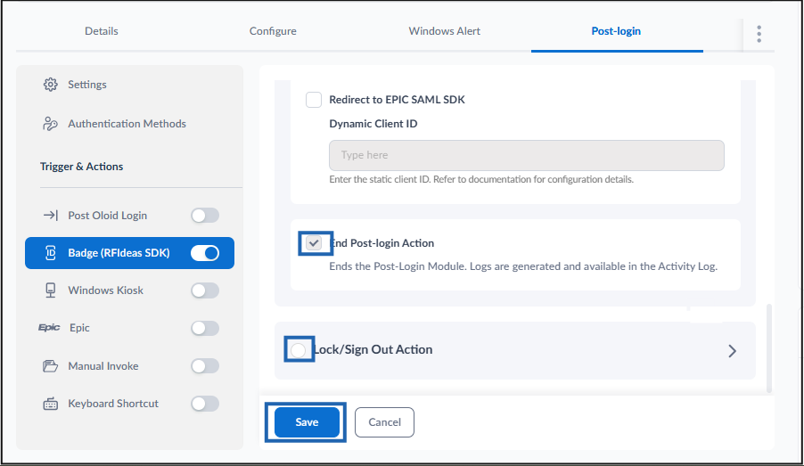

#### Configure Windows Kiosk

1. Click **Windows Kiosk** tab.
2. Enable the **Windows Kiosk** toggle.
   When the device runs in Windows Kiosk Mode, the post-login process can be triggered through either the Oloid Shell or the native Windows Shell.
   **Post-login Action** is selected by default.
3. Select **Post-login Action** to run actions after the user authenticates. Then select the actions you want to run:
   - **Create Oloid Session:** Creates a new Oloid session after authentication so the post-login flow can continue.
   - **Open Web View:** Opens a web view. In **Web URL**, enter the Oloid User Portal URL your Oloid representative recommends.

     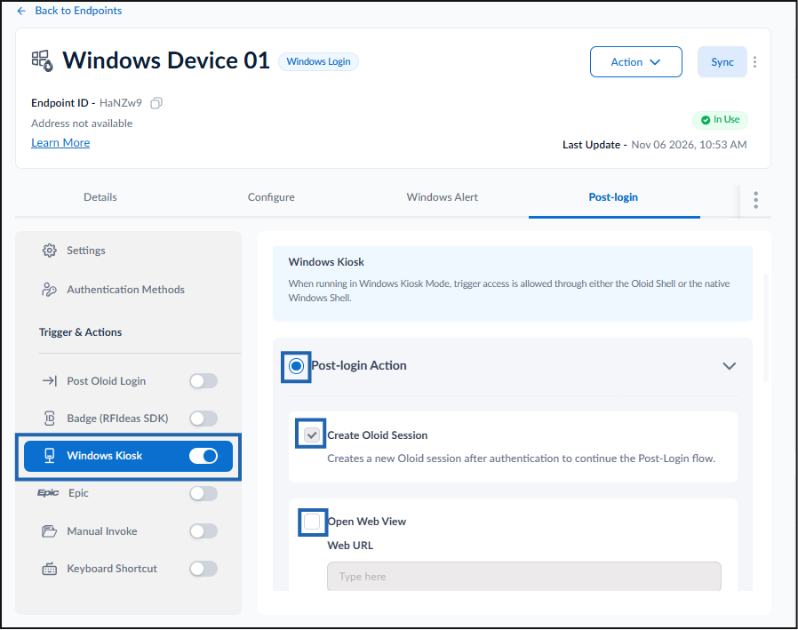

   - **Invoke a .SH script file:** Runs a script. In **File Path**, enter the local path to the .SH script file.
   - **Open Browser with configured URL:** Opens the browser. In **Web URL**, enter the Auto-SSO URL your Oloid representative provides.
   - **Redirect to EPIC SAML SDK:** Redirects to Epic for SAML login. In **Dynamic Client ID**, enter the static client ID.

     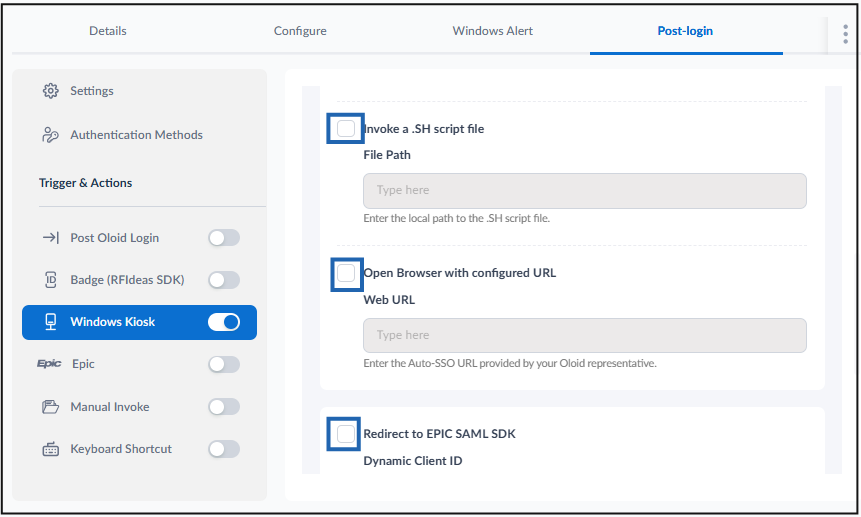

   - **End Post-login Action:** Ends the Post-login Module. Logs are generated and available in the Activity Log.
     *Note:* **Lock/Sign Out Action** is coming soon for the Windows Kiosk trigger.
4. Click **Save**.

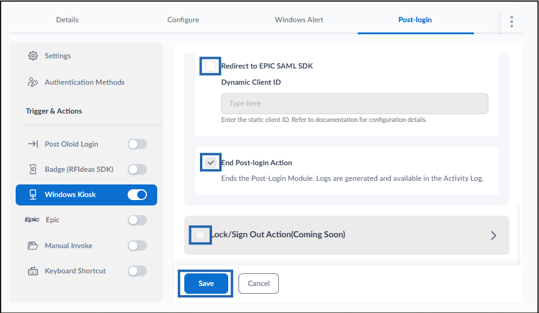

#### Configure Epic

1. Click **Epic** tab.
2. Enable the **Epic** toggle.
   When the Epic Communication Module is enabled, Epic EHR calls it to start the post-login process.
   **Post-login Action** is selected by default.
3. Select **Post-login Action** to run actions after the user authenticates. Then select the actions you want to run:
   - **Create Oloid Session:** Creates a new Oloid session after authentication so the post-login flow can continue.
   - **Open Web View:** Opens a web view. In **Web URL**, enter the Oloid User Portal URL your Oloid representative recommends.

     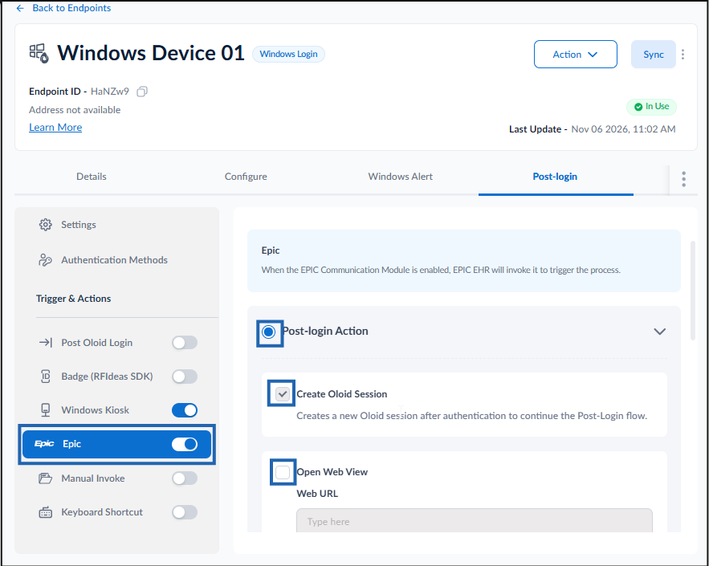

   - **Invoke a .SH script file:** Runs a script. In **File Path**, enter the local path to the .SH script file.
   - **Open Browser with configured URL:** Opens the browser. In **Web URL**, enter the Auto-SSO URL your Oloid representative provides.
   - **Redirect to EPIC SAML SDK:** Redirects to Epic for SAML login. In **Dynamic Client ID**, enter the static client ID.

     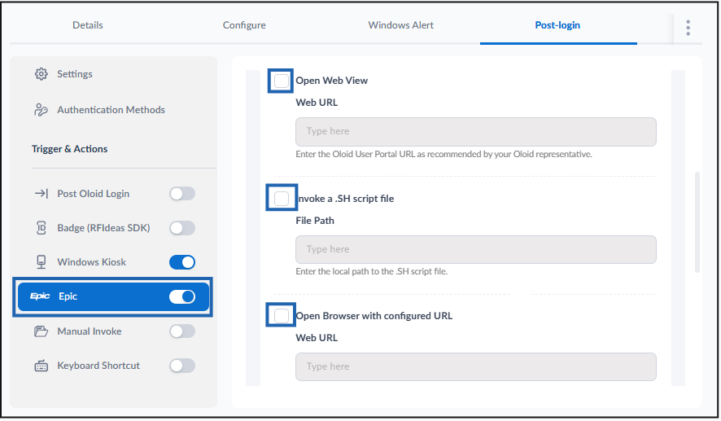

   - **End Post-login Action:** Ends the Post-login Module. Logs are generated and available in the Activity Log.
     *Note:* **Lock/Sign Out Action** is coming soon for the Epic trigger.
4. Click **Save**.

   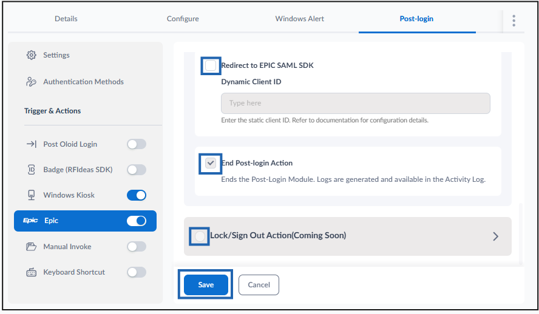

#### Configure Manual Invoke

#### Click **Manual Invoke** tab.

2. Enable the **Manual Invoke** toggle.
   The post-login process runs when the executable (.exe) file is opened directly. **Post-login Action** is selected by default.
3. Select the actions you want to run:
   - **Create Oloid Session:** Creates a new Oloid session after authentication so the post-login flow can continue.
   - **Open Web View:** Opens a web view. In **Web URL**, enter the Oloid User Portal URL your Oloid representative recommends.

     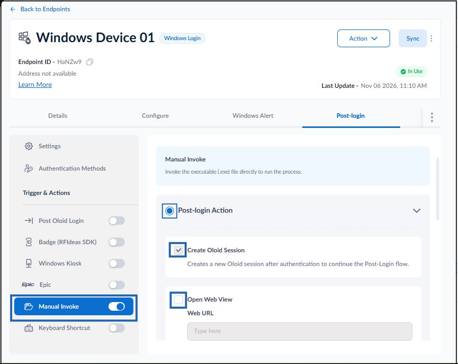

   - **Invoke a .SH script file:** Runs a script. In **File Path**, enter the local path to the .SH script file.
   - **Open Browser with configured URL:** Opens the browser. In **Web URL**, enter the Auto-SSO URL your Oloid representative provides.
   - **Redirect to EPIC SAML SDK:** Redirects to Epic for SAML login. In **Dynamic Client ID**, enter the static client ID.

     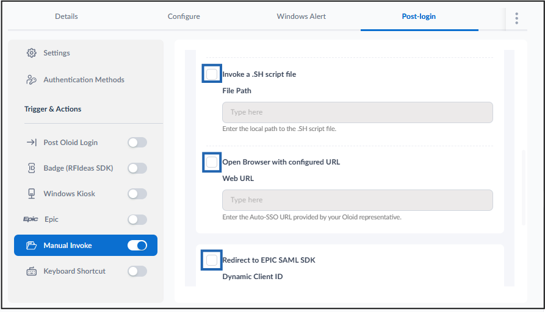

   - **End Post-login Action:** Ends the Post-login Module. Logs are generated and available in the Activity Log.
     *Note:* **Lock/Sign Out Action** is coming soon for the Manual Invoke trigger.
4. Click **Save**.

   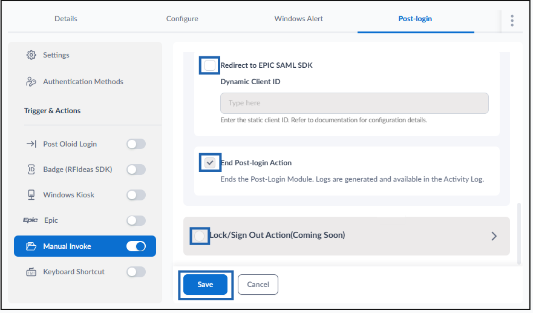

#### Configure Keyboard Shortcut

1. Click **Keyboard Shortcut** tab.
2. Enable the **Keyboard Shortcut** toggle.
3. The post-login process runs when the user presses the keyboard shortcut. The default shortcut is **Ctrl+O** on Windows or **Command+O** on Mac.
   **Post-login Action** is selected by default.
4. Select the actions you want to run:
   - **Create Oloid Session:** Creates a new Oloid session after authentication so the post-login flow can continue.

     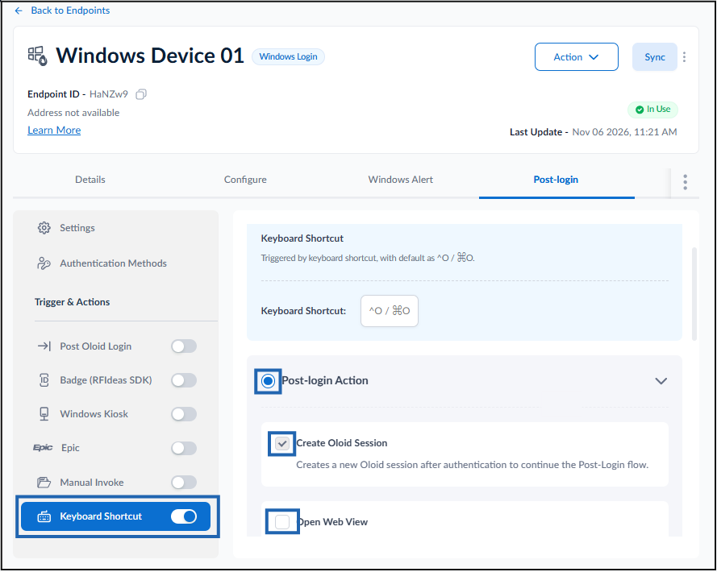

   - **Open Web View:** Opens a web view. In **Web URL**, enter the Oloid User Portal URL your Oloid representative recommends.
   - **Invoke a .SH script file:** Runs a script. In **File Path**, enter the local path to the .SH script file.
   - **Open Browser with configured URL:** Opens the browser. In **Web URL**, enter the Auto-SSO URL your Oloid representative provides.
   - **Redirect to EPIC SAML SDK:** Redirects to Epic for SAML login. In **Dynamic Client ID**, enter the static client ID.

     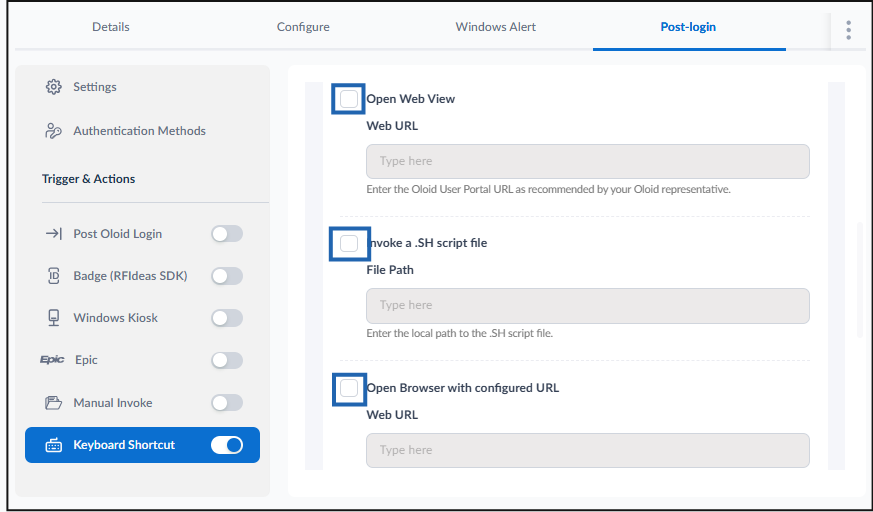

   - **End Post-login Action:** Ends the Post-login Module. Logs are generated and available in the Activity Log.
     *Note:* **Lock/Sign Out Action** is coming soon for the Keyboard Shortcut trigger.

Click **Save**.

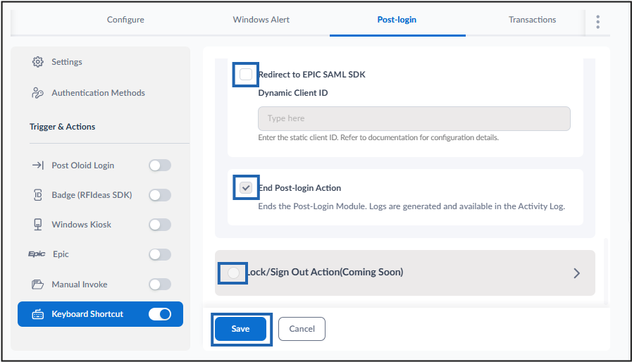
