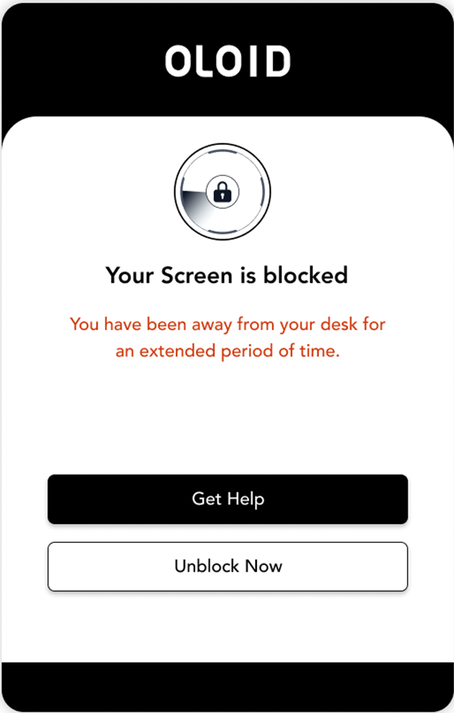
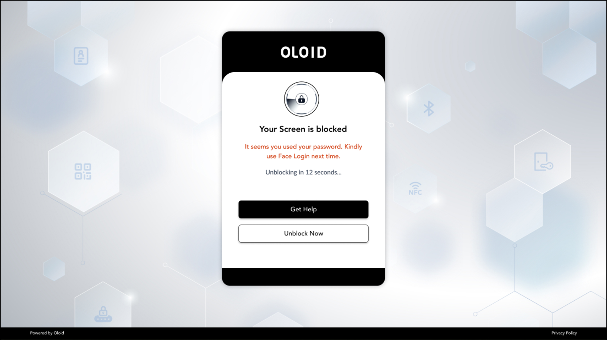

{/* Source: Intercom article 16980564 -  */}
{/* Generated by intercom_to_mintlify.py - re-running overwrites this file. */}

## Screen block on Check Emotion (Emotion Detected)

This document provides instructions for users to take action when their Windows screen is blocked by the Presence Detection feature during a session. Presence Detection uses facial, gaze tracking, head pose tracking, and emotion classification to monitor user attentiveness.

## Requirement for Presence Detection Feature

1. Your Windows system must be registered for Presence Detection.
2. The "Multiple Faces Detected" option must be enabled by your admin at the endpoint level.

## Steps to Take if Your Screen is Blocked

1. **Click "Get Help" to contact your Support team and report screen block.**
   - The Support Team will notify your supervisor of the event.
   - The supervisor will review and unblock your screen.
2. **Click "Unblock Now" after Supervisor confirms of screen unblock.**
   - Your screen will be unblocked, and you can resume work.
3. **If the screen remains blocked and the "Unblock Failed" popup appears:**
   - Contact your supervisor to reach out to Oloid Support.

<Note>
  **Note:** Without Supervisor approval, your screen will automatically be unblocked after the specified time duration if auto unblock is enabled for that endpoint.
</Note>

For more information on auto unblock, see [How the Self-Unblock Feature Works in Windows Login Presence Detection](/platforms/windows/windows-login/how-the-self-unblock-feature-works-in-windows-login-presence-detection)

