{/* Source: Intercom article 16904142 -  */}
{/* Generated by intercom_to_mintlify.py - re-running overwrites this file. */}

## Introduction

This document provides step-by-step instructions for configuring the Card Reader using the RF IDEAS Configuration Utility for Oloid Connect.

## Prerequisites

Before you begin, make sure you have:

- A compatible rf IDEAS badge reader.
- The required badge or card.
- The rf IDEAS Configuration Utility installed on your laptop.

<Note>
  **Note:** This document is based on the following configuration:
</Note>

| Item | Details |
| --- | --- |
| Utility application version | rf IDEAS Configuration Utility v6.15 |
| Badge readers used | RDR-80531BKU, RDR-80536BKU |
| Card type used | HID Prox |

Steps, screenshots, and behavior may differ with other versions of the utility application, other badge reader models, or other card types. If your setup differs, or you need help, contact [Oloid Support](mailto:support@oloid.ai).

---

## To configure rfIDEAS for SDK Type Reader

Follow the below steps:

1. [Identify the card type](#identify-the-card-type)
2. Verify reader compatibility
3. [Configure the reader using Auto-Config](#configure-the-reader-using-auto-config)
4. [Steps to Retrieve Configured Badge Values](#steps-to-retrieve-configured-badge-values)
5. [Convert the 12-digit Decimal value into a 5-digit Decimal value](#convert-the-12-digit-decimal-value-into-a-5-digit-decimal-value) (if required)

### Identify the card type

1. Launch the **rf IDEAS Configuration Utility** app.

   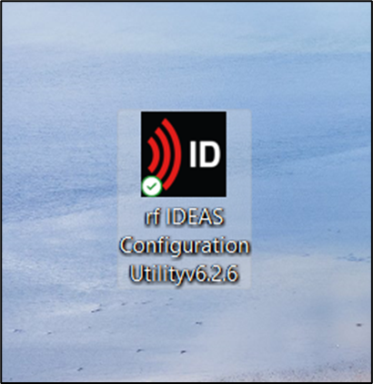

   The app opens.
2. Connect the card reader to the system.
3. Once the badge reader is connected to the laptop, Click On the **“Connect”** button in the **rf IDEAS Configuration Utility**

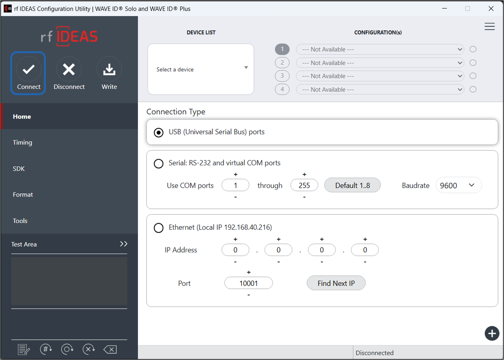

The **Reader ID** is displayed in the **Device List** section.

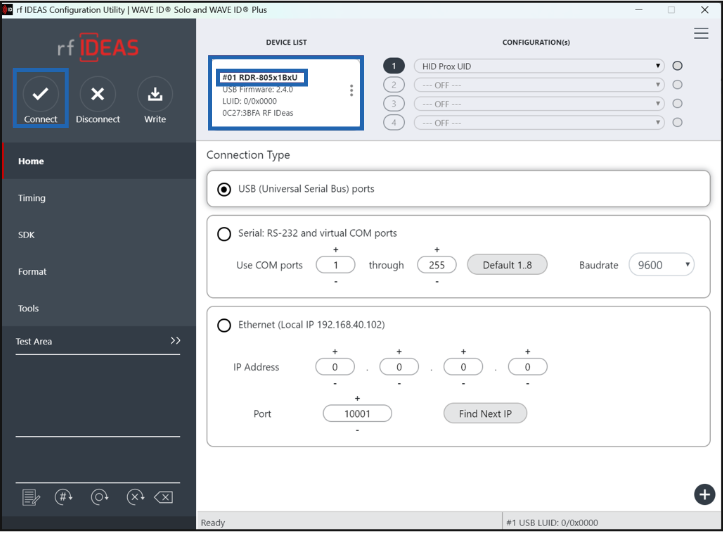

### Verify Badge Type and Reader Compatibility

1. Select the **Tools** option from the **rf IDEAS Configuration Utility** menu.

   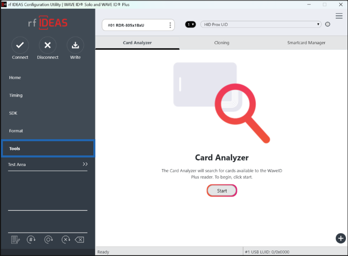

2. Place the card/badge on the reader.
3. Click **Start** in the “**Card Analyzer**” section.

   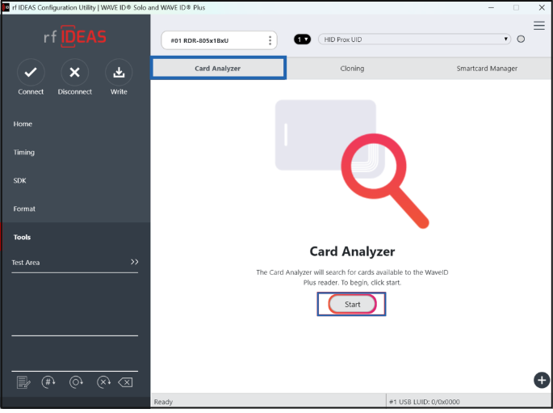

4. Click **Learn Card** to begin identifying the badge/card.

   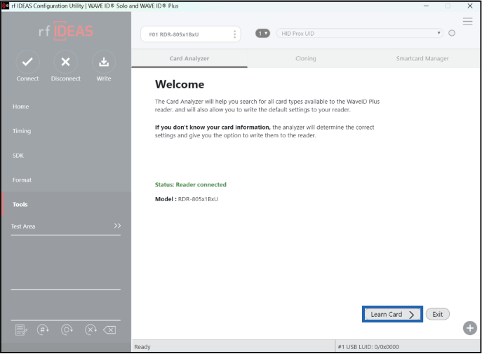

   The Learn Card screen is displayed.
5. Click **Start Scan** to begin scanning the badge/card.

   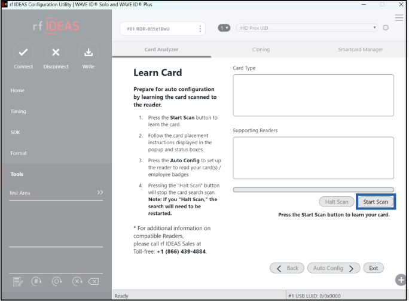

Place the badge/card on the reader and click “**OK**” on the pop-up window that appears.

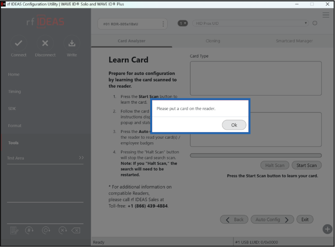

The badge scanning process starts, and a **“Scanning in Progress”** message is displayed. Wait until the scanning process is complete.

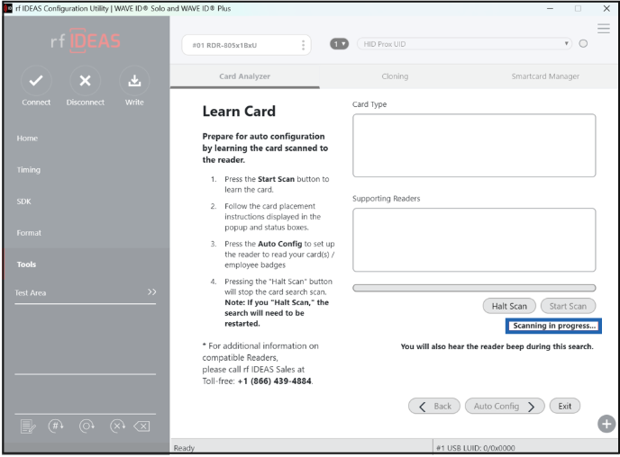

Once the scanning is complete, the identified card type is displayed in the “**Card Type**” field. The “**Supporting Readers**” field displays a list of rf IDEAS readers that support the identified card type.

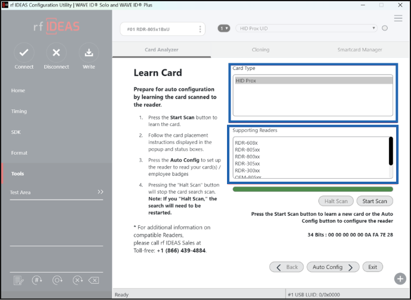

<Note>
  **Note:** Card Type : Identifies the type of RFID card/Badge.
</Note>

Supporting Readers : The reader models that can read that card type.

### Configure the reader using Auto-Config

1. Click “**Auto Config**” to automatically configure the reader to read the Card ID, of the scanned badge/card.

   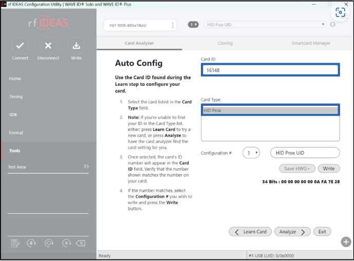

   <Note>
     **Note:** The Card ID of the scanned/configured card will be displayed in the **Card ID** field, as illustrated in the image below. For example, **16148** represents the Card ID of the card that has been scanned/configured.
   </Note>

2. Click the **Write** button to save the configuration.

   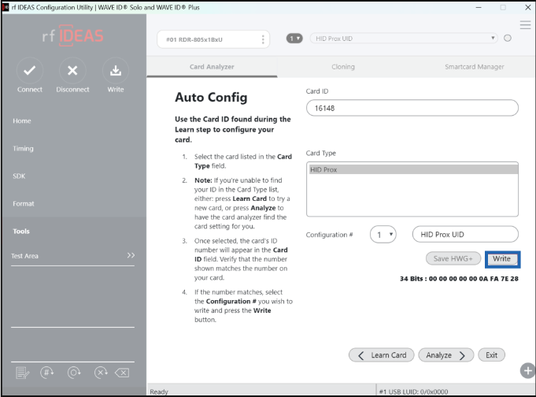

3. Remove the card from the reader, then click **OK** on the pop-up message.

   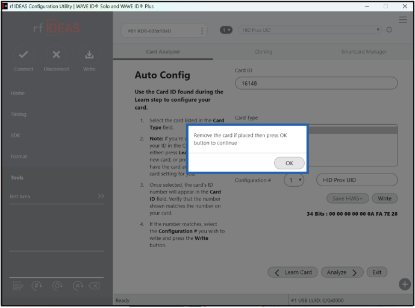

4. Finally, click the **Exit** button to navigate to home screen.

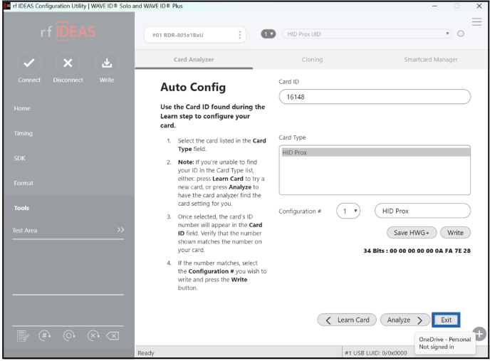

<Note>
  **Note:** The steps outlined above are intended solely for configuring the required values on the Badge/Card using the **Auto Config File**.
</Note>

### Steps to Retrieve Configured Badge Values

Ensure the **RF IDeas reader** is connected to the laptop and is displayed in the **Device List** section.

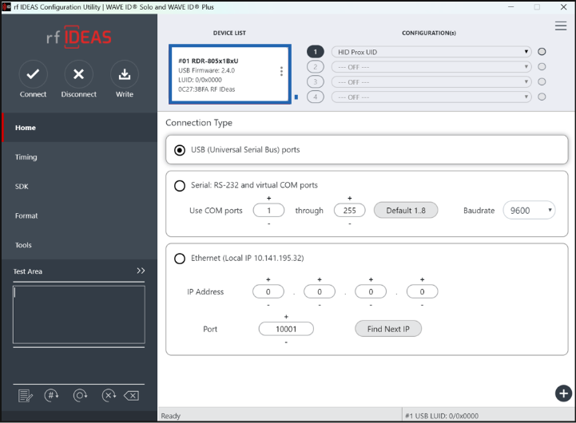

1. Select a **valid card type** from the **Configuration(s) Dropdown**.

   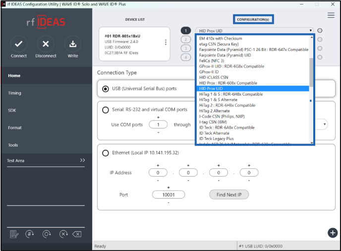

   <Note>
     **Note:** The **Configuration(s) Dropdown** refers to the type of card/badge being used to obtain the **badge value**. Select the card type based on the badge type identified earlier.
   </Note>

   Ex : HID Prox, HID iClass CSN,
   **→** “ Based on the badge type identified earlier, select the corresponding card type from the **Configuration(s) Dropdown**.”
   **→** If multiple supporting card types are identified in the card configuration, you can select any one of them.
   **→** If an invalid badge type is selected in the **Configuration(s) Dropdown**, the reader will not read the badge value.
2. Navigate to the **SDK** section in the **RF IDeas Utility Software**.
3. Turn off the **Disable Keystrokes for SDK** toggle button.

   <Note>
     **Note:** If **“Disable Keystroke for SDK”** is already turned off, proceed without making any changes to this setting.
   </Note>

   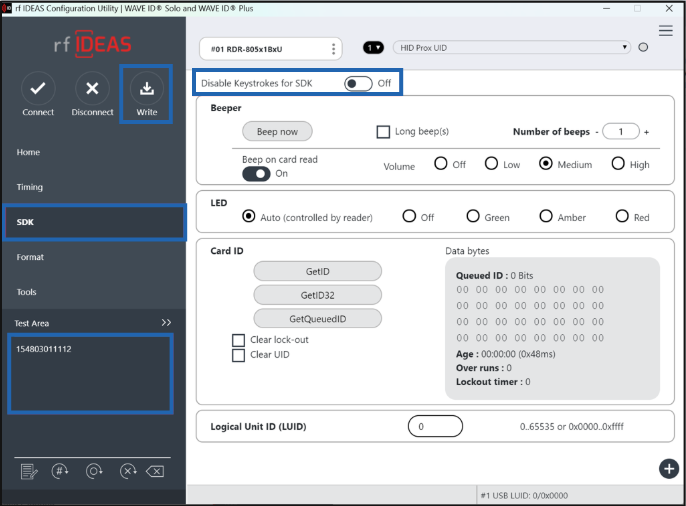

4. Select a **valid card type** from the **Configuration(s) Dropdown**.
5. Click **Write** to save and apply the latest configuration changes.

   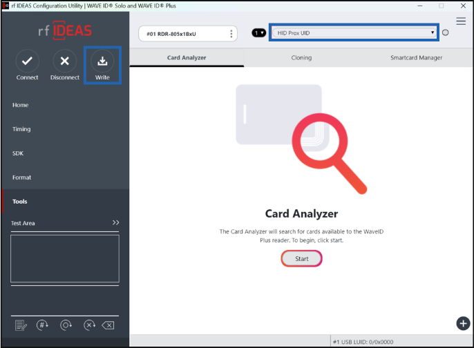

6. Click on the **Text Area** and scan the badge using the reader. If the correct configuration is applied, the reader will read the badge value and display it in the **Text Area**. By default, the badge value is displayed in **Decimal value (12 digits)** format.

   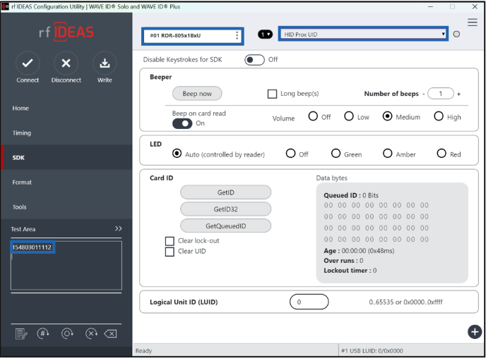

### Convert the 12-digit Decimal value into a **5-digit Decimal value**

By default, the badge value is displayed in **12-digit Decimal format.** The following configuration and steps explain how to convert the 12-digit Decimal value into a **5-digit Decimal value**.

1. In the left menu panel, select **Format** > **Data Format**

   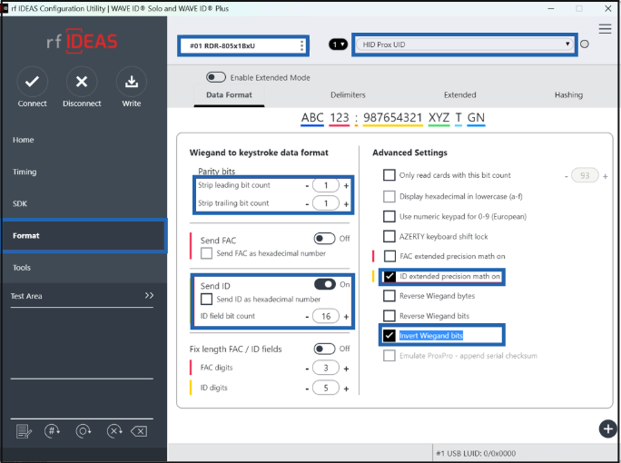

2. In the **Data Format** tab, do the following:
   1. Under **Wiegand to Keystroke Data Format → Parity Bits**:
      - Set **Strip Leading Bit Count** to **1**.
      - Set **Strip Trailing Bit Count** to **1**.
      - Turn **Send ID ON**
   2. In the Under **Advanced Settings**:
      - Check the **“ID Extended Precision Math On”** checkbox.
      - Check the **“Invert Wiegand Bits”** checkbox.

        <Note>
          **Note:** By default ID value is set to 5. Enable FAC /ID field and set ID digit value as per your requirement , based on configured value you will get the output.
        </Note>

        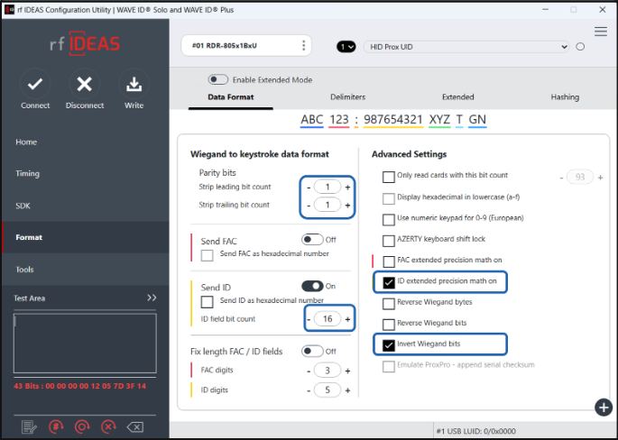

3. Click **Write** to save and apply the latest configuration changes.

   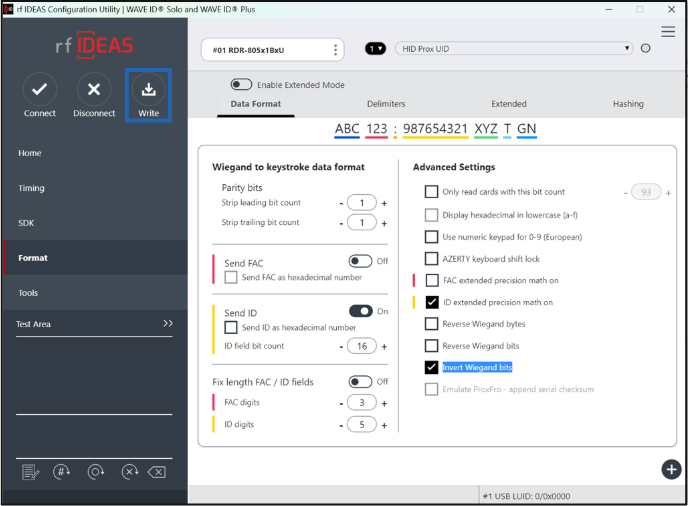

4. Click on the **Test Area** and scan the badge using the reader. If the correct configuration is applied, the reader will read the badge value and display it in the **Text Area**. By default, the badge value is displayed in **Decimal value (5 digits)** format.

   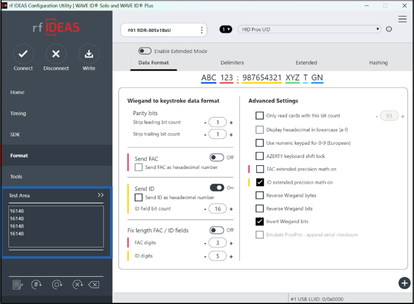

### Verify Badge Value Consistency

After completing the configuration, scan the same badge multiple times. The reader should return the **same badge value every time**. The badge value should remain consistent and should not change between scans.
