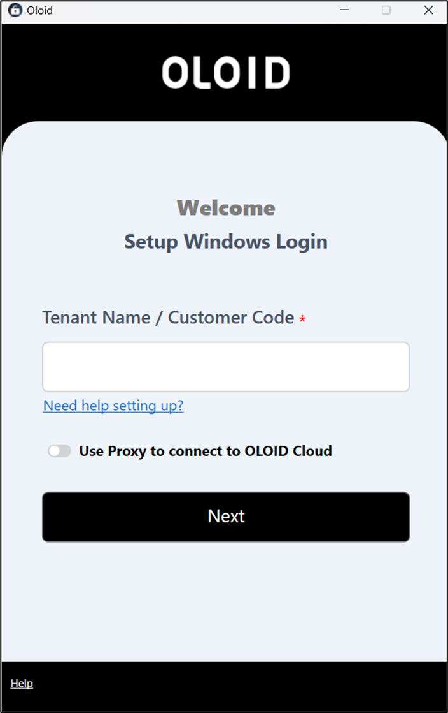
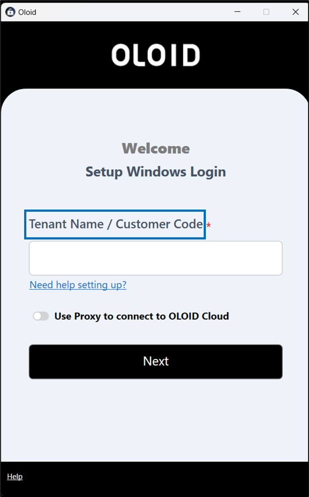
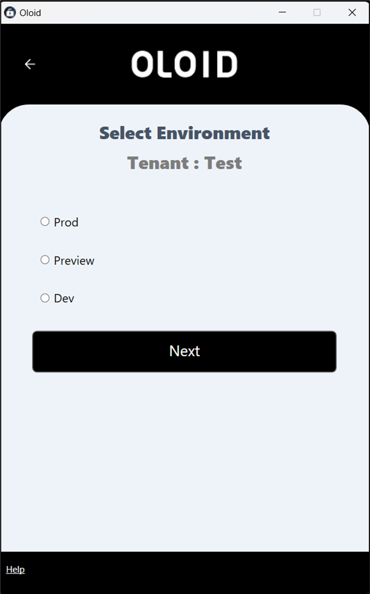
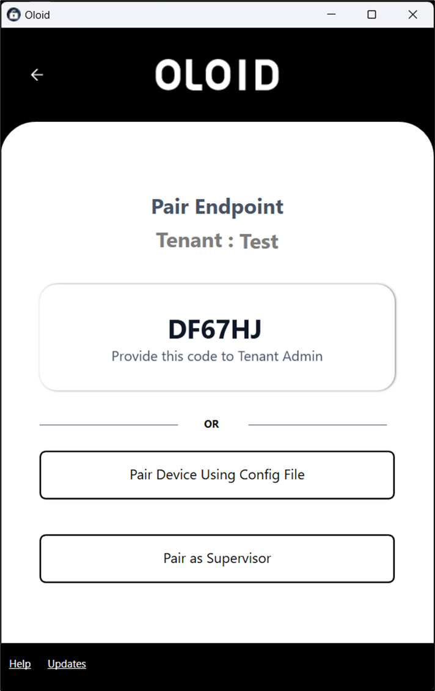

{/* Source: Intercom article 8629775 - https://oloid.help/en/articles/8629775-configuring-windows-device-app-with-tenant-name */}
{/* Generated by intercom_to_mintlify.py - re-running overwrites this file. */}

Steps to configure Windows Device app:

1. Double-click on the **Windows Device** app to open.
   The **Welcome** page is displayed.

   

2. Enter tenant name in the **Tenant Name / Customer Code** field.

   

3. Click **Next**.
   If the tenant name is available in different environments then **Select Environment** page is displayed.

   

4. Select an environment and click **Next**.

The Windows device is configured with the tenant. You can now activate the endpoint to use the app.

To know more, refer here

- [How to download **Windows Device login** app installer files?](/drafts/unassigned/intercom/how-to-download-windows-device-login-installer-files)
- [How to install **Windows Device login** app?](/platforms/windows/windows-login/how-to-install-and-configure-windows-login-agent-app)
