{/* Source: Intercom article 8385046 - https://oloid.help/en/articles/8385046-creating-passwords-and-shared-credentials-for-users-in-oloid-platform-user-guide */}
{/* Generated by intercom_to_mintlify.py - re-running overwrites this file. */}

## TOC

**[Introduction](#introduction)**

**[Pre-requisite](#pre-requisite)**

**[Accessing Oloid Portal](#accessing-oloid-portal)**

- [To set new Password](#to-set-new-password)
- [To Access Oloid Portal](#to-access-oloid-portal)

**[Create and Manage Users](#create-and-manage-users)**

- [To Create a User](#to-create-a-user)
- [To Import Users](#to-import-users)

**[Create and Invite Tenant Admin](#create-and-invite-tenant-admin)**

- [To invite Tenant Admin](#to-invite-tenant-admin)
- [To Create and Invite Tenant admin](#to-create-and-invite-tenant-admin)

**[Create and Manage Credentials](#create-and-manage-credentials)**

- [To Create Password](#to-create-password)
- [To Edit Password](#to-edit-password)
- [To Delete Password](#to-delete-password)
- [To Create PIN](#to-create-pin)
- [To Add Badge](#to-add-badge)

**[Create and Manage Shared Credentials](#create-and-manage-shared-credentials)**

- [To Create shared Credential](#to-create-shared-credential)
- [To Edit Shared Credential](#to-edit-shared-credential)
- [To Delete Shared Credential](#to-delete-shared-credential)

## Introduction

This document provides step-by-step instructions to create password and shared credential for users in the Oloid Portal.

## Pre-requisite

You must be a user in the Oloid Portal.

## Accessing Oloid Portal

To access Oloid Portal, you should be a tenant admin. Once the tenant admin account is created, you will receive the URL and credentials (username and temporary password) for the portal on your registered email id.

### To set new Password

1. Launch your browser.
2. Enter the URL provided for you in the browser’s address bar. Then, press **Enter** on your keyboard.
3. Enter your login information in the appropriate fields.

   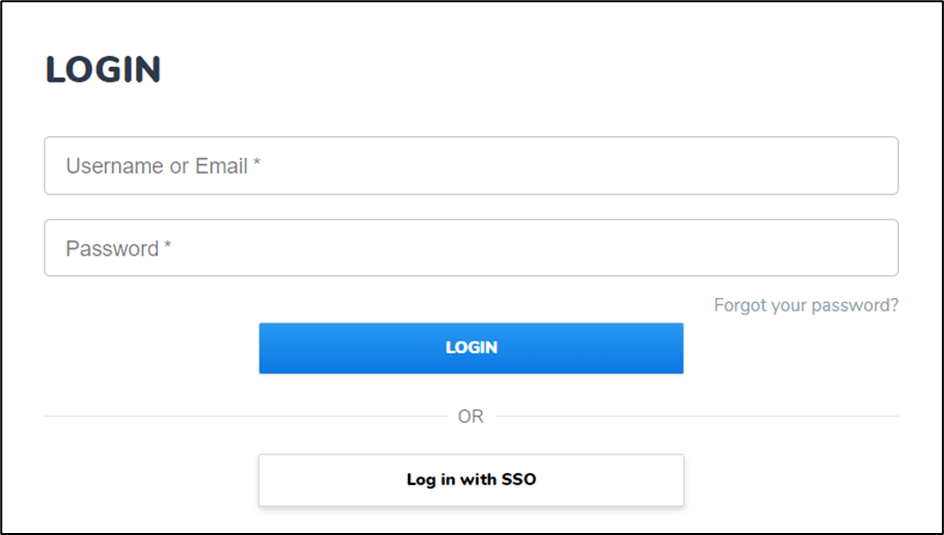

4. Click **LOGIN**.
   The **Set New Password** screen is displayed.

   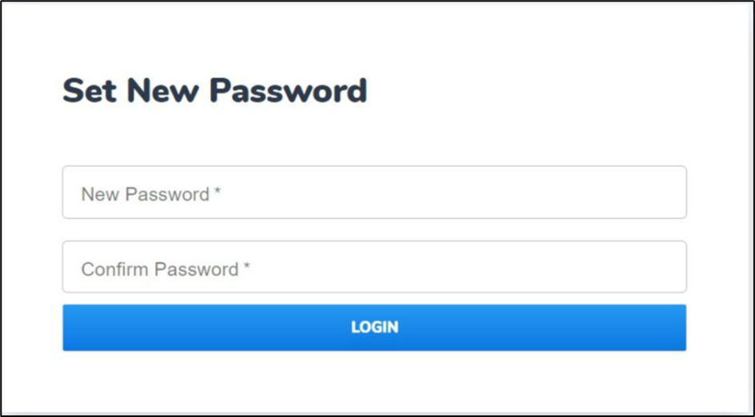

5. Enter New Password.

   <Note>
     **Note:** Password must contain at least one uppercase, one lowercase letter, one number, no consecutive or sequence characters The password should not contain any part of username.
   </Note>

6. Enter Confirm Password.
7. Click **LOGIN**.
   The Oloid Portal is displayed.

### To Access Oloid Portal

**Pre-requisite**: You should be a user with Tenant Admin role.

1. Launch your browser.
2. Enter the URL provided for you in the browser’s address bar. Then, press **Enter** on your keyboard.
3. Enter your login information in the appropriate fields.

   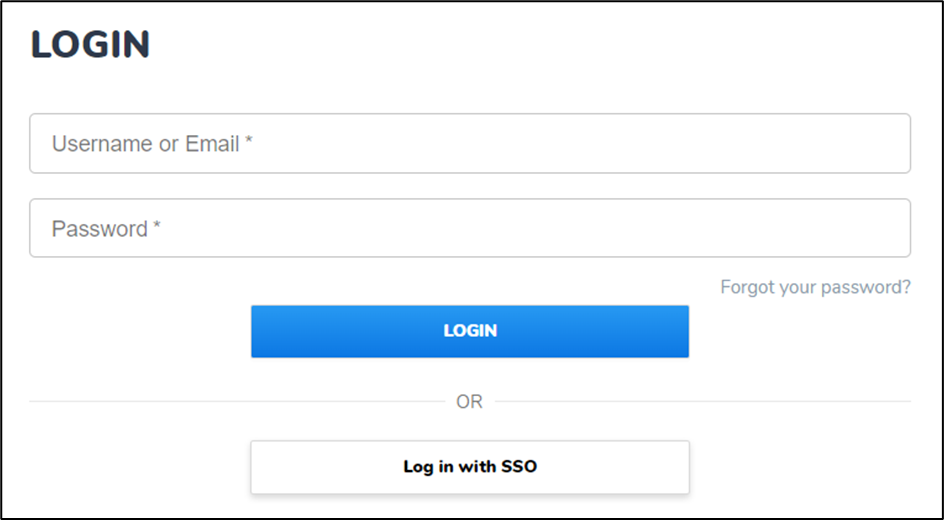

4. Click **LOGIN**.
   The Oloid Portal is displayed.

   <Note>
     **Note:** Oloid uses **SSO login** and also allows you to log in to the portal with your Google, Microsoft, Okta, or with your Email account.
   </Note>

## Create and Manage Users

Tenant Admin is granted rights to manage and access the users related to the tenant.

### To Create a User

1. Log in to the **Oloid Portal**.
2. . On the home page of the portal, click **Users** on the left menu panel.
   The User page is displayed.

   

3. Click **CREATE USER** on the top right corner of the page.

   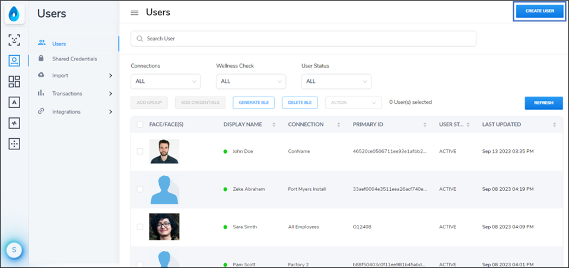

   The **Create a new user** pop-up page is displayed.

   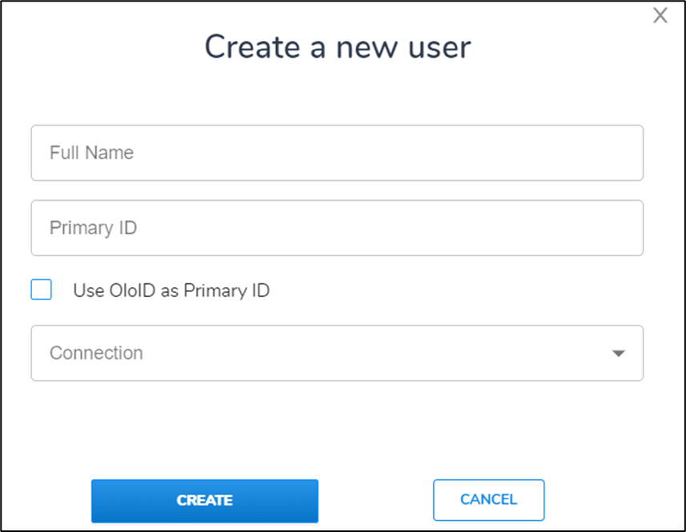

4. Enter **Full Name** of the user.
5. Enter **Primary ID** (optional).
6. Select **Use OloID as Primary ID** to use OloID for your primary ID.
7. Select connection from the **Connection** list.
8. Click **CREATE**.
   The new user is created and listed on the **Users** page.

   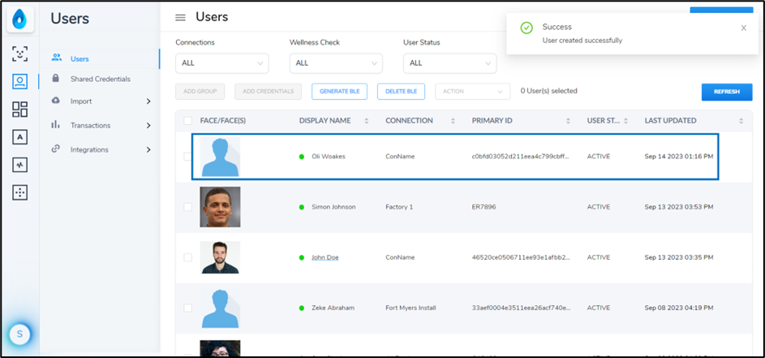

### To Import Users

1. Go to the **Users** page.

   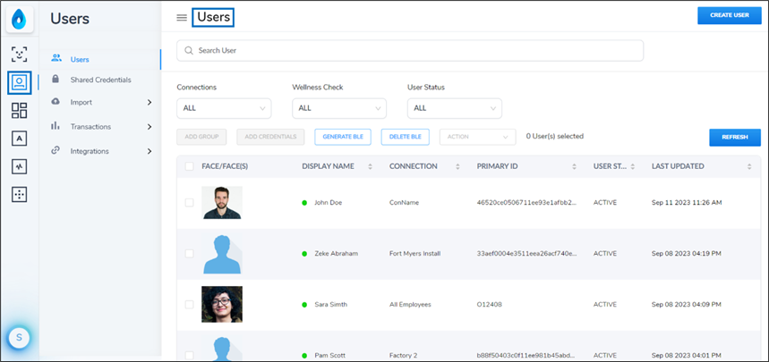

2. Go to **Import** > **Users** on the **Users** menu panel.

   

   The **Import Users** page is displayed.
3. Click **IMPORT USERS** button on top right corner of the page.

   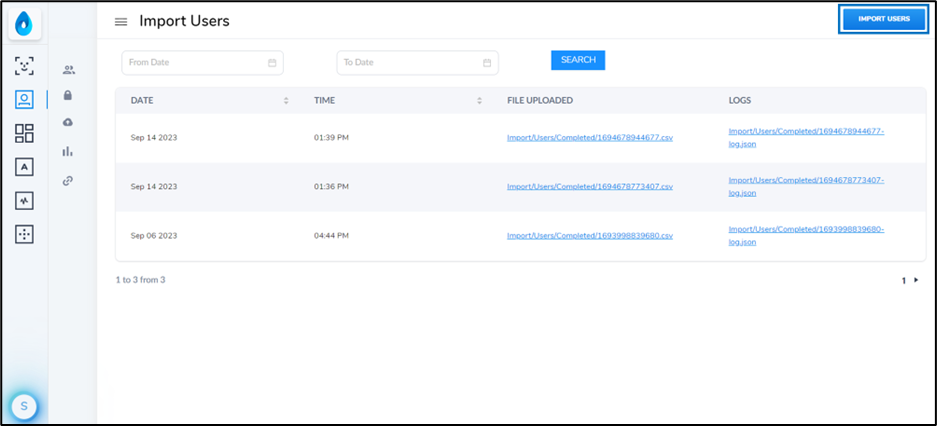

   The **Import User(s)** pop-up box is displayed.
4. Click **Download template** to download the CSV file template.

   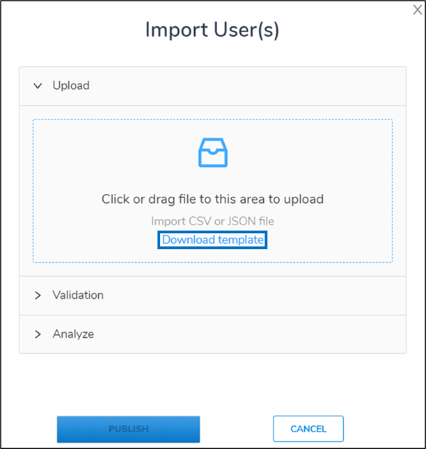

5. Add values in the CSV file for respective users.
6. **Upload** the CSV file.
   The file is uploaded in the **Validation** section.

   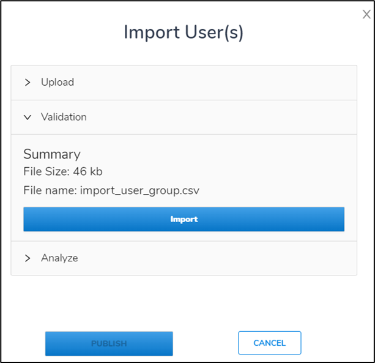

7. Click **Import**.
8. Select connection name in the **Analyze** section from **Connection** dropdown and click **Analyze**.
9. Click **Publish** after validating and analysing the file.
   The user and user details are added to the system.

   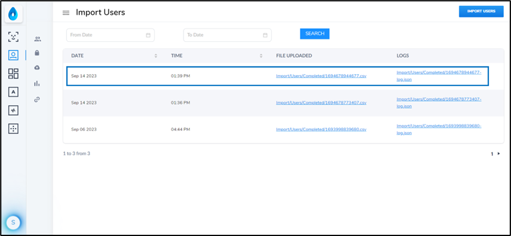

## Create and Invite Tenant Admin

A Tenant Admin has complete access to Oloid Portal and all the Oloid connected devices. You must be an Oloid user to be a Tenant Admin.

### To invite Tenant Admin

1. Log in to the **Oloid Portal**.
2. On the home page of the portal, click **user profile** icon on the bottom left corner of the menu panel.
   The user profile menu is displayed.
3. Do one of the following:
   1. Go to **Settings** > **Tenant Admins** > **INVITE TENANT ADMIN**.

      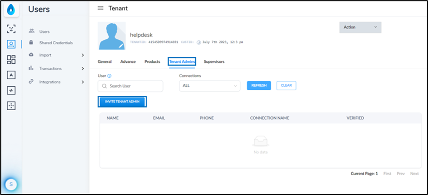

   2. Click **+ Invite Admin**.

      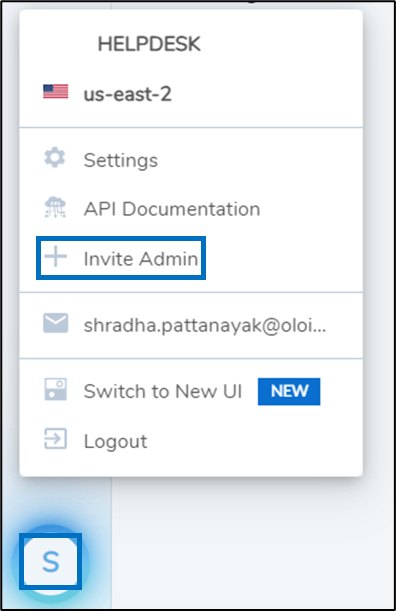

   3. Go to **Settings** > Click **Action** > **Invite Tenant Admin**.

      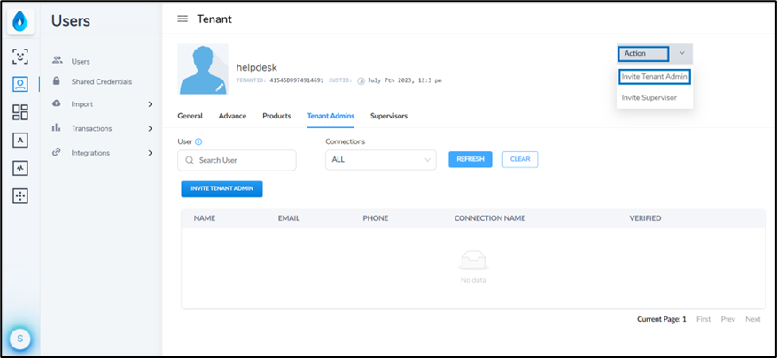

      The **INVITE TENANT ADMIN** pop-up box is displayed.

      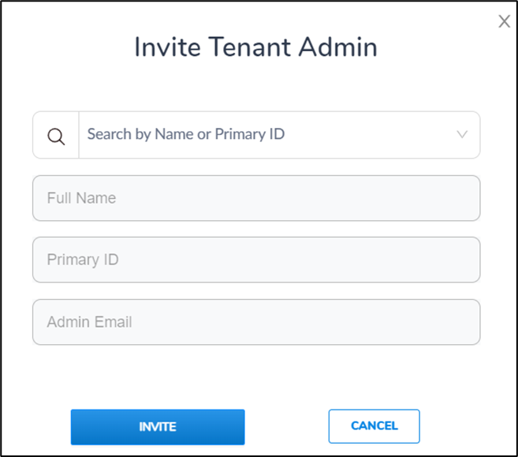

4. Enter **Name** or **Primary ID** of existing User in the search field.
5. Select the accurate user name from the dropdown list.
6. Select **INVITE**.
   The tenant admin is listed on the **Tenant Admin** tab.

   <Note>
     **Note:** An invite email is sent to the user for verification.
   </Note>

   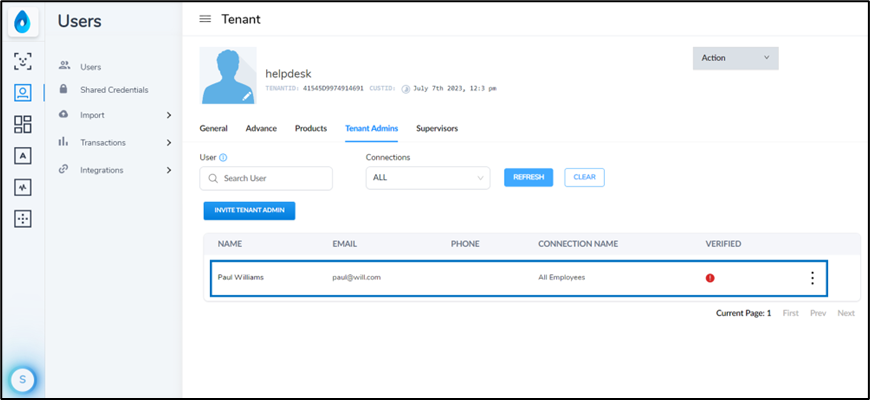

### To Create and Invite Tenant admin

1. Go to **user profile** icon on the bottom left corner of the menu panel.
   The user profile menu is displayed.
2. Do one of the following:
   1. Go to **Settings** > **Tenant Admins** > **INVITE TENANT ADMIN**.

      

   2. Click **+ Invite Admin**.

      

   3. Go to **Settings** > Click **Action** > **Invite Tenant Admin**.

      

      The **INVITE TENANT ADMIN** pop-up box is displayed.

      

3. Click **Name** or **Primary ID** field > **Create user**.
   The **Create Tenant Admin** pop-up box is displayed.

   

4. On the pop-up box, do the following:
   1. Enter **Full Name** of the user.
   2. Enter **Primary ID** (optional).
   3. Select **Use OloID as Primary ID** to use OloID for your primary ID.
   4. Select connection from the **Connection** list.
   5. Enter **Admin Email** of the user.
   6. Click **CREATE & INVITE**.
      The tenant admin is created and listed on the Tenant Admin tab.

      <Note>
        **Note:** An invite email is sent to the user for verification.
      </Note>

      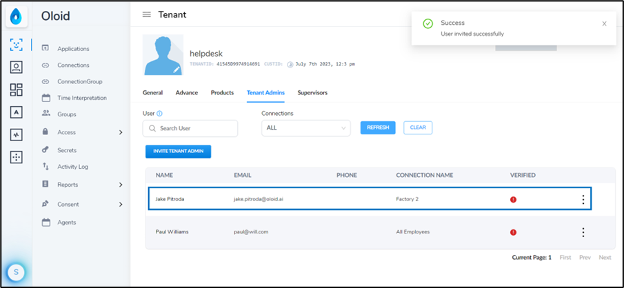

## Create and Manage Credentials

Credentials allow a user to access and authenticate themselves on the Oloid Portal.

### To Create Password

1. Log in to the **Oloid Portal**.
2. On the home page of the portal, click **Users** on the left menu panel.
   The **Users** page is displayed.

   

3. Click **Display Name** to edit.

   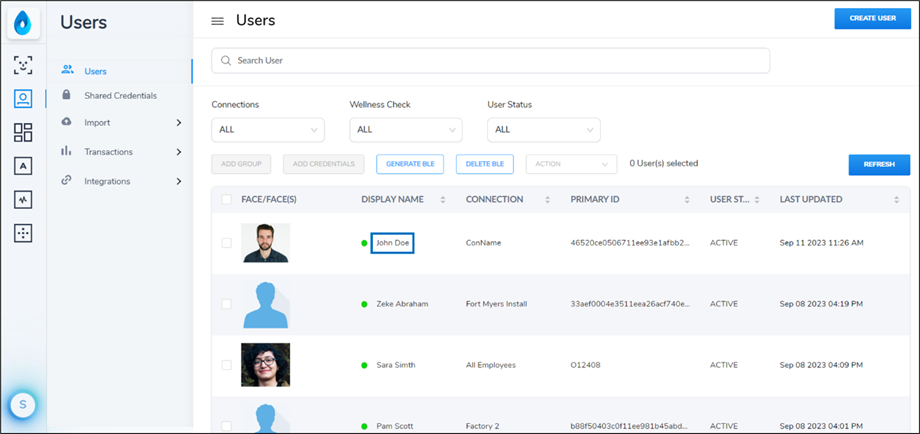

   The User details page is displayed.
4. Go to **Credentials** > **Passwords** tab > **CREATE PASSWORD**.

   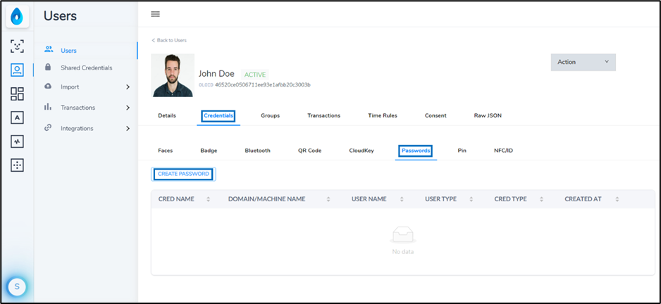

   The **Create Password** pop-up box is displayed.

   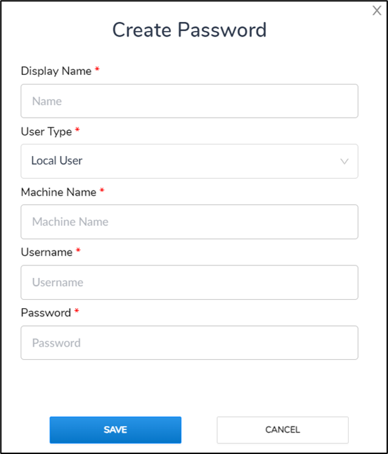

5. On the pop-up box, do the following:
   1. Enter **Display Name** that displays on the Windows Login page.
   2. Select a user type from **User Type** dropdown list.
   3. Enter **Machine Name**.
   4. Enter **Username** of your Windows Login.
   5. Enter **Password** of your Windows Login.
   6. Click **Save**.
      The password is created and listed in the **Passwords** tab.

      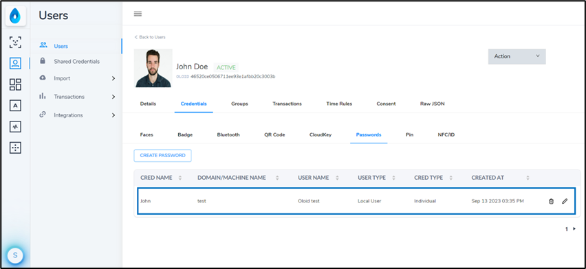

### To Edit Password

1. Go to the **Users** page.
2. Click **Display Name** to edit.

   

   The User details page is displayed.
3. Go to **Credentials** > **Passwords** tab.

   

4. Click **edit** icon for a particular user.

   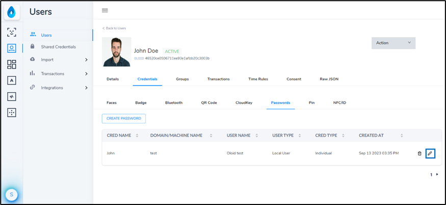

   The **Update Password** pop-up box is displayed.

   

5. Enter the new password in the **Password** field.

   <Note>
     **Note:** You should update the password only when you update the Windows password.
   </Note>

6. Click **Update**.
   The password is updated successfully

### To Delete Password

1. Go to the **Users** page.
2. Click **Display Name** to edit.
   The User details page is displayed.
3. Go to **Credentials** > **Passwords** tab.

   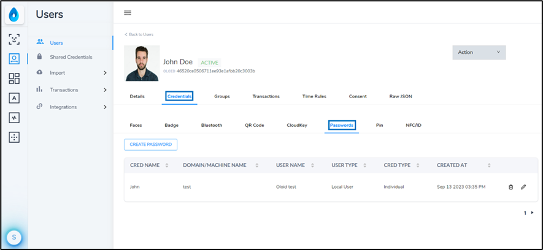

4. Click **delete** icon for a particular user.

   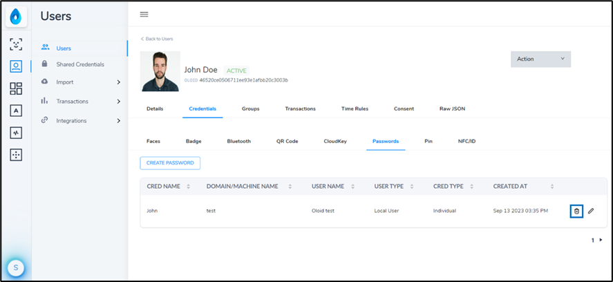

   A confirmation pop-up box is displayed.

   

5. Select **DELETE**.
   The user is successfully deleted.

### To Create PIN

1. Go to the **Users** page.
2. Click **Display Name** to edit.
   The User details page is displayed.
3. Go to **Credentials** > **Pin** tab > **CREATE PIN**.

   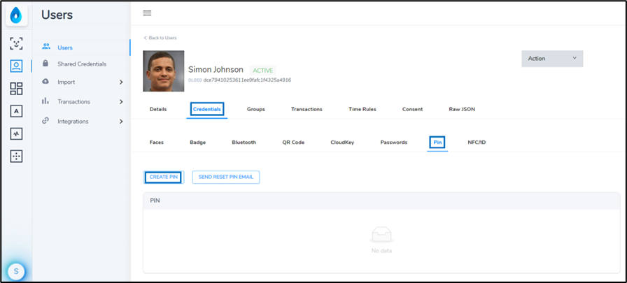

   The **Add Pin** pop-up box is displayed.

   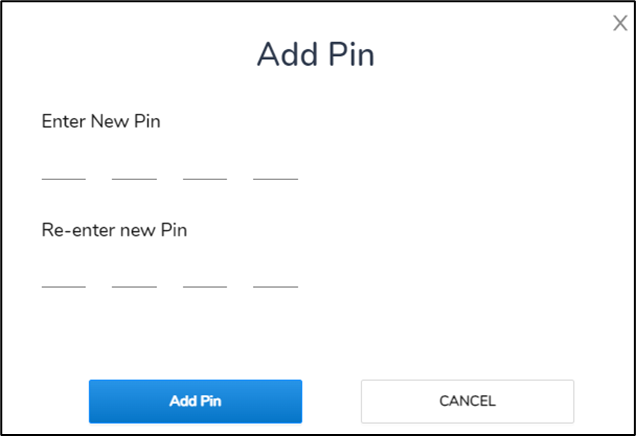

4. On the pop-up box, do the following:
   1. Enter **New Pin**.

      <Note>
        **Note:** You must enter numbers.
      </Note>

   2. Re-enter n**ew Pin**.
   3. Click **Add Pin**.
      The pin is created and listed under the **Pin** tab.

      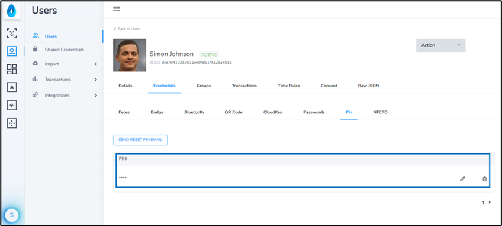

### To Add Badge

1. Go to the **Users** page.
2. Click **Display Name** to edit.
   The User details page is displayed.
3. On the **Details** tab, do the following:
   1. Enter **Secondary ID**.
   2. Select **Weigand** from **Credential Format** dropdown list.
   3. Click **Save**.
4. Go to **Credentials** > **Badge** tab.
   The Badge ID is created and the badge details are listed under the **Badge** tab.

   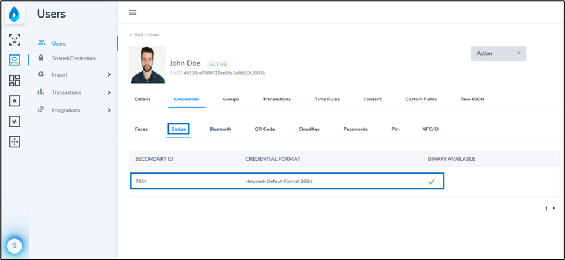

## Create and Manage Shared Credentials

Shared Credentials are passwords that can be used to access a local windows machine or a domain. It is shared among users to which they are assigned to.

### To Create shared Credential

1. Log in to the **Oloid Portal**.
2. On the home page of the portal, click **Users** on the left menu panel.
   The **Users** page is displayed.

   

3. Click **Shared Credentials** on the left menu panel.

   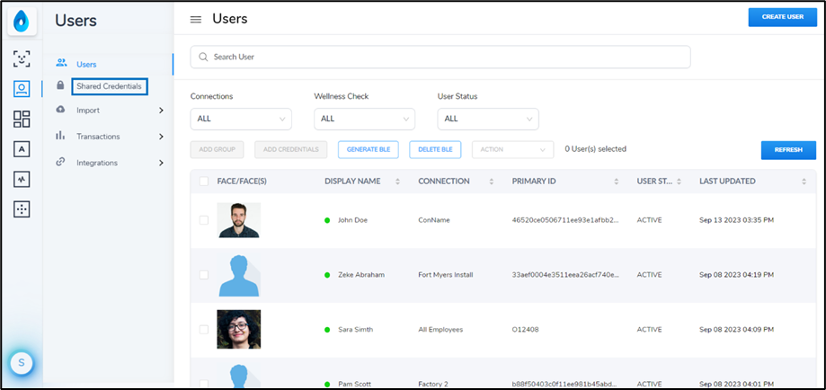

   The **Shared Credentials** page is displayed.
4. Click **Create Credentials** on the right corner of the page.

   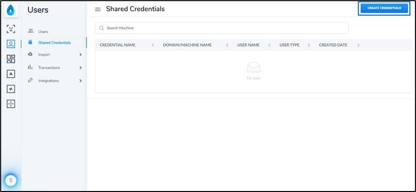

   The **Create Password** pop-box is displayed.

   

5. On the pop-up box do the following:
   1. Enter **Display Name** that displays on the Windows Login page.
   2. Select user type from **User Type** dropdown.
   3. Enter **Machine Name**.
   4. Enter user name then select user name from **Credential Supervisor** dropdown.
   5. Enter **Username** of your Windows Login.
   6. Enter **Password** of your Windows Login.
   7. Click **Save**.
      The credential is created and listed on the **Shared Credentials** page.

      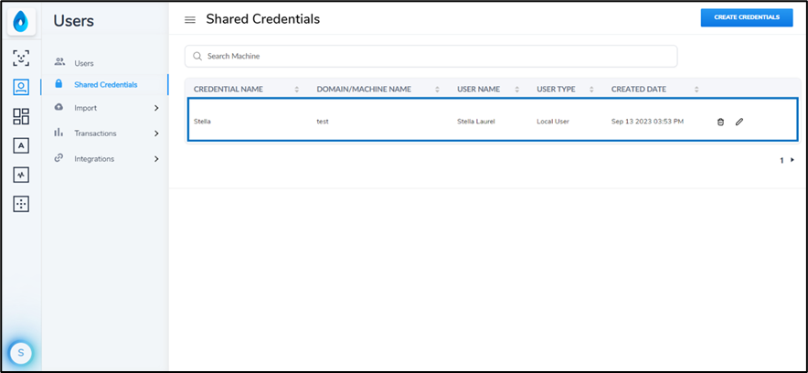

### To Edit Shared Credential

1. Go to the **Users** page.
2. Click **Shared Credentials** on the left menu panel.
   The Shared Credentials page is displayed.
3. Click **edit** icon for a particular user.

   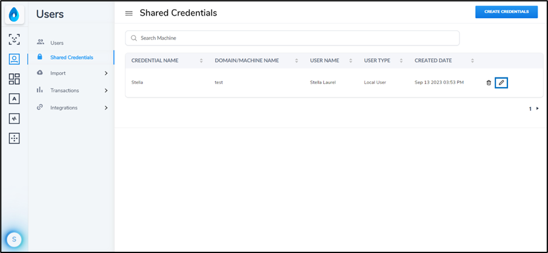

   The **Update Password** pop-up box is displayed.

   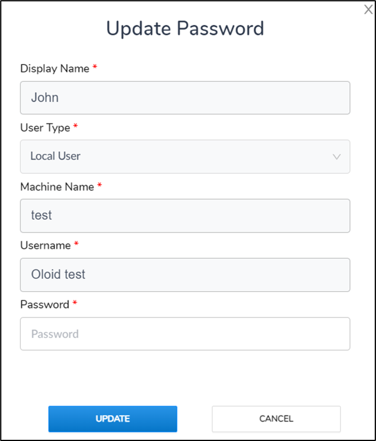

4. Enter the new password in the **Password** field.

   <Note>
     **Note:** You should update the password only when you update the Windows password.
   </Note>

5. Click **Update**.
   The password is updated successfully.

### To Delete Shared Credential

1. Go to the **Users** page.
2. Click **Shared Credentials** on the left menu panel.
   The **Shared Credentials** page is displayed.
3. Click **delete** icon for a particular user.

   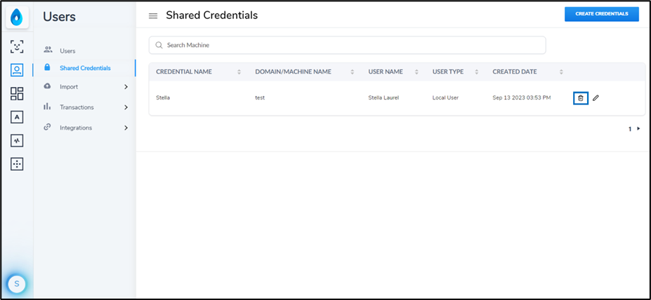

   A confirmation pop-up box is displayed.

   

4. Select **DELETE**.
   The credential is removed from the **Shared Credentials** page.
