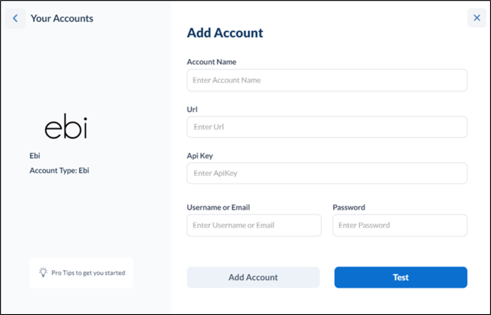
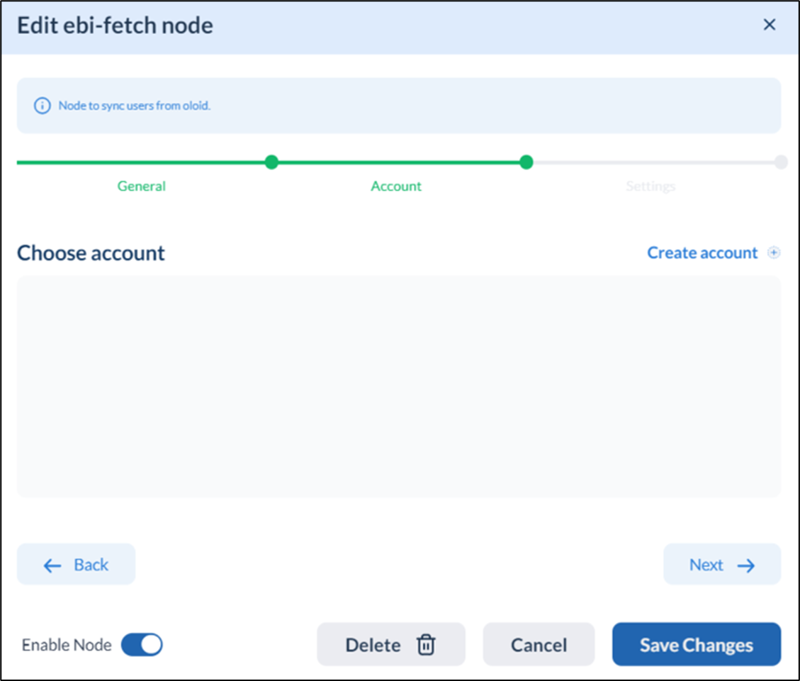

{/* Source: Intercom article 9361033 -  */}
{/* Generated by intercom_to_mintlify.py - re-running overwrites this file. */}

**Steps to add Ebi account:**

1. Click **Accounts** on top right of main page.
   The Accounts pop-up box is displayed.
2. Select **Ebi** from the displayed accounts.
   The Add Account pop-up screen is displayed.

   

3. Do the following:
   1. Enter **Account Name** for the account.
   2. Enter **URL**.
   3. Enter API Key.
   4. Enter **Username or Email** and **Password**.
   5. Click **Test** to test for connectivity (optional but recommended).
   6. Click **Add Account**.
      The account is created and listed on the Accounts page.

## Steps to associate Ebi Account to a Trigger/Action Node

While creating a flow, whenever you are using Ebi action/trigger node, you can associate Ebi account in the second tab of node config pop-up box.

