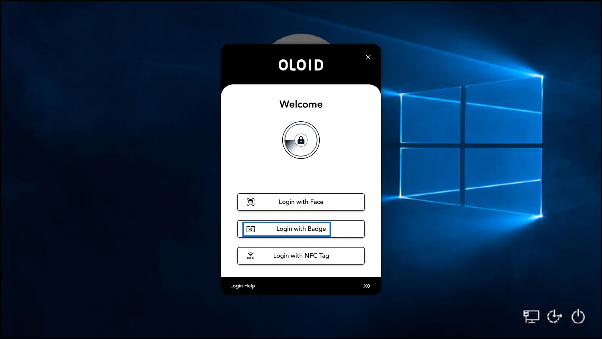
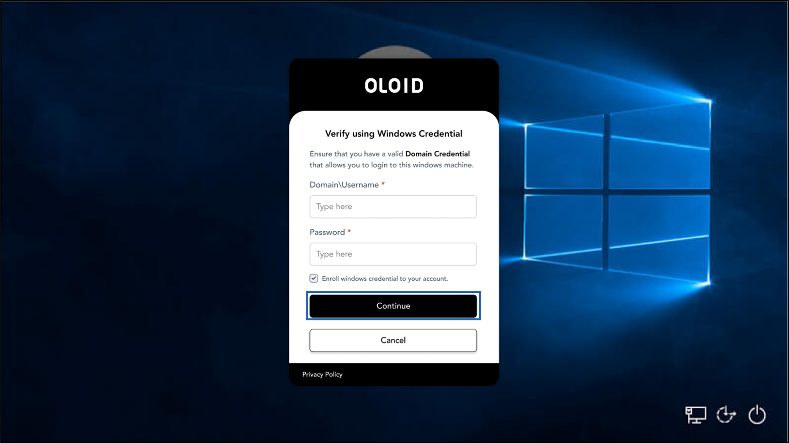
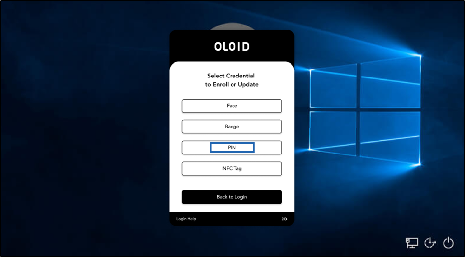
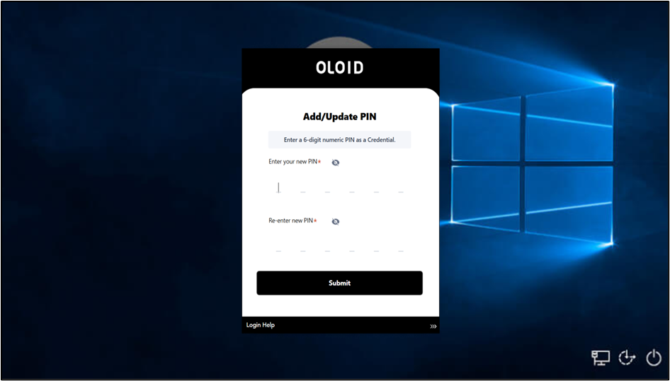
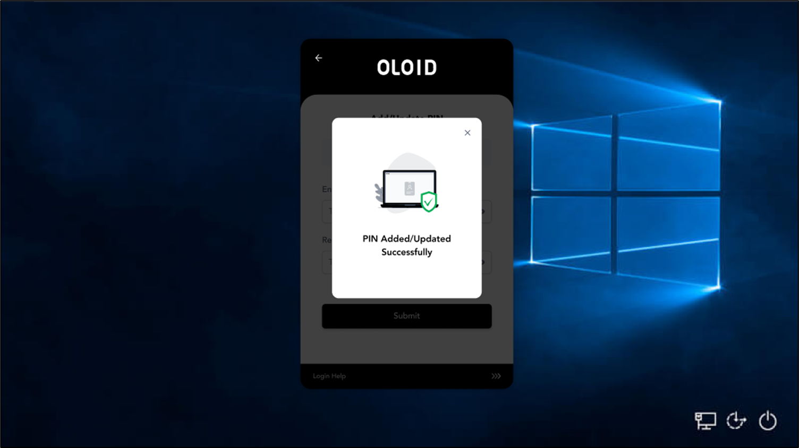
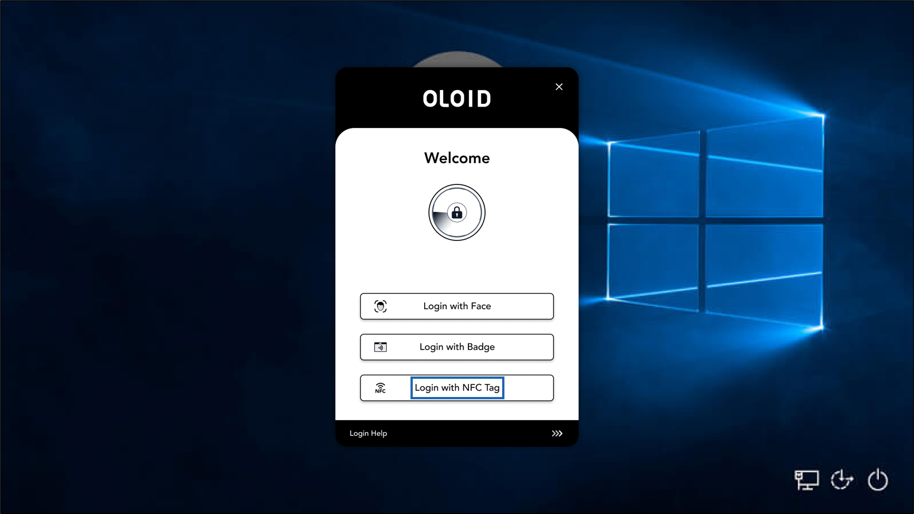
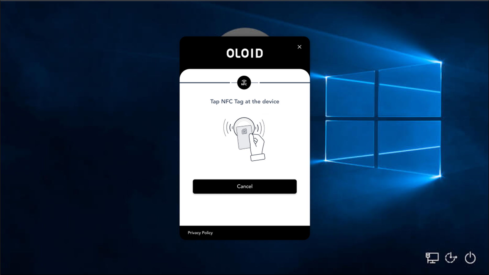
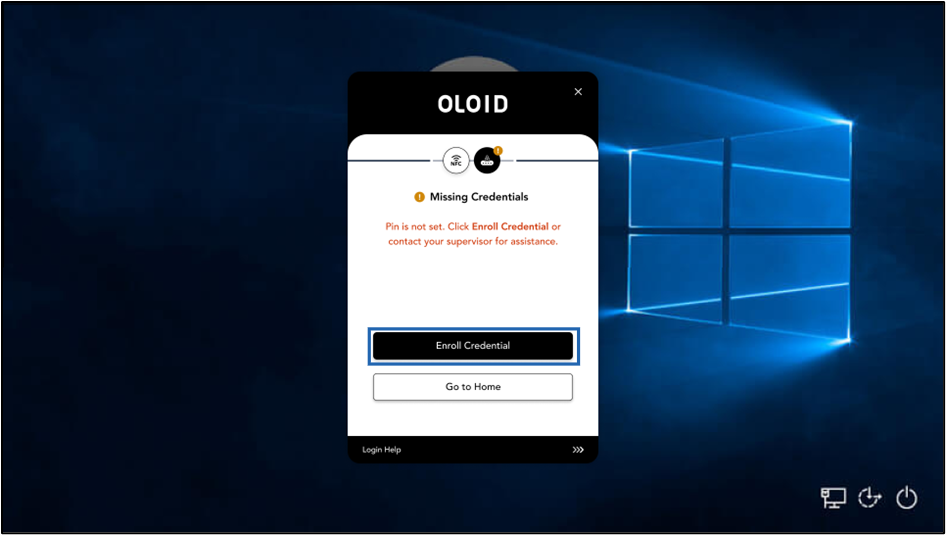

{/* Source: Intercom article 11425228 -  */}
{/* Generated by intercom_to_mintlify.py - re-running overwrites this file. */}

## Badge

Steps to enroll PIN through Windows Login app:

1. On the Windows lock screen, click **Login with OLOID**.

   

   The Windows login app opens and the **Welcome** page is displayed.
2. Select **Login with Badge**.

   

3. Tap the **Badge** on the **Badge Reader** to scan it.

   <Note>
     **Note:** The badge reader must be connected to the computer.
   </Note>

   

   <Note>
     **Note:** If badge authentication is successful but your PIN is missing or expired, a Missing Credentials pop-up box is displayed to enroll PIN.
   </Note>

   The **Missing Credentials** pop-up box is displayed.
4. Click **Enroll Credential**.

   

   The **Verify using Windows Credential** screen is displayed.
5. Do the following:
   1. Enter **Domain\Username**.
      Enter your Windows domain and username in the format `Domain\Username`.
   2. Enter **Password**.
      Use your Windows account password.
   3. Select **Enroll Windows credential to your account**. (Optional)
   4. Click **Continue**.

      

      The **Select Credential to Enroll or Update** screen is displayed.
6. Select **PIN.**

   

   The **Add/Update PIN** screen is displayed.

   <Note>
     **Note:** You can configure PIN credentials in the Oloid Portal. For more details, refer [How to configure PIN](/platform/tenant-admin-portal/tenant-admin-portal-how-to-configure-pin)
   </Note>

   

7. Do the following:
   1. Enter new PIN.
   2. Re-enter new PIN.
      The PIN is enrolled successfully.

      

## NFC

Steps to enroll PIN through Windows Login app:

1. On the Windows lock screen, click **Login with OLOID**.

   

   The Windows login app opens and the **Welcome** page is displayed.
2. Select **Login with NFC Tag**.

   

3. Tap the **NFC Tag** on the **Card Reader** to scan it.

   <Note>
     **Note:** The card reader must be connected to the computer.
   </Note>

   

   <Note>
     **Note:** If NFC authentication is successful but your PIN is missing or expired, a Missing Credentials pop-up box is displayed to enroll PIN.
   </Note>

   The **Missing Credentials** pop-up box is displayed.
4. Click **Enroll Credential**.

   

   The **Verify using Windows Credential** screen is displayed.
5. Do the following:
   1. Enter **Domain\Username**.
      Enter your Windows domain and username in the format `Domain\Username`.
   2. Enter **Password**.
      Use your Windows account password.
   3. Select **Enroll Windows credential to your account**. (Optional)
   4. Click **Continue**.

      

      The **Select Credential to Enroll or Update** screen is displayed.
6. Select **PIN.**

   

   The **Add/Update PIN** screen is displayed.

   <Note>
     **Note:** You can configure PIN credentials in the Oloid Portal. For more details, refer [How to configure PIN](/platform/tenant-admin-portal/tenant-admin-portal-how-to-configure-pin)
   </Note>

   

7. Do the following:
   1. Enter new PIN.
   2. Re-enter new PIN.
      The PIN is enrolled successfully.

      
