{/* Source: Intercom article 9668957 - https://oloid.help/en/articles/9668957-face-login-enroll-error-list-and-mitigation-ways */}
{/* Generated by intercom_to_mintlify.py - re-running overwrites this file. */}

### Face Enrollment Guidelines

### Positioning

- **Face the Camera**: Look directly into the camera and ensure your face is centered in the frame.
- **Frame Your Face**: Position yourself so that there are 1-2 inch margins around your face, avoiding extreme angles and poses.
- Only one person should be present during face registration.

### Expressions

- **Neutral Expression**: Keep a neutral expression, avoiding exaggerated facial movements.
- **Remove Glasses**: If you are wearing dark glasses or tinted lenses, remove them to ensure both eyes are clearly visible.

### Lighting

- **Avoid Bright Backlighting**: To prevent shadows and glare, ensure the lighting is even. Avoid bright lights directly behind you.
- **Optimal Lighting Conditions**: Use soft, even lighting to enhance the clarity of your image.

### Focus & Movement

- **Image Clarity**: Ensure the captured image is sharp and not blurry, as image focus is crucial for accurate recognition.
- **Adjust Distance**: If the camera is having difficulty focusing, you might be too close or too far from the device.

These steps will help ensure a successful face enrollment process, resulting in accurate and reliable recognition.

## Face Login / Enrollment Error List and Mitigation Strategies

### 1. User Not Found

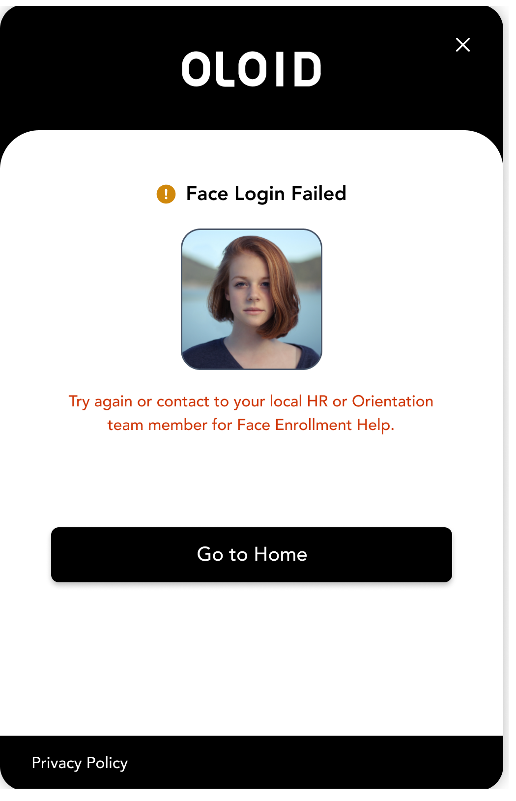

- **Description**: The system cannot find a matching face in the database.
- **Mitigation**:
  - **Re-enroll**: If you've recently changed your appearance significantly, re-enroll your face data.
  - **Check User Account**: Ensure you're using the correct user account associated with your face data.

### 2. Face Close to Border

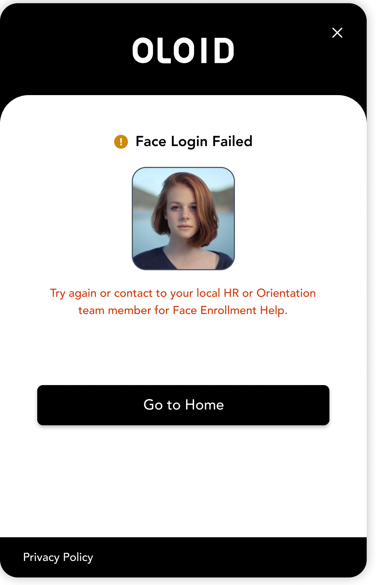

- **Description**: The face is too close to the edges of the camera frame, affecting recognition.
- **Mitigation**:
  - **Center Your Face**: Ensure your face is centered in the frame with sufficient space around it.
  - **Adjust Camera Distance**: Move closer or farther from the camera to fit your face properly in the frame.

### 3. Face Too Small

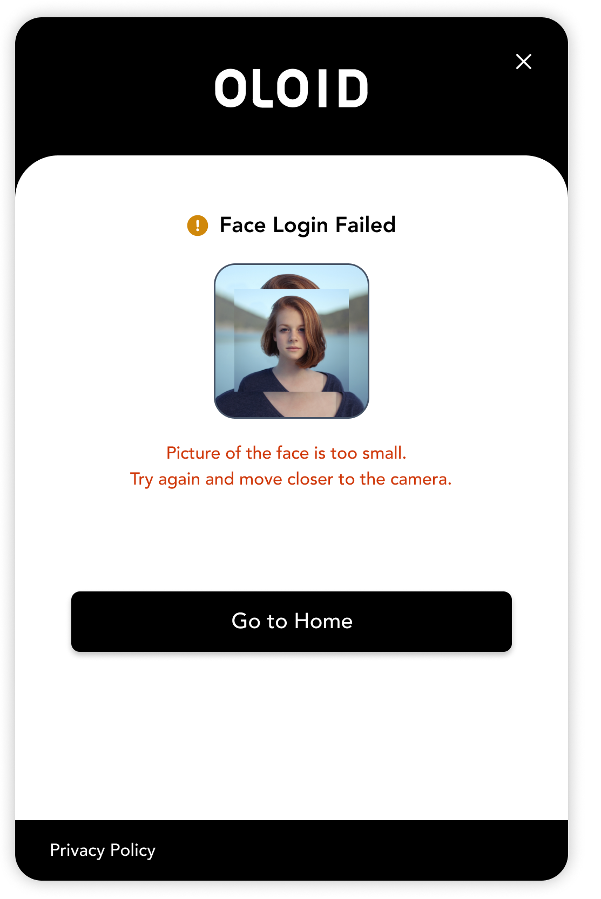

- **Description**: The face appears too small in the frame, making it difficult for the system to capture details.
- **Mitigation**:
  - **Move Closer**: Move closer to the camera to make your face appear larger in the frame.
  - **Zoom In**: If the camera allows, use zoom features to enlarge your face.

### 4. Face Angle Too Large

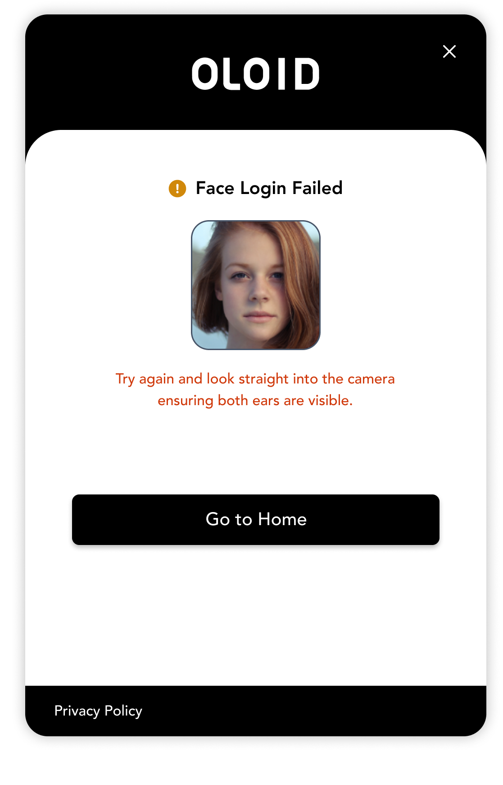

- **Description**: The face is captured at an extreme angle, hindering accurate recognition.
- **Mitigation**:
  - **Adjust Face Position**: Look directly into the camera and keep your face straight.
  - **Avoid Tilting**: Keep your head level and avoid tilting it excessively to the side or up/down.

### 5. Too Many Faces

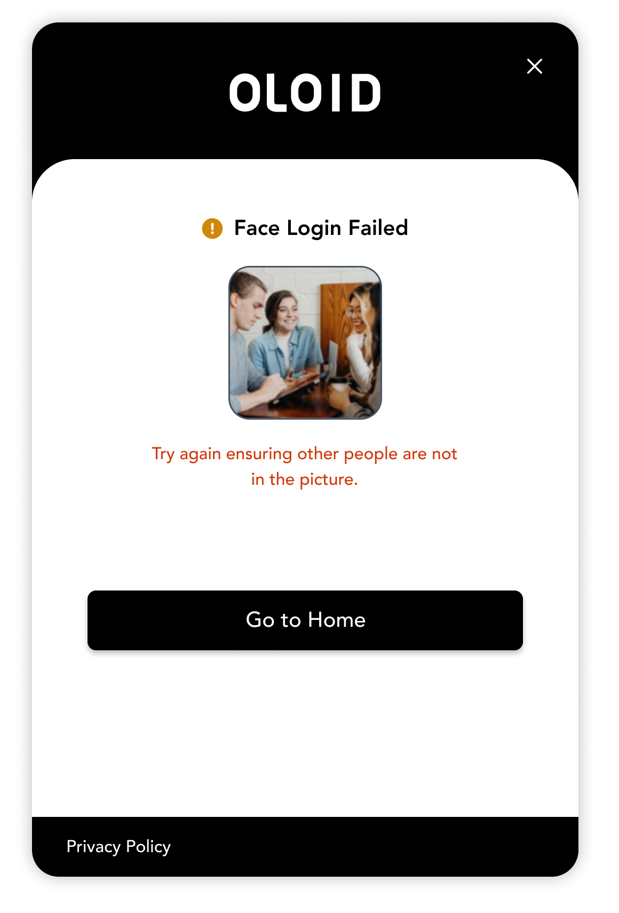

- **Description**: The system detects multiple faces in the frame, causing confusion.
- **Mitigation**:
  - **Ensure Single User**: Make sure only your face is visible during the enrollment or login process.
  - **Clear Background**: Avoid having other people or face-like objects in the background.

### 6. Face Picture Quality Error

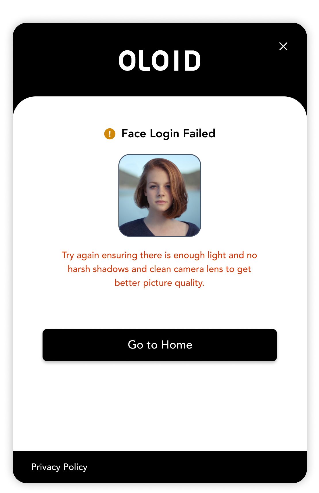

- **Description**: The image quality is poor, affecting the system's ability to recognize the face.
- **Mitigation**:
  - **Check Camera Settings**: Ensure the camera resolution is set to a high enough setting.
  - **Improve Lighting**: Ensure proper lighting to avoid grainy or low-quality images.

### 7. Face Liveliness Error

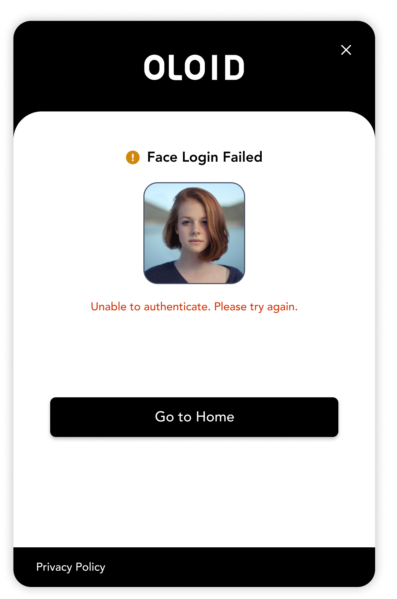

- **Description**: The system suspects that the face presented is not real, possibly a photo or video.
- **Mitigation**:
  - **Ensure Liveness**: Move slightly during the capture process, like blinking or turning your head slightly.
  - **Use Real-Time Capture**: Avoid using static images or videos; present your live face to the camera.

### 8. Internal Error

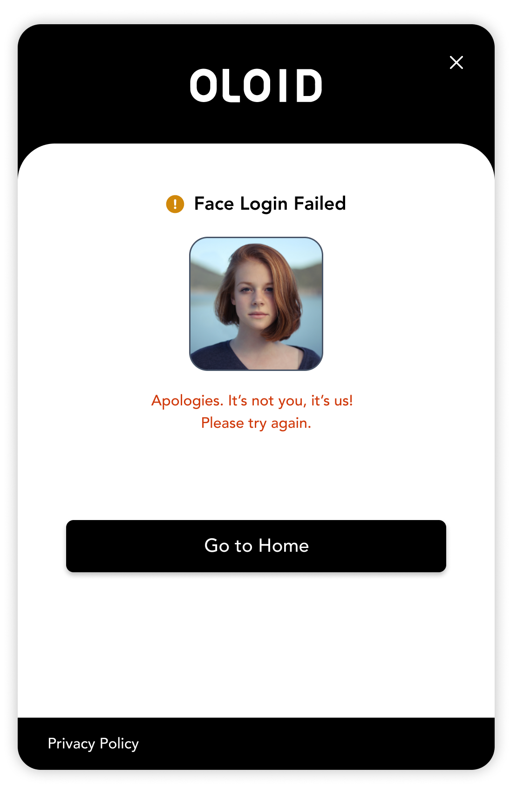

- **Description**: A system malfunction or software issue prevents successful enrollment or login.
- **Mitigation**:
  - **Restart System**: Restart the device and the face recognition software.
  - **Check for Updates**: Ensure the software is up-to-date.
  - **Contact Support**: If the problem persists, contact technical support.

### 9. Face is Occluded

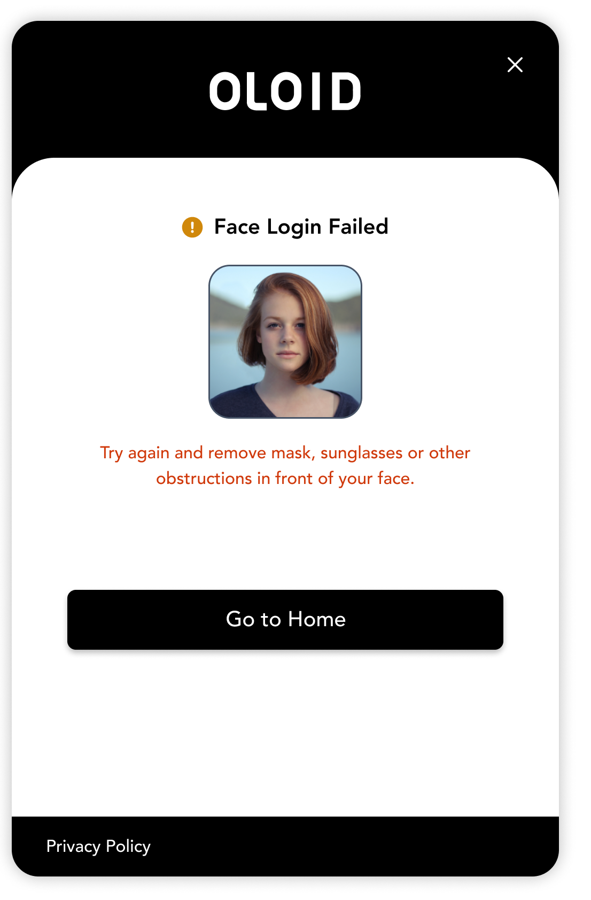

- **Description**: The face is partially covered or obscured, preventing full recognition.
- **Mitigation**:
  - **Remove Obstructions**: Remove hats, glasses, masks, or anything that may cover part of your face.
  - **Ensure Clear Visibility**: Ensure your entire face is visible and well-lit.

### 10. Best Shot Validation Failed

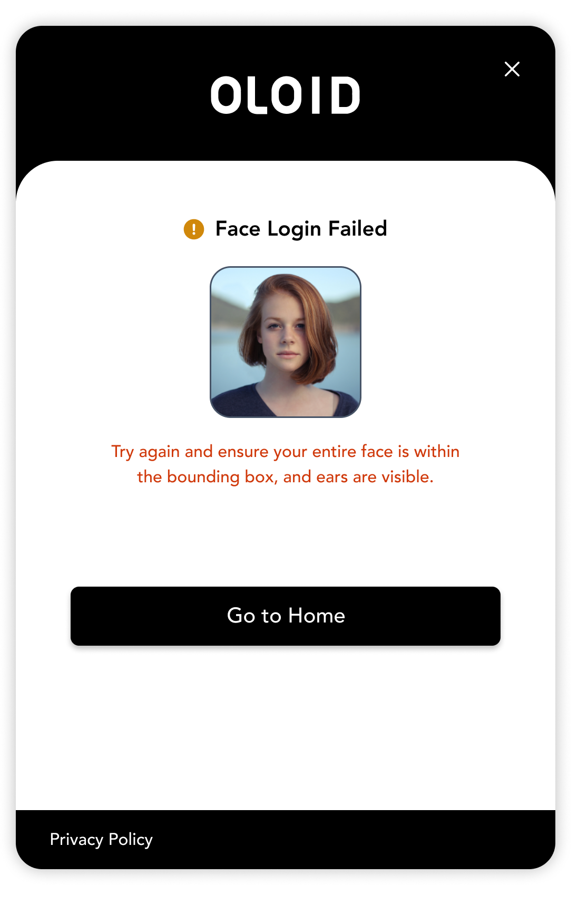

- **Description**: The system could not capture an optimal image for recognition.
- **Mitigation**:
  - **Retake Image**: Follow the system prompts to retake the image, ensuring good lighting and a clear view of your face.
  - **Check Positioning**: Make sure your face is centered and at an appropriate distance from the camera.

### 11. Face is Cropped

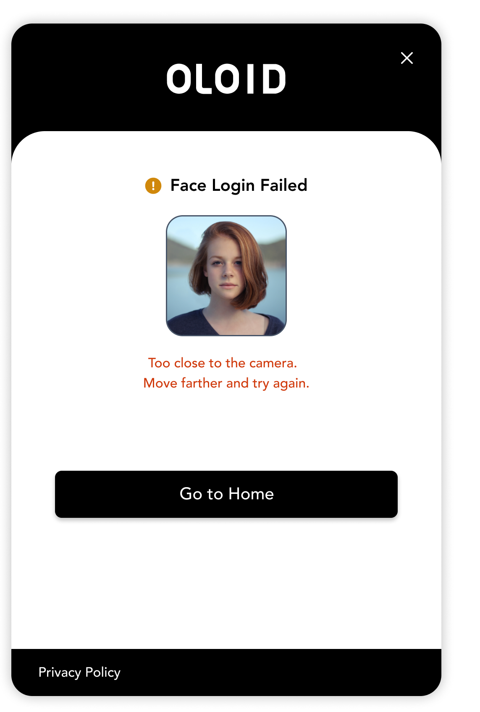

- **Description**: The face is not fully captured in the frame, leading to incomplete data.
- **Mitigation**:
  - **Center Your Face**: Ensure your entire face fits within the frame, with some space around the edges.
  - **Adjust Camera or Position**: Reposition yourself or adjust the camera to avoid cropping.

### 12. Face Not Found

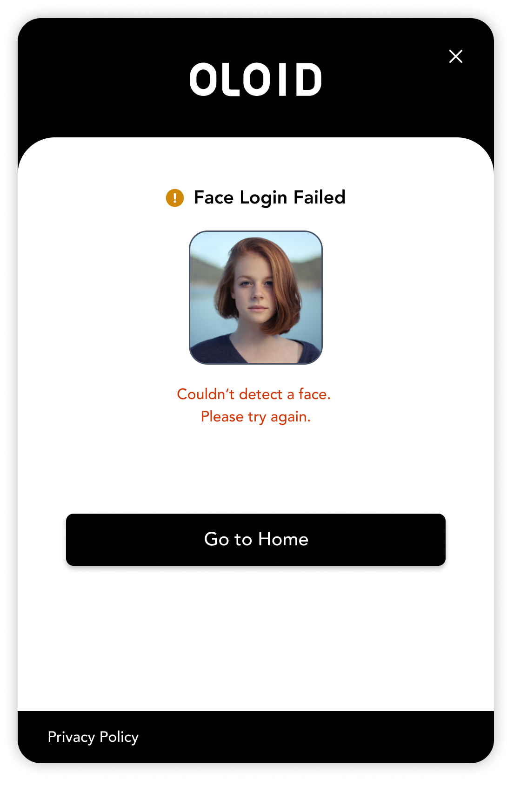

- **Description**: The system cannot detect a face in the frame.
- **Mitigation**:
  - **Ensure Proper Lighting**: Use adequate lighting to ensure your face is visible.
  - **Position Yourself Correctly**: Ensure you are in the camera's field of view and your face is unobstructed.

### 13. Online Face and User Not Found

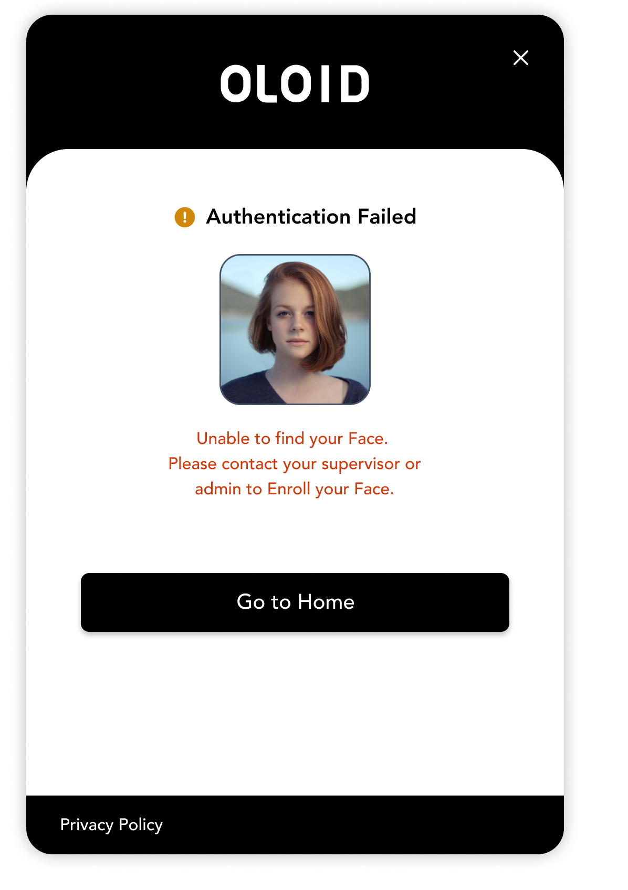

- **Description**: The system cannot find a matching face or user profile in the online database.
- **Mitigation Strategies**:
  - **Verify User Account Details**: Ensure that you are using the correct username or account details. Double-check that your account is active and properly linked to your facial data.
  - **Re-enroll Your Face Data**: If your appearance has changed significantly since the last enrollment (e.g., new hairstyle, facial hair, etc.), consider re-enrolling your face data.
  - **Check Network Connection**: Ensure your device has a stable internet connection to access the online database. If connectivity issues persist, try switching networks or restarting your device.

### 14. Offline Trying to Face Login

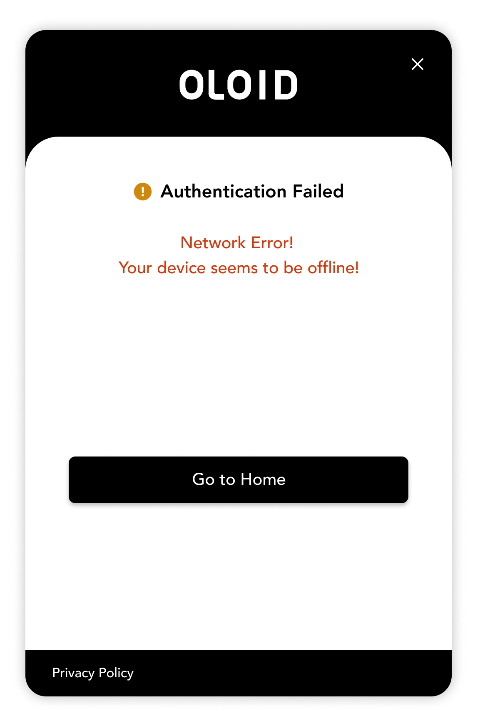

- **Description**: The system is attempting to perform a face login without an internet connection, which may be required for authentication.
- **Mitigation Strategies**:
  - **Connect to the Internet**: If the face login system requires an internet connection for authentication, ensure your device is connected to a stable network.
  - **Use Offline Mode (if available)**: Some systems may support offline face recognition. Check if this option is available and if your facial data is stored locally on the device.

### 15. Face Not Matching Reference Image

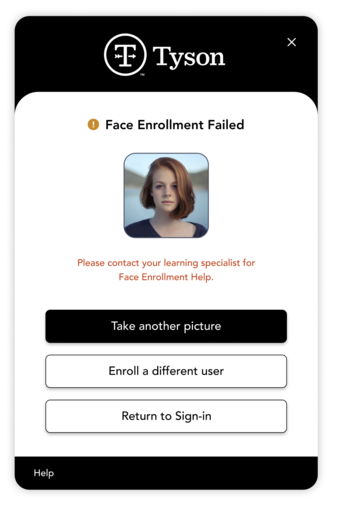

- **Description**: The captured face image does not match the reference image stored in the system, possibly due to changes in appearance or image quality issues.
- **Mitigation Strategies**:
  - **Match Reference Conditions**: Try to replicate the conditions under which the reference image was taken. This includes similar lighting, facial expressions, and camera angles.
  - **Update Reference Image**: If your appearance has significantly changed (e.g., wearing glasses, new facial hair), consider updating your reference image in the system.
  - **Ensure High-Quality Image Capture**: Make sure the image captured during login is clear and well-lit. Avoid blurry or low-quality images by keeping the camera steady and ensuring proper lighting.

### 16. Max Limit Reached (Already Added Maximum Number of Images for Face Login)

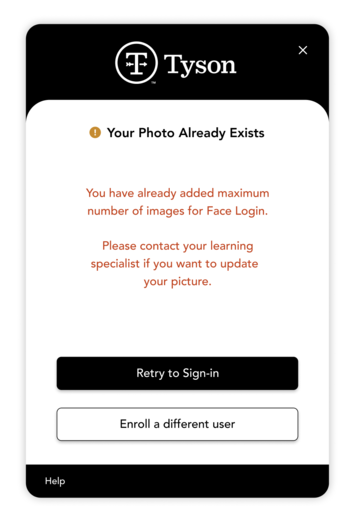

- **Description**: The system has reached the maximum number of stored facial images for face login.
- **Mitigation Strategies**:
  - **Review System Limits**: Check the system’s documentation to understand the maximum number of facial images allowed.
  - **Delete Outdated or Unnecessary Images**: If possible, remove old or unnecessary facial data to free up space for new images. Prioritize keeping the most recent and accurate images.
  - **Contact Support**: If you cannot manage the images yourself or if the limit has been reached unexpectedly, contact technical support for assistance.
