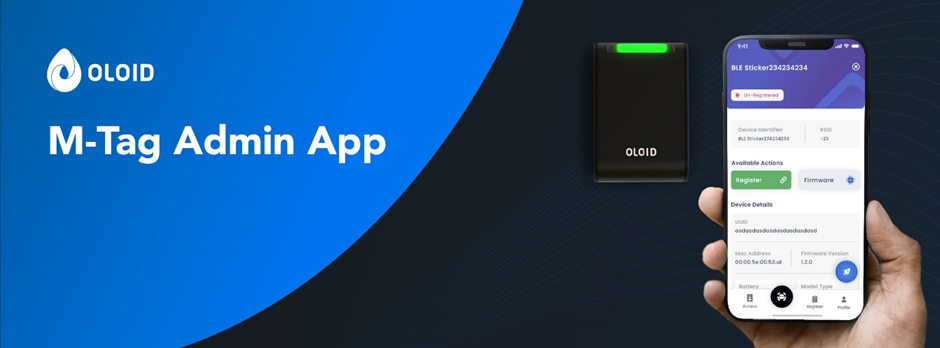

{/* Source: Intercom article 7220843 - https://oloid.help/en/articles/7220843-getting-started-with-oloid-m-tag-admin-app */}
{/* Generated by intercom_to_mintlify.py - re-running overwrites this file. */}

The M-Tag Admin App allows you to register the M-Tags, add and update settings for the M-Tag, and unregister M-Tags.

To use the Oloid M-Tag Admin app, you need an administrator account on your device.

As an administrator, you can perform essential admin tasks from your iOS mobile device with the M-Tag Admin app.

Here is a list of articles that will help you get up and running with M-Tag Admin App.

- [M-Tag Admin App installation and login](/drafts/unassigned/intercom/m-tag-admin-app-installation-and-login)
- [How to register M-Tag](/drafts/unassigned/intercom/how-to-register-m-tag)
- [How to modify M-Tag settings](/drafts/unassigned/intercom/how-to-modify-m-tag-settings)
- [Unregister M-Tag](/drafts/unassigned/intercom/unregister-m-tag)
- [Recommended Settings](/drafts/unassigned/intercom/recommended-settings)
