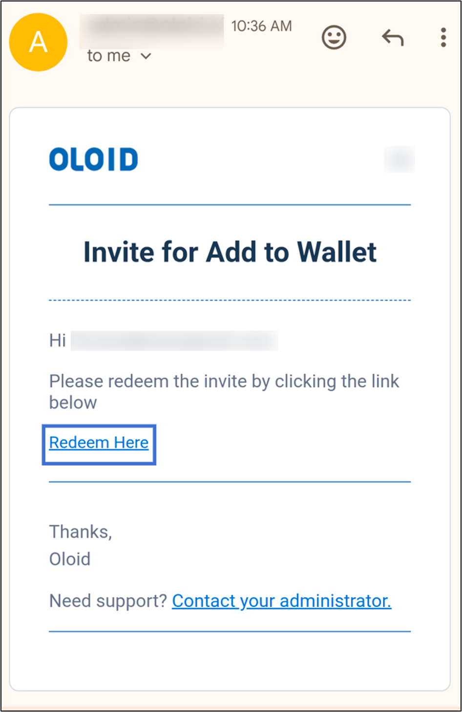
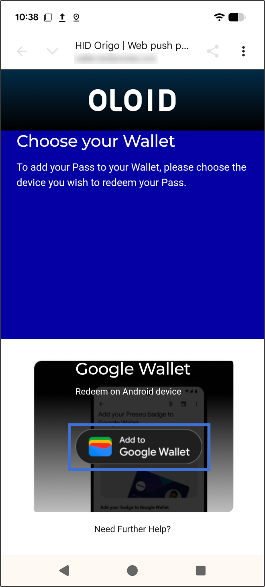
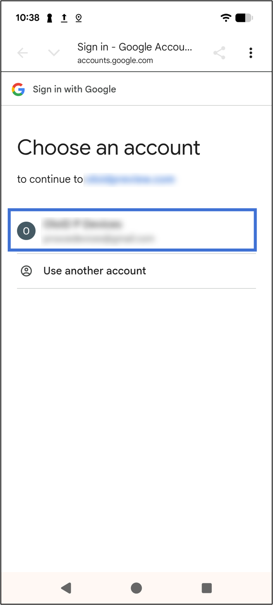
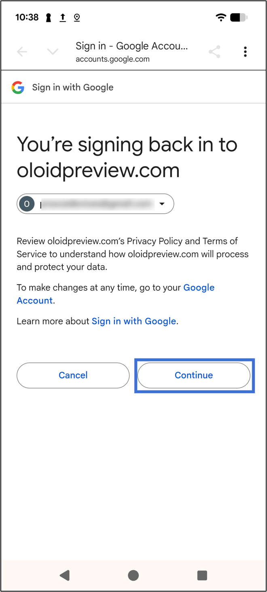
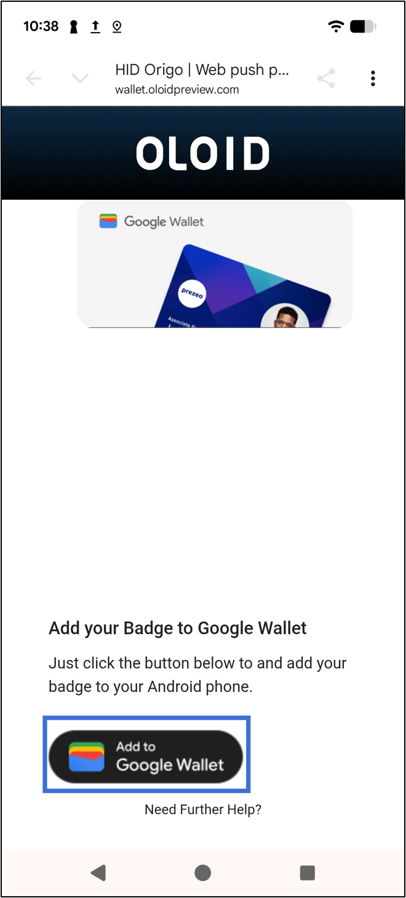
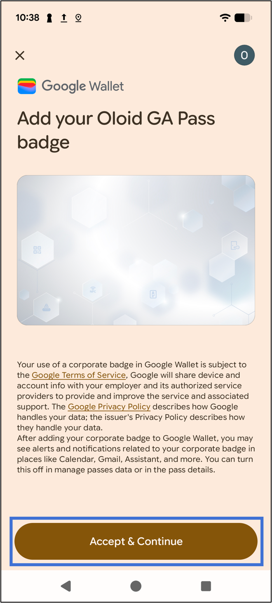
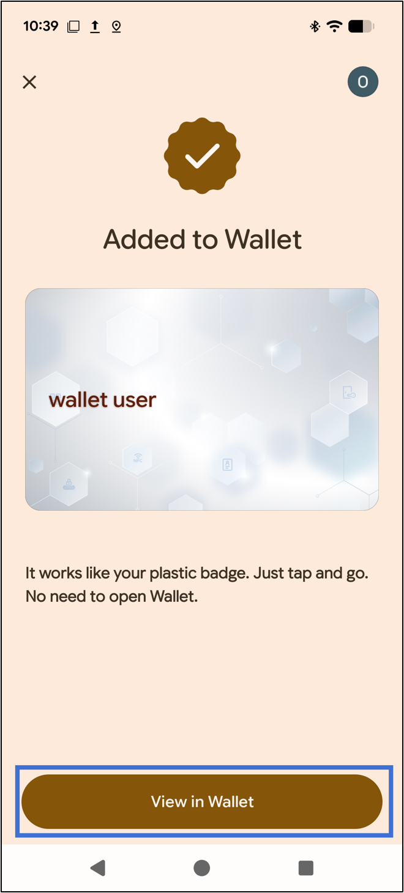
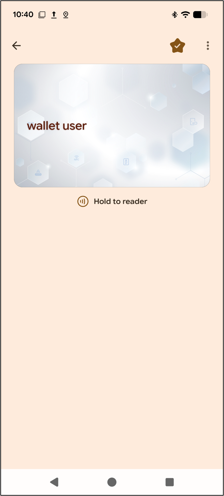

{/* Source: Intercom article 15431547 -  */}
{/* Generated by intercom_to_mintlify.py - re-running overwrites this file. */}

## Steps to Add pass to wallet

## Introduction

This document provides instructions to Add pass to wallet using the invite link.

## Prerequisites

- You must download and install the Google Wallet app on your mobile device. For more, refer to
- A valid invite link to add pass must be available in the user’s mailbox.

## Steps to Add pass to wallet

1. Tap the invite link available in your mailbox.
   The mail box is displayed.
2. Tap **Redeem Here.**

   

   The **Redeem on Android Device** is displayed
3. Tap **Add to Google Wallet**.

   

   The **Choose an account** screen is displayed.
4. Select the preferred google account.

   

   The Confirmation page is displayed.
5. Tap **Continue**.

   

   The **Add your badge to google wallet** page is displayed.
6. Tap **Add to Google Wallet**.

   

   The **Add your Oloid GA Pass badge** page is displayed.
7. Tap **Accept &Continue.**

   

   The Badge is successfully added to the wallet.
8. Tap **View in Wallet** to view the pass.

   

   The Badge is displayed.

   
