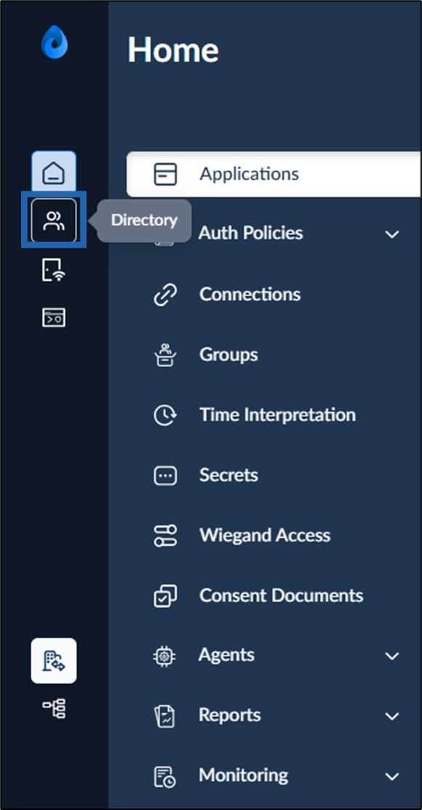
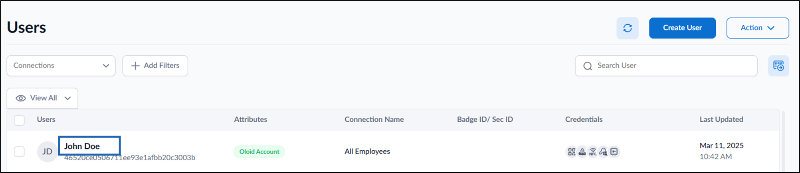
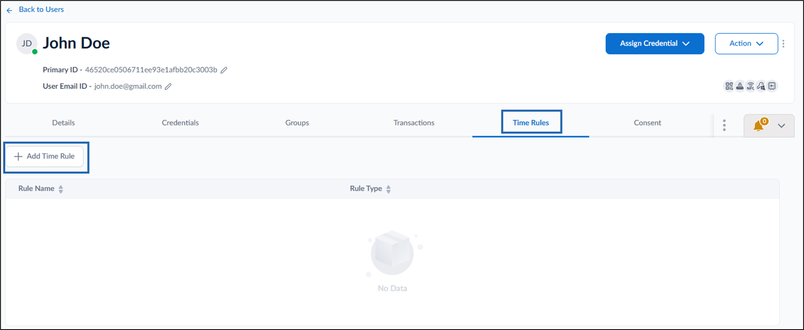
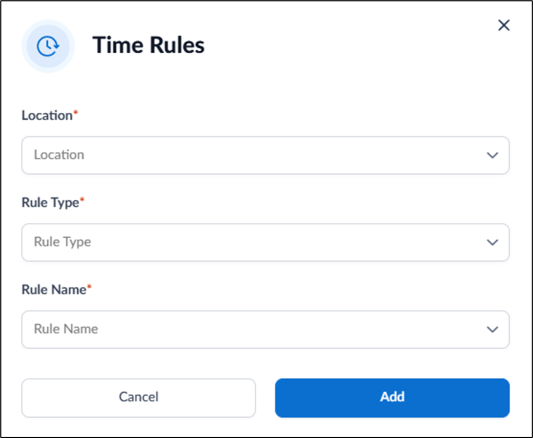
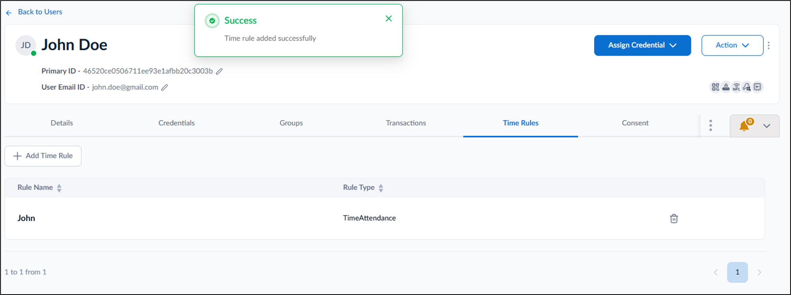

{/* Source: Intercom article 10748617 -  */}
{/* Generated by intercom_to_mintlify.py - re-running overwrites this file. */}

Steps to add Time Rule to User:

1. Log in to the **Oloid Portal**.
2. On the homepage, go to **Directory**.

   

   The **Users** page is displayed.
3. Select **User**.

   

   The user **Details** page is displayed.
4. Go to **Time Rules** tab > click **+Add Time Rule**.

   

   The **Time Rules** pop-up box is displayed.
5. Do the following on the pop-up box:

   

   1. Select location from the **Location** dropdown.
   2. Select type from the **Rule Type** dropdown list.
   3. Select **Rule Name** from the dropdown.
   4. Click **Add**.
      The Time Rule is added and listed in the page.

      
