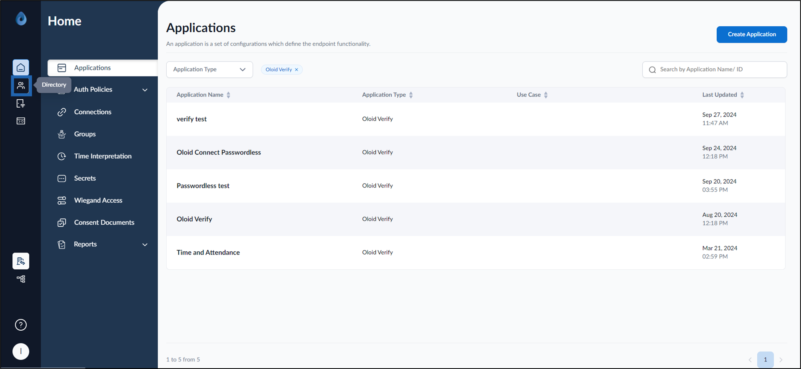
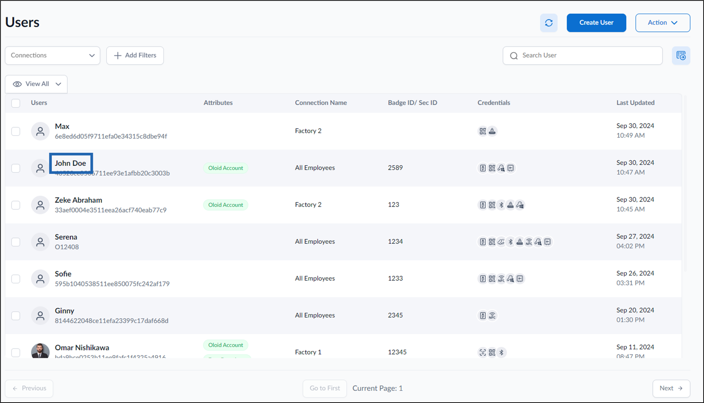
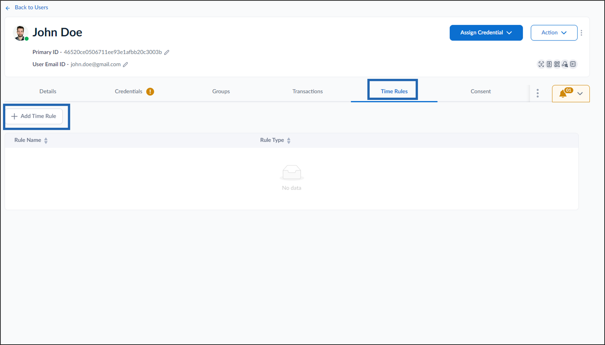
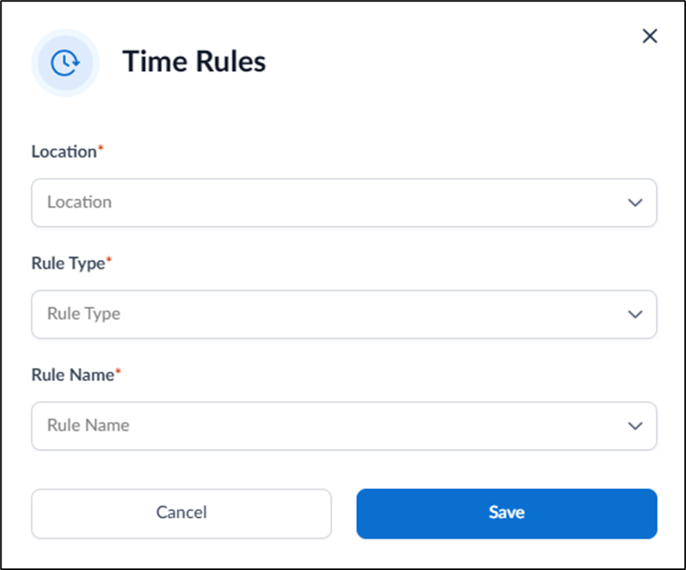
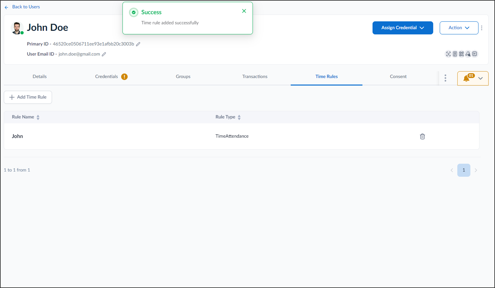

{/* Source: Intercom article 9937080 -  */}
{/* Generated by intercom_to_mintlify.py - re-running overwrites this file. */}

Steps to add time rules:

1. Login to the **Oloid Portal.**
2. On the homepage, click **Directory** from the left menu panel.

   

   The **Users** page is displayed.
3. Click **username** to edit.

   

   The **User details** page is displayed.

   

4. Go to **Time Rules** tab > **+ Add Time Rule**

   

   The **Time Rules** pop-up screen is displayed.

   

5. On the pop-up screen, do the following:
   1. Select location from the **Location** dropdown list.
   2. Select **Rule Type** from the dropdown list.
   3. Select **Rule Name** from the dropdown list.
   4. Click **Save**.
      The Time Rule is successfully set.

      
