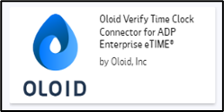
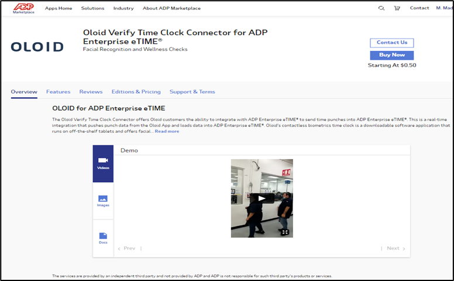
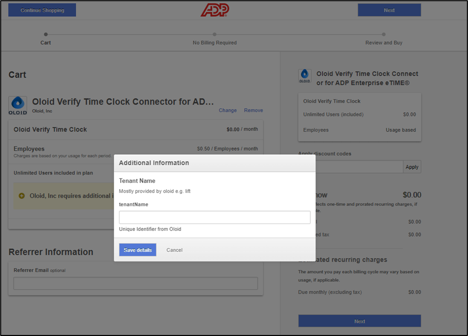
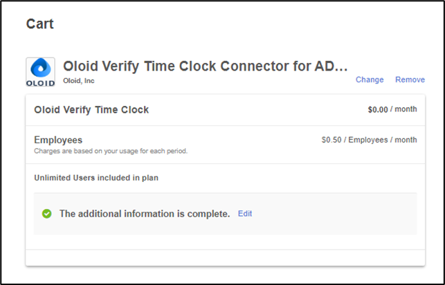
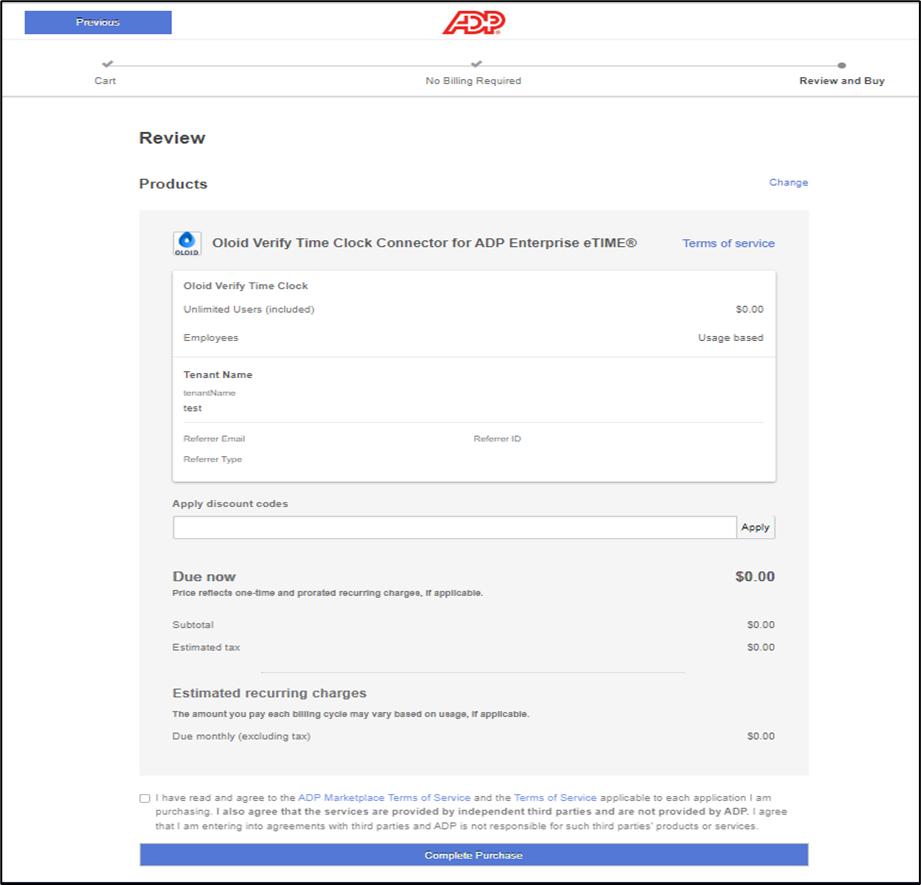

{/* Source: Intercom article 8217407 -  */}
{/* Generated by intercom_to_mintlify.py - re-running overwrites this file. */}

Oloid Verify Time Clock Connector integrates with ADP Enterprise eTIME® to send time punches into ADP Enterprise eTime®. This is a real-time integration that pushes the details from Oloid Verify App and load data into ADP Workforce Now® Essential Time. It supports ADP Credentials to Oloid Portal to get worker info from ADP. Oloid’s facial recognition-based time and attendance clocking, wellness attestation and temperature scanning app is touchless, accurate and easy to use. Oloid’s contactless biometrics time clock is a downloadable software application that runs on off-the-shelf tablets.

Subscription Events Supported by Oloid Connector

1. Create Subscription
2. Change Subscription
3. Assign Users
4. Un-assign Users
5. Cancel Subscription
6. Import Users from Marketplace
1. **Subscribe to Oloid Connector.**
   - Login to ADP site at [https://apps.adp.com/en-US/apps/325443](https://apps.adp.com/en-US/apps/325443)
   - Tap on Oloid App.

     

2. **Click ‘Buy Now’.**

   

3. **Click ‘Continue’ and fill tenant name: daddario. Press “Check” button to validate tenant details.**

   

   

4. **Continue by filling out billing info and Review details. Once all steps are complete, your order will be successful.**

   

*Please contact your Oloid Customer Success contact if you have any questions.*
