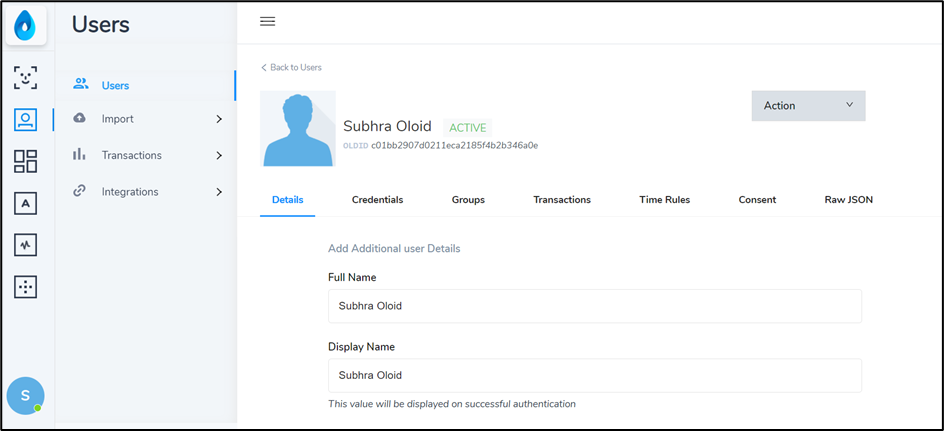
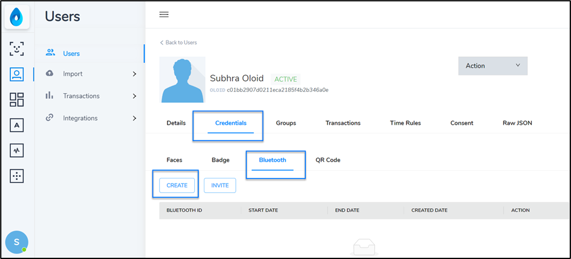
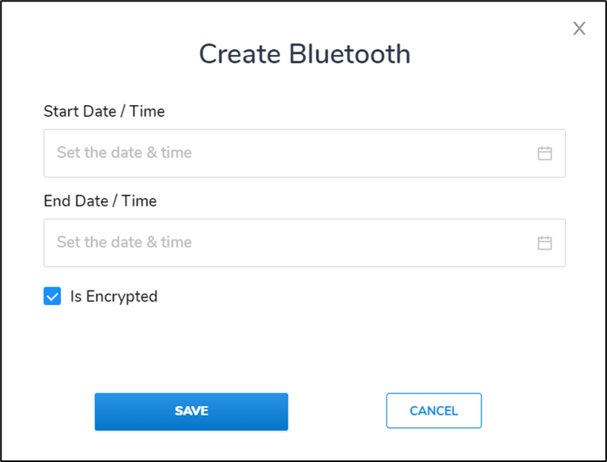

{/* Source: Intercom article 7129819 - https://oloid.help/en/articles/7129819-how-to-create-bluetooth-id */}
{/* Generated by intercom_to_mintlify.py - re-running overwrites this file. */}

Bluetooth ID is generated for the M-Tag application to function.

Pre-requisites: Wiegand format and Secondary ID should be added to User details.

1. Login to the Tenant Admin Portal.

2. On the Home page of the portal, click **Users** on the left panel menu.

The **Users** page is displayed.

3. Click **Display Name** to edit.

The User details page is displayed.

4. Go to **Credentials**> **Bluetooth** tab.

5. Click **CREATE**.

The **Create Bluetooth** pop-up box is displayed.

6. Enter **Start date/ Time** and **End date/Time**.

7. Click **Save**.

The Bluetooth ID is created.
