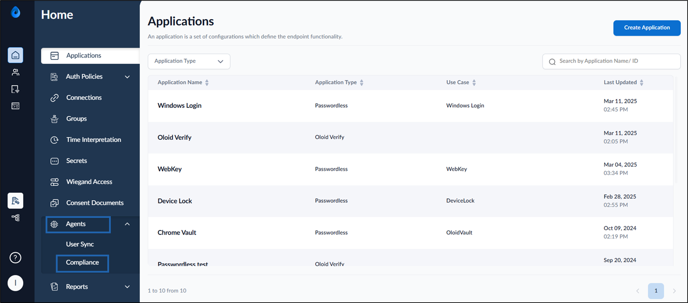
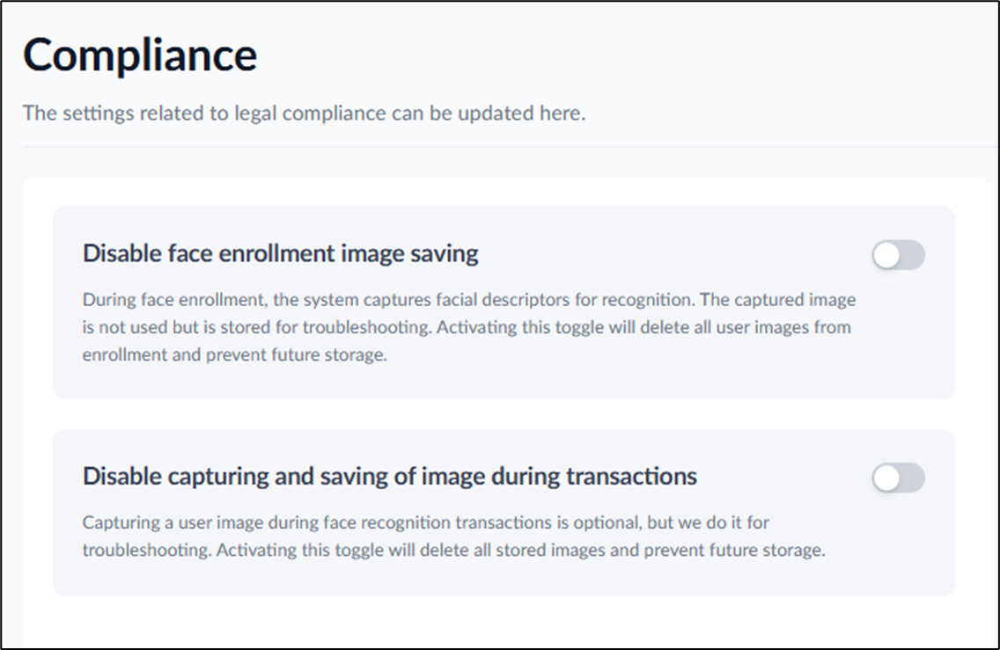
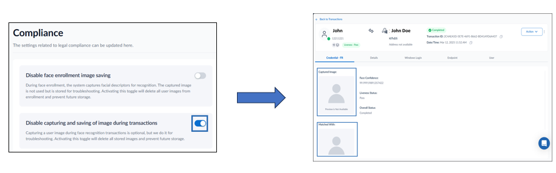

{/* Source: Intercom article 10765342 -  */}
{/* Generated by intercom_to_mintlify.py - re-running overwrites this file. */}

Short Description:

The Disable capturing and saving of image during transactions feature in Compliance setting allows the system to delete all captured images of the user during transaction using Face.

Steps to disable face capturing and saving of image during transactions:

1. Log in to the **Oloid Portal**.
2. On the homepage, select **Agents** tab > click **Compliance**.

   

   The **Compliance** page is displayed.

   

3. Turn on **Disable capturing and saving image during transactions**: It disables capturing face of the user during transaction using face. The Admin cannot see the user's face in the Transactions tab.
   To know about user transactions, see **[How to view and download user transaction](/platform/tenant-admin-portal/tenant-admin-portal-how-to-view-and-download-user-transactions-in)**.

