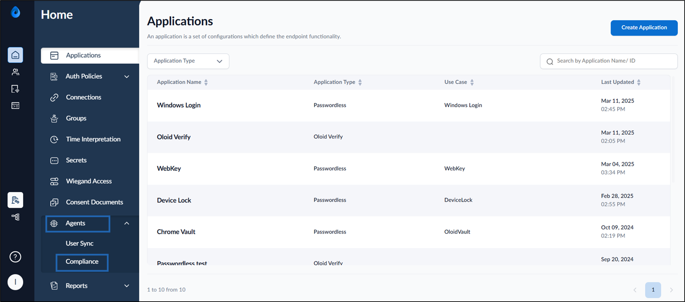
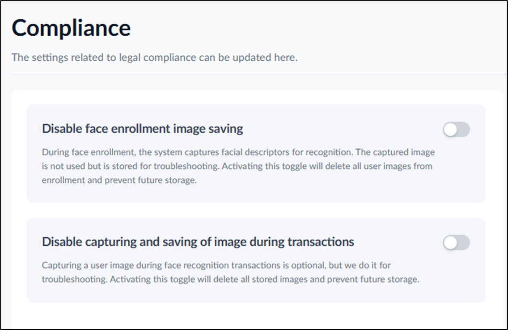
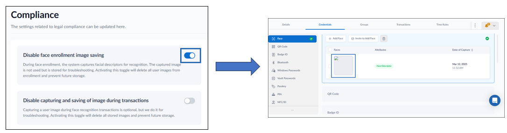

{/* Source: Intercom article 10756535 -  */}
{/* Generated by intercom_to_mintlify.py - re-running overwrites this file. */}

Short Description:

With **Disable the face enrollment image saving** feature in Compliance settings, you can conceal the user's uploaded face on the Oloid Portal and maintain its confidentiality.

Steps to configure Compliance tab:

1. Log in to the **Oloid Portal**.
2. On the homepage, select **Agents** tab > click **Compliance**.

   

   The **Compliance** page is displayed.

   

3. Do the following:
   1. Turn on **Disable face enrollment image saving**: It disables capturing face of the user during face enrollment. The face is neither displayed nor can be downloaded in the user details under face tab.
      To know more about enrolling face, see **[How to onboard face of a single user](/platform/tenant-admin-portal/tenant-admin-portal-how-to-add-face-of-a-single-user)**.

      

      The settings to disable face enrollment image saving is configured successfully.
