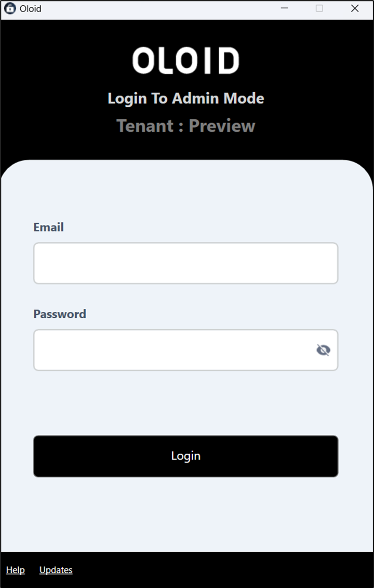
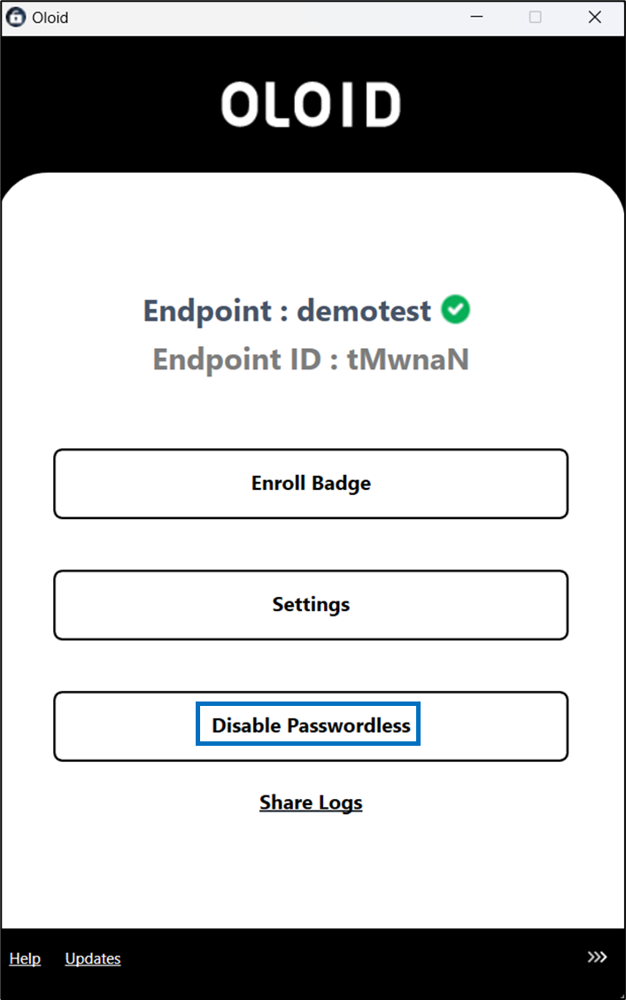
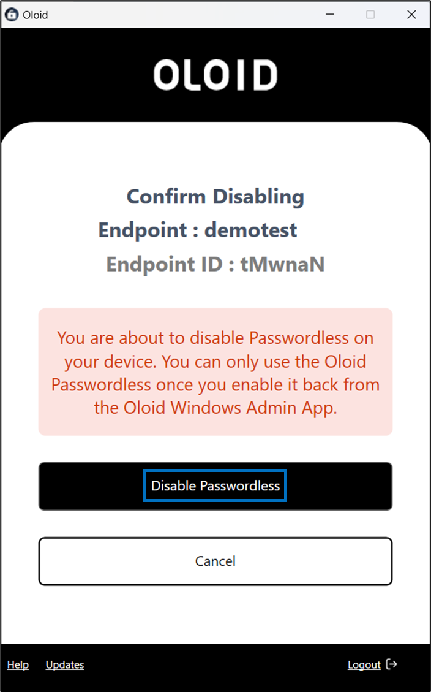
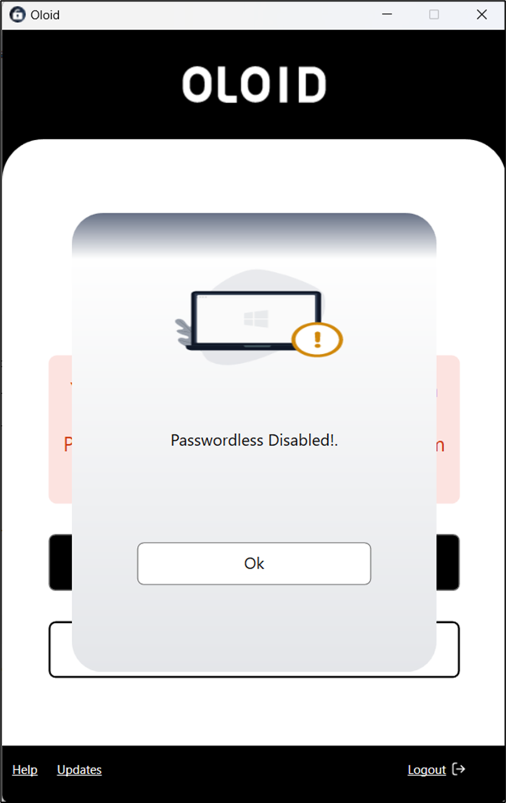

{/* Source: Intercom article 8894431 - https://oloid.help/en/articles/8894431-how-to-disable-passwordless-in-windows-device-app */}
{/* Generated by intercom_to_mintlify.py - re-running overwrites this file. */}

To disable passwordless follow the below steps:

1. Launch the **Windows Login** app.
2. On the login page of the app, enter the registered login credentials.

   

3. Click **Login**.
   The paired endpoint details are displayed.
4. Select **Disable Passwordless**.

   

   The **Confirm Disabling** page is displayed.
5. Select **Disable Passwordless**.

   

   The Passwordless is disabled successfully.

   

   The Windows Device Login app is no longer available on the Windows lock screen.
