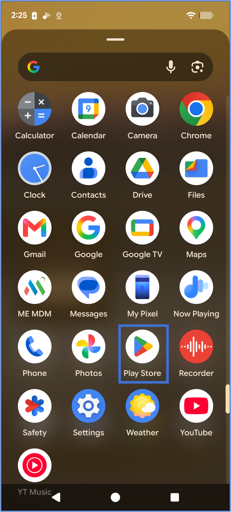
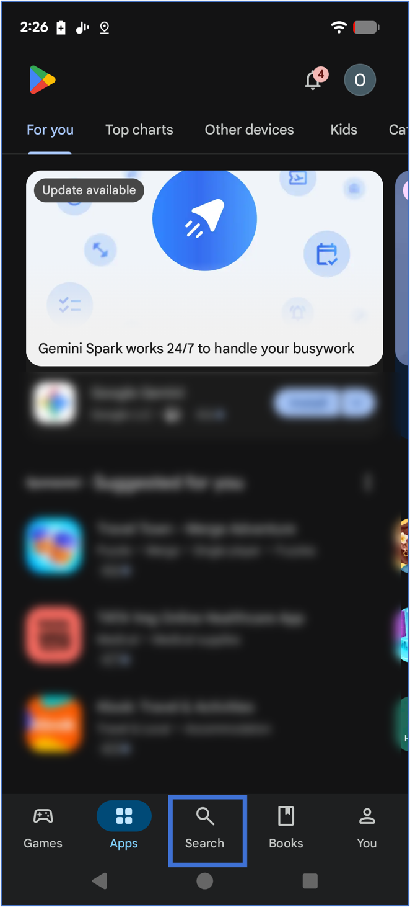
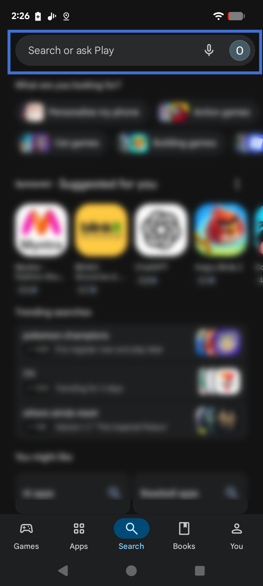
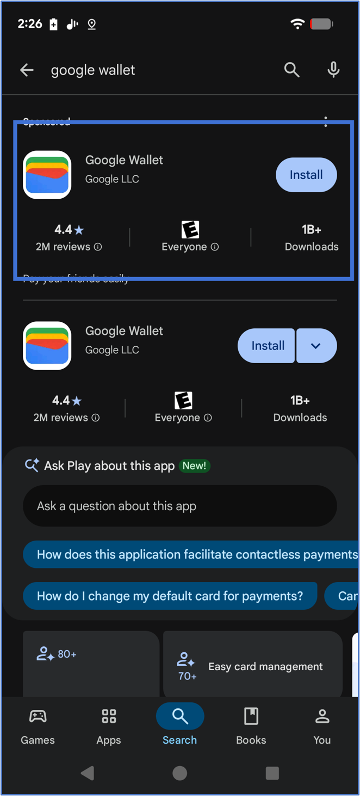
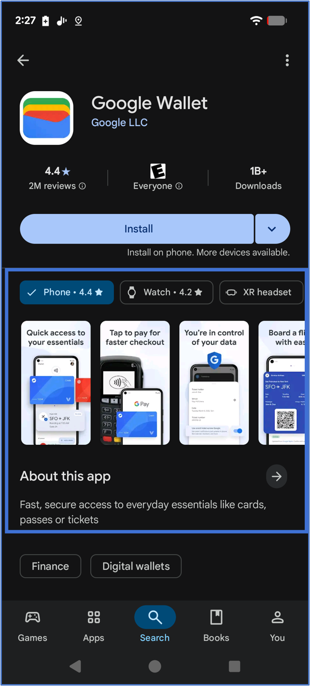
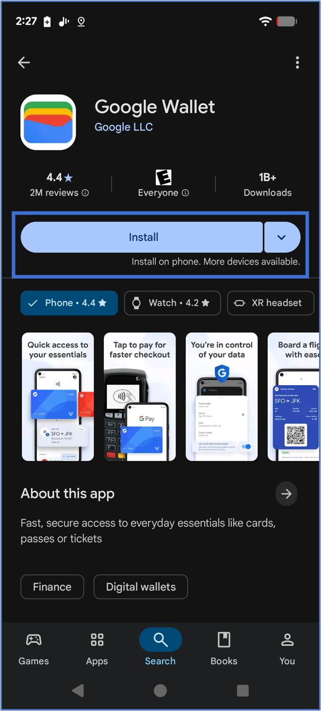

{/* Source: Intercom article 15431602 -  */}
{/* Generated by intercom_to_mintlify.py - re-running overwrites this file. */}

## Introduction

This document provides step-by-step instructions to download and install the **Google Wallet** application from the Google Play Store on an Android device.

## Prerequisite

- Make sure you have a stable internet connection.
- You have access to the **Google Play Store** on the Android device.

## Steps to Download Google Wallet App

1. Locate the **Play Store** on your home screen and tap on it to launch the application.

   

   The Playstore homepage is displayed.
2. Tap on the **Search** icon located at the bottom of the screen.

   

   The Search bar is displayed.
3. In the search bar, type **Google Wallet** and tap on the search result.

   

4. Tap **Install**.

   

5. Review the app's details, ratings, and user reviews to make sure it's the correct app you want to download.

   

Tap the **Install** button.

The **Google Wallet** app is installed successfully on the Android device.

Once the installation is complete, launch the **Google Wallet** app to open.
