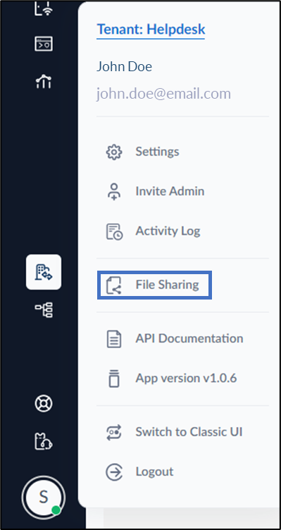
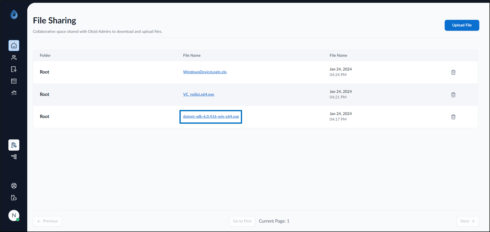
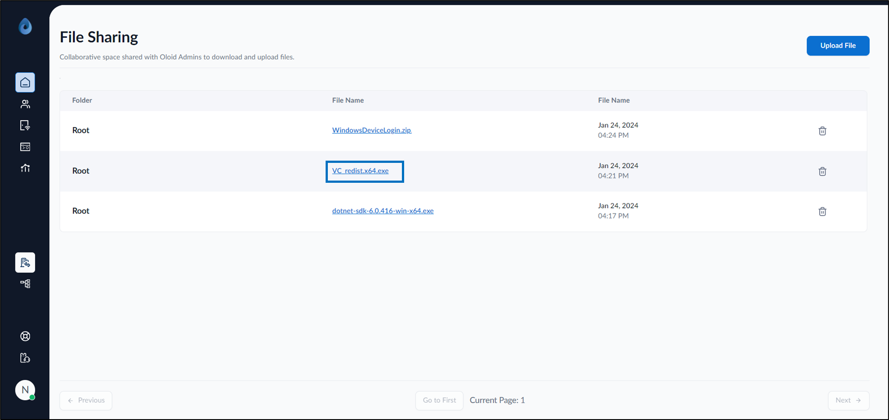
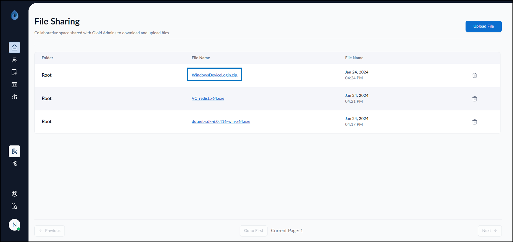

{/* Source: Intercom article 8575199 - https://oloid.help/en/articles/8575199-how-to-download-windows-device-login-installer-files */}
{/* Generated by intercom_to_mintlify.py - re-running overwrites this file. */}

To install Windows Device Login you need to download and install the following from the Oloid portal:

1. .Net SDK
2. C++ Redistributable
3. Oloid Windows Device Login

Steps to download the files:

1. Log in to the **Oloid Portal**.
2. On the homepage of the portal, click **User profile icon** on the bottom left corner of the menu panel.

   

   The user profile menu is displayed.
3. Select **File Sharing**.

   

   The **File Sharing** page is displayed.
4. Do the following:
   1. Select **.Net SDK file** to download.

      

   2. Select **Microsoft Visual C++ redistributable** file to download.

      

   3. Select **WindowsDeviceLogin.zip** to download.

      

      All the files are downloaded to the system.
