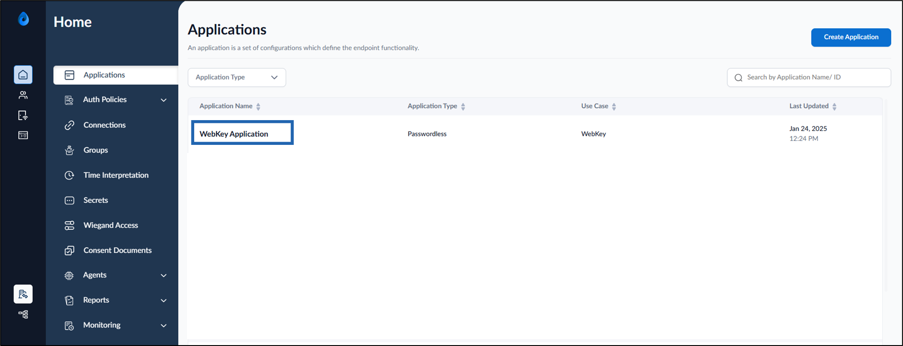
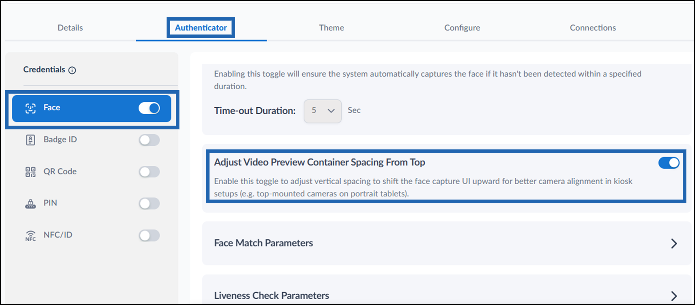

{/* Source: Intercom article 11388100 -  */}
{/* Generated by intercom_to_mintlify.py - re-running overwrites this file. */}

Enabling this toggle shifts the face preview container upward on the screen, allowing for better vertical alignment between the camera and the user's face. This improves face detection accuracy in scenarios where the camera is mounted at the top edge of the device.

**Steps to enable Adjust Video Preview Container Spacing:**

1. Log in to **Tenant Admin Portal**.
2. On the homepage, select **WebKey** application.

   

   The **WebKey details** page is displayed.
3. Go to **Authenticator** tab > **Face** >Enable **Adjust Video Preview Container Spacing From Top** toggle button.

   

4. Click **Save**.
   The configuration is saved successfully.
