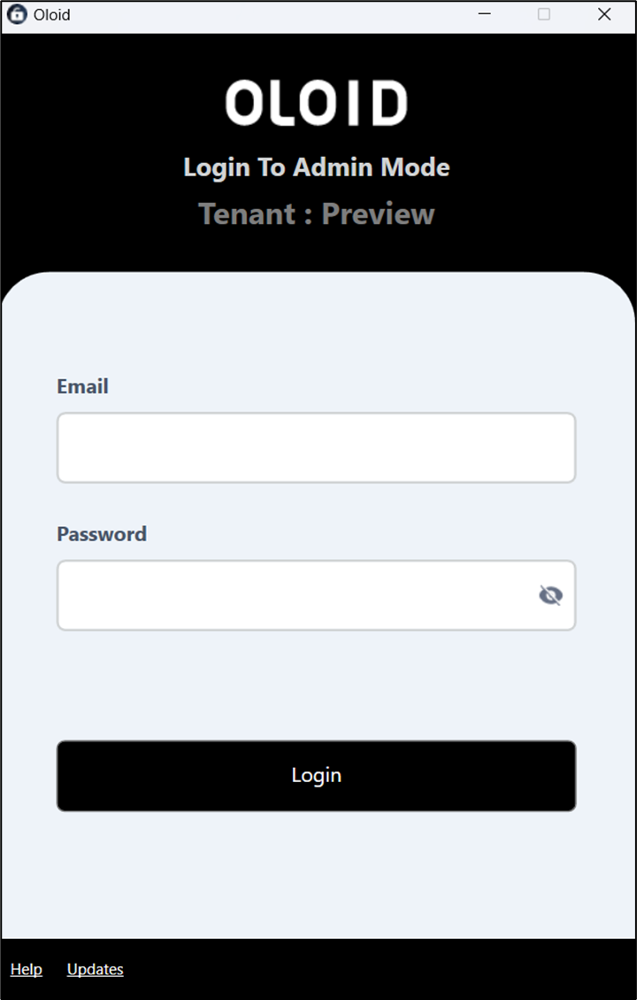
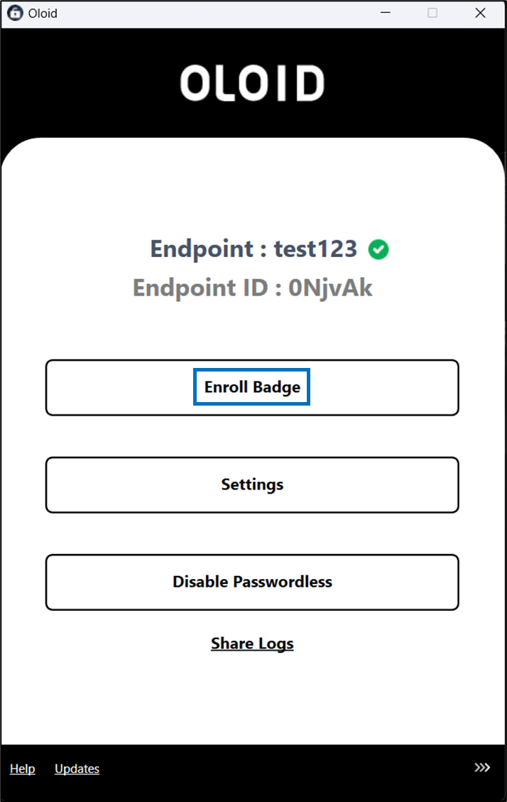
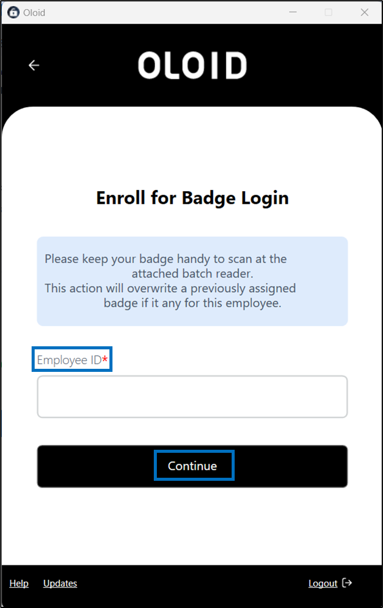
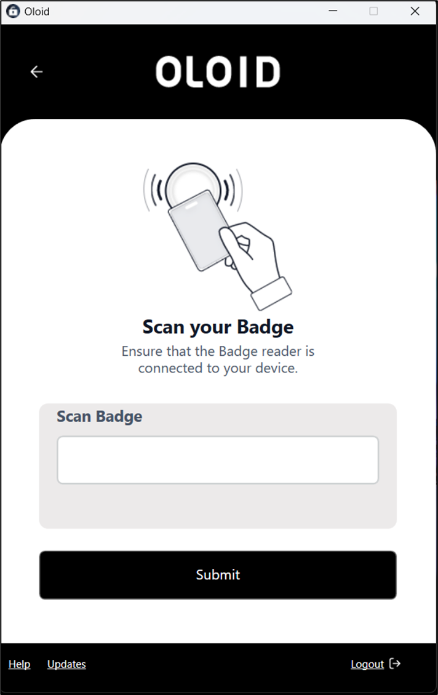
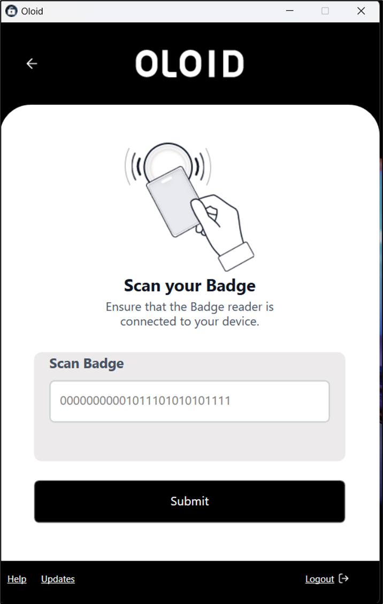
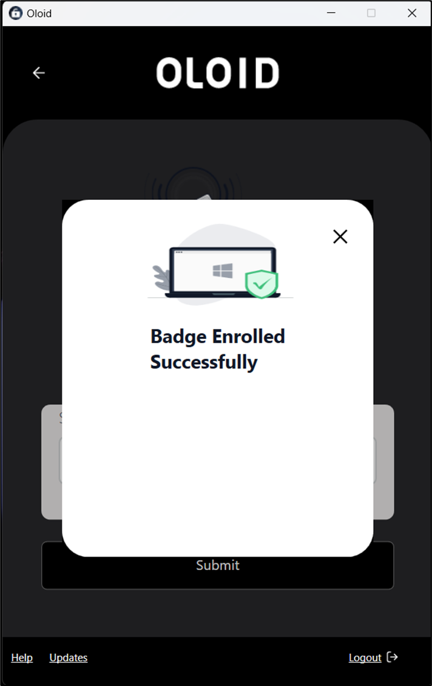

{/* Source: Intercom article 8825186 - https://oloid.help/en/articles/8825186-how-to-enroll-badge-as-credential-using-windows-device-login-app */}
{/* Generated by intercom_to_mintlify.py - re-running overwrites this file. */}

## Pre-requisite

- The user should be added in the Oloid portal.
- Endpoint should be configured.

To enroll badge follow the below steps:

1. Launch the **Windows Login** app.
2. On the home page of the app, enter the registered login credentials.

   

3. Click **Login**.
   The paired endpoint details are displayed.
4. Select **Enroll Badge**.

   

   The **Enroll for Badge Login** page is displayed.
5. Enter the **Employee ID** and click **Continue**.

   <Note>
     **Note:** Employee ID is the Primary ID of the user in the Oloid Portal.
   </Note>

   

   The **Scan your Badge** page is displayed.

   

6. Scan your badge in the Badge Reader.
   The scanned badge number is auto-populated on the **Scan Badge** field.

   

7. Click **Submit**.
   The badge is enrolled successfully.

   
