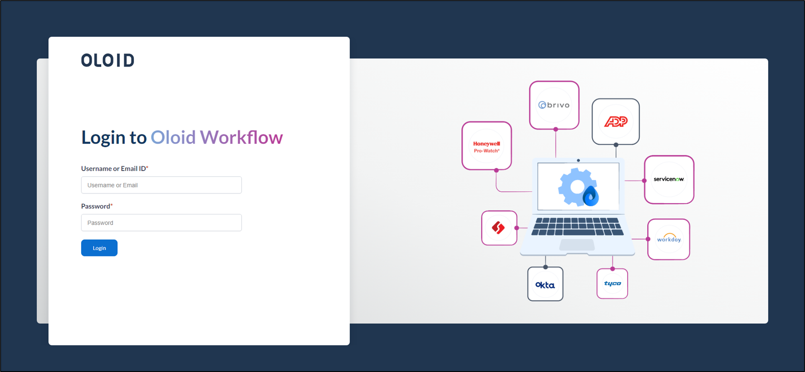
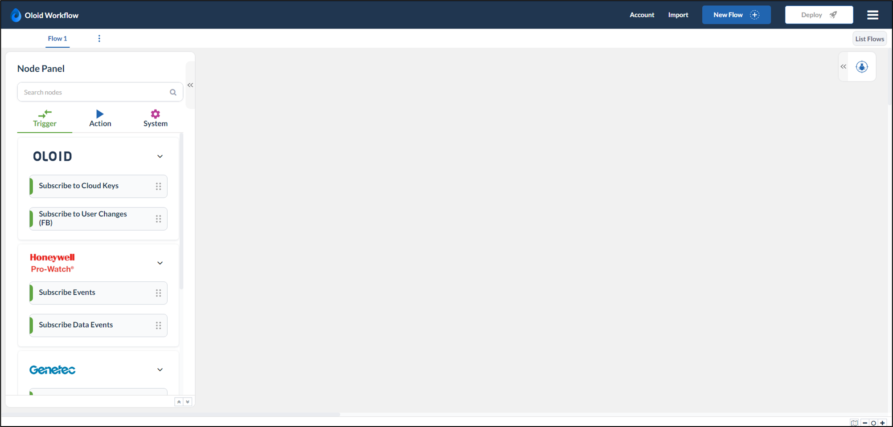
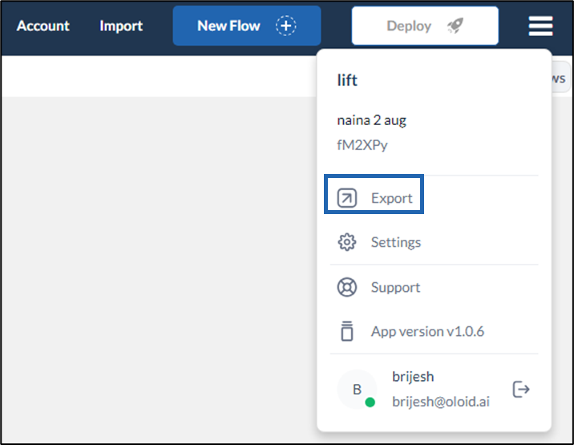
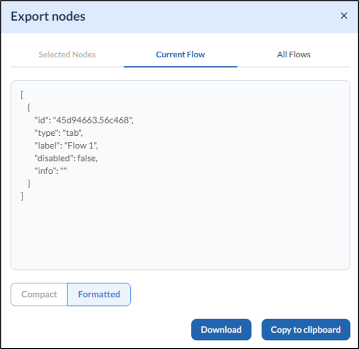
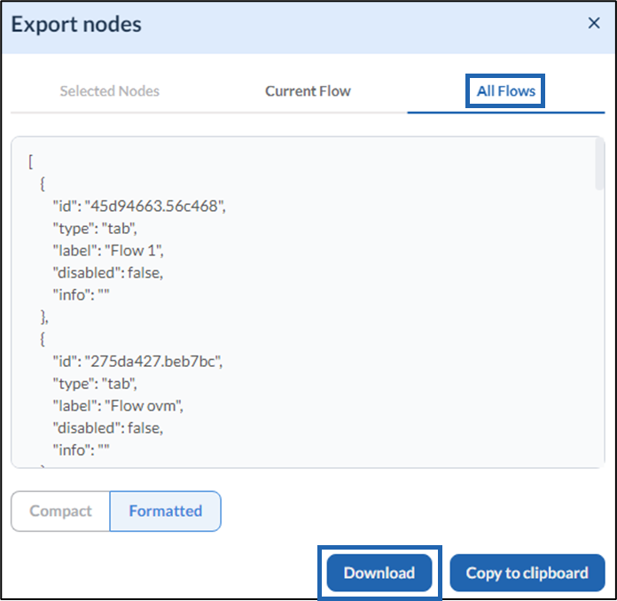

{/* Source: Intercom article 9717148 -  */}
{/* Generated by intercom_to_mintlify.py - re-running overwrites this file. */}

Steps to export a Flow:

1. Launch the workflow on prem machine.
2. Navigate to the workflow application URL **(e.g: default URL http://localhost)**in your browser address bar. Then, press Enter on your keyboard.
   The Workflow Login page is displayed.

   

3. Enter username and password in the appropriate fields.
4. Click **Login**.
   The Oloid Workflow application page is displayed.

   

5. Click navigation menu  icon on the top right corner.
   The list of options is displayed.
6. Select **Export** to export the flows.

   

   The **Export Nodes** pop-up box is displayed.

   

7. Select **All Flows** tab, then click **Download**.

   

   The json flow is downloaded to your local device.
