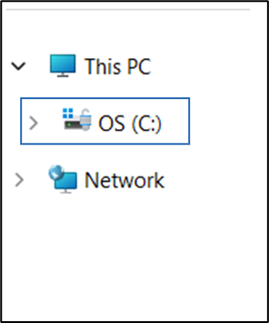
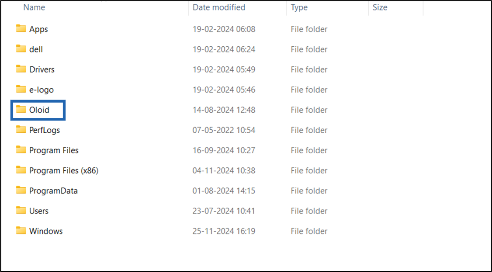
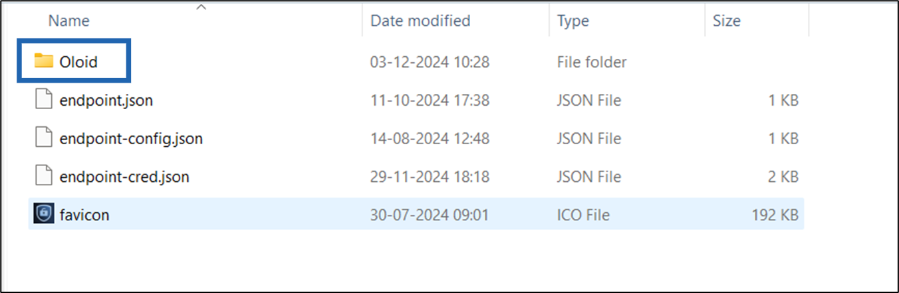
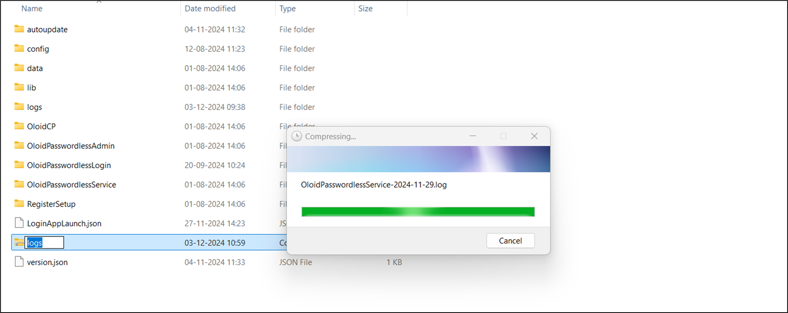
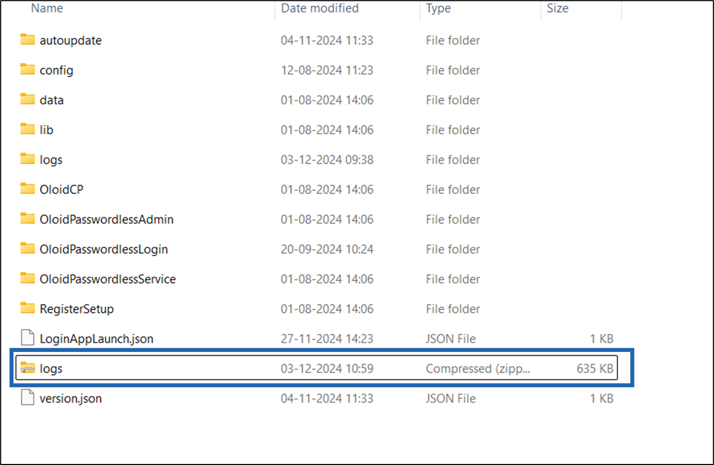

{/* Source: Intercom article 10224841 -  */}
{/* Generated by intercom_to_mintlify.py - re-running overwrites this file. */}

Steps to extract logs:

1. Open **Local system**.
2. Go to **File Explorer** > select **OS (C:)** from the left menu panel.

   

   The **OS (C:)** screen is displayed.
3. Double click the **Oloid folder**.

   

   The **Oloid** folder is opened.
4. Double click the **Oloid folder**.

   

   The **Oloid** folder is opened.
5. Select **Logs** folder and **right click**.
   The **menu** is displayed.
6. Go to **Compress to** > select **Zip File**.
   **(ADD SS)**
   The compressing process is started.

   

   The Logs are extracted successfully.

   

   You can share the extracted logs on **[support@oloid.ai](mailto:support@oloid.ai)** .
