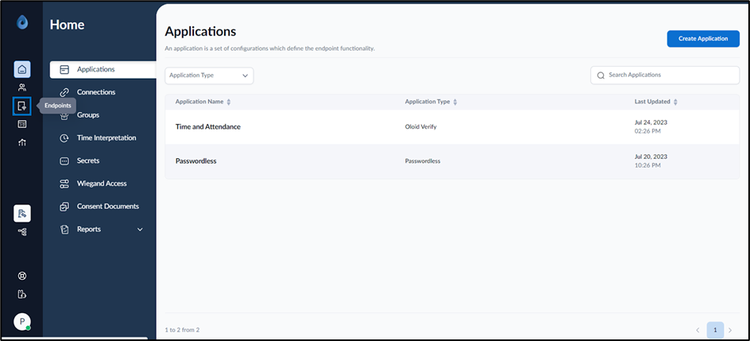
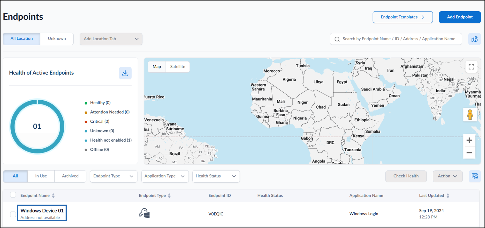
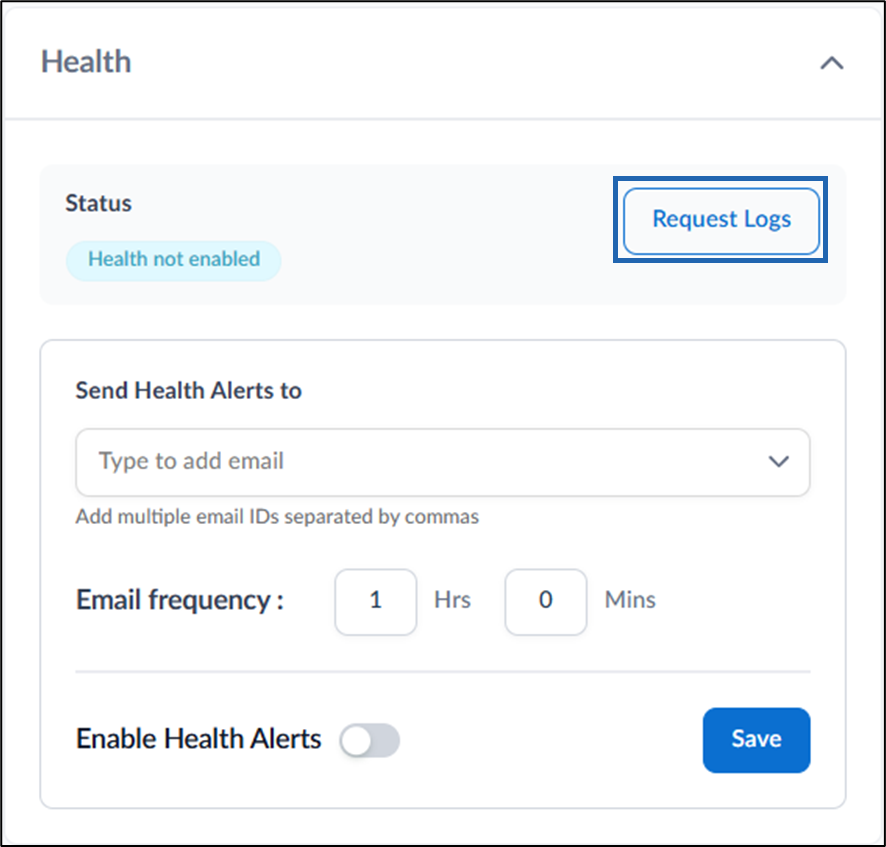
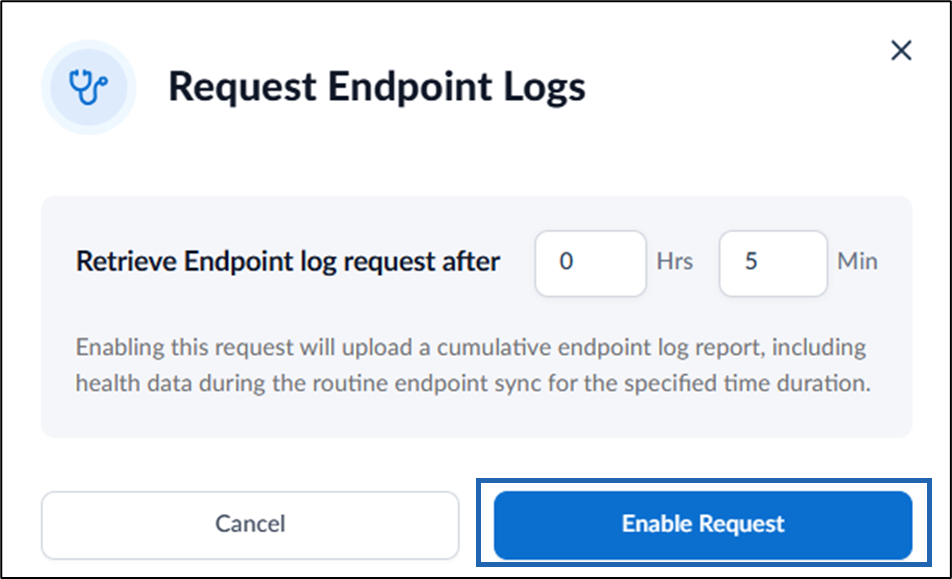
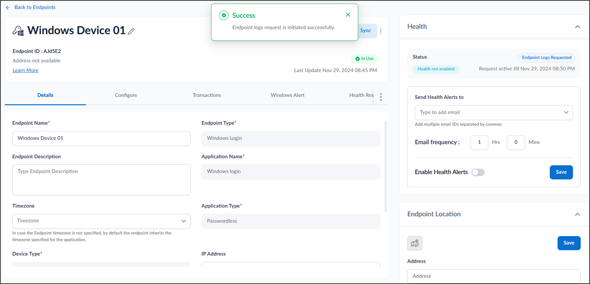

{/* Source: Intercom article 10214464 -  */}
{/* Generated by intercom_to_mintlify.py - re-running overwrites this file. */}

The Request Endpoint Logs feature allows you to retrieve a cumulative log report, including health data, for a specific endpoint during its routine sync process.

Steps to extract logs:

1. Log in to the **Oloid Portal**.
2. On the homepage of the portal, click **Endpoints** on the left panel menu.

   

   The **Endpoints** page is displayed.
3. Select an endpoint to edit.

   

   The Endpoint detail page is displayed.
4. Go to **Health** section at the top right corner and then select **Request Logs**.

   

   The Request Endpoint Logs pop-up box is displayed.
5. Do the following:
   1. **Retrieve Endpoint log request after**: Specify the time period for the requested log in **Hrs** and **Min**.
   2. Select **Enable Request** to confirm the log request.

      

      The endpoint logs request is initiated successfully and stored in the AWS S3 bucket.

      
